# Capítulo IV: Product Implementation & Validation

## 4.1. Software Configuration Management

### 4.1.1. Software Development Environment Configuration

El equipo usa las siguientes herramientas para gestionar, diseñar, desarrollar y probar CraveWallet, agrupadas en cuatro actividades.

#### Project Management

La tabla 138 describe las herramientas usadas.

*Tabla 138. Herramientas de gestión del proyecto.*

| Herramienta | Uso en CraveWallet | Sitio |
| --- | --- | --- |
| GitHub Projects | Backlog del producto, planificación de sprints y seguimiento de issues en tableros Kanban. | <https://github.com/features/project-management> |
| Trello | Tablero del Product Backlog con una lista por sprint. Durante el Sprint 1 no se conservó evidencia histórica suficiente del tránsito de cada tarea; para los siguientes sprints se usarán los estados *To Do*, *In Process*, *To Review* y *Done* con actividad fechada (sección 2.4.3). | <https://trello.com/> |

*Fuente: elaboración del equipo Gastify.*

#### Product UX/UI Design

La tabla 139 detalla las herramientas para investigar a los usuarios, modelar el dominio y construir los prototipos.

*Tabla 139. Herramientas de investigación, diseño y modelado.*

| Herramienta | Uso en CraveWallet | Sitio |
| --- | --- | --- |
| Figma | Wireframes, mock-ups, Design System y prototipos del landing page y de la aplicación móvil (sección 3.1). | <https://www.figma.com/> |
| UXPressia | User Personas, Empathy Maps, Journey Maps e Impact Maps (secciones 2.3 y 2.4.2). | <https://uxpressia.com/> |
| Miro | EventStorming, Domain Message Flows, Bounded Context Canvases y Context Map (sección 2.5). | <https://miro.com/> |
| Structurizr | Diagramas C4 de contexto, contenedores y componentes, versionados como DSL (sección 2.5.3). | <https://structurizr.com/> |

*Fuente: elaboración del equipo Gastify.*

#### Software Development

El landing page se construye con Next.js, React y TypeScript; el backend, con Java 21 y Spring Boot; y las dos aplicaciones móviles del proyecto se implementan tanto en Android nativo con Kotlin y Jetpack Compose (`CraveWallet-Mobile`) como en multiplataforma con Dart y Flutter (`CraveWallet-Flutter`). La tabla 140 agrupa las herramientas por producto.

*Tabla 140. Herramientas y tecnologías de desarrollo.*

| Producto | Herramienta | Uso en CraveWallet | Sitio |
| --- | --- | --- | --- |
| Todos | GitHub | Repositorios, control de versiones con Git y revisión de pull requests. | <https://github.com/> |
| Landing page | Visual Studio Code | Editor principal, con soporte para TypeScript, React y Tailwind CSS. | <https://code.visualstudio.com/> |
| Landing page | WebStorm | IDE alternativo de JetBrains para JavaScript y TypeScript. | <https://www.jetbrains.com/webstorm/> |
| Landing page | TypeScript 5 | Lenguaje del landing page, con verificación estática de tipos. | <https://www.typescriptlang.org/> |
| Landing page | React 19 | Componentes de la interfaz del landing page. | <https://react.dev/> |
| Landing page | Next.js 16 | Framework de React para el enrutamiento, la generación estática y el build. | <https://nextjs.org/> |
| Landing page | Tailwind CSS 4 | Estilos con clases de utilidad sobre los tokens del Design System. | <https://tailwindcss.com/> |
| Landing page | Vercel | Despliegue automático del landing page al integrar cambios en `main` (sección 4.1.4). | <https://vercel.com/> |
| Backend | IntelliJ IDEA | IDE del backend, con soporte para Maven, Spring Boot, pruebas y depuración. | <https://www.jetbrains.com/idea/> |
| Backend | Java 21 | Lenguaje del REST API y de los tres Bounded Contexts. | <https://openjdk.org/projects/jdk/21/> |
| Backend | Spring Boot 3.5.16 | REST API con validación, seguridad JWT y servicios de aplicación. Versión declarada en el `pom.xml` del backend. | <https://spring.io/projects/spring-boot> |
| Backend | Spring Data JPA | Repositorios de la Infrastructure Layer de cada Bounded Context. | <https://spring.io/projects/spring-data-jpa> |
| Backend | Maven | Dependencias, compilación, pruebas y empaquetado del backend. | <https://maven.apache.org/> |
| Backend | PostgreSQL 17 | Base de datos del perfil `prod`, publicada en Render junto con el REST API (sección 4.1.4). | <https://www.postgresql.org/> |
| Backend | H2 2.3.232 | Persistencia en memoria y archivo para ejecución local y pruebas de usuarios, sesiones, suscripciones, gastos, presupuestos y membresías Premium. | <https://www.h2database.com/> |
| Backend | Flyway | Migraciones V1–V5 del esquema; JPA valida las tablas sin crearlas automáticamente. | <https://www.red-gate.com/products/flyway/> |
| Backend | Docker y Render | El `Dockerfile` empaqueta el JAR con Java 21 y Render publica el servicio con su base PostgreSQL (sección 4.1.4). | <https://www.docker.com/> |
| Aplicación móvil (Android nativa) | Kotlin y Jetpack Compose | Lenguaje y toolkit de interfaz de la aplicación Android nativa (`CraveWallet-Mobile`), con Material 3 y Navigation Compose. | <https://developer.android.com/compose> |
| Aplicación móvil (Android nativa) | Gradle | Compilación, pruebas y empaquetado del APK de la aplicación nativa. | <https://gradle.org/> |
| Aplicación móvil (Android nativa) | Android Studio | Emulador de Android y herramientas del SDK para probar la aplicación. | <https://developer.android.com/studio> |
| Aplicación móvil (Multiplataforma) | Dart 3 y Flutter 3 | Lenguaje y SDK de la aplicación móvil multiplataforma (`CraveWallet-Flutter`), con Material 3, `http`, `shared_preferences` y `url_launcher`. | <https://flutter.dev/> |

*Fuente: elaboración del equipo Gastify.*

#### Software Testing

Los criterios de aceptación de las User Stories se escriben en Gherkin, como indica la tabla 141.

*Tabla 141. Herramientas de prueba.*

| Herramienta | Uso en CraveWallet | Sitio |
| --- | --- | --- |
| Gherkin | Escenarios *Given / When / Then* de los criterios de aceptación (sección 2.4.1), base de las pruebas de aceptación. | <https://cucumber.io/docs/gherkin/reference/> |
| JUnit 5 y Spring Boot Test | Suite ejecutable del backend, con pruebas unitarias y de integración mediante MockMvc, JWT y H2. | [Suite versionada del backend](https://github.com/1ACC0238-2620-4950-Gastify-CraveWallet/CraveWallet-Backend/tree/a0aeabc/src/test/java/pe/edu/upc/gastify/cravewallet) |
| Mockito y servidor HTTP local | Simulación de proveedores externos (ExchangeRate-API, Google Places y Mercado Pago) y comprobación de respuestas inválidas, caché y caídas sin depender de Internet. | [Pruebas de cotización](https://github.com/1ACC0238-2620-4950-Gastify-CraveWallet/CraveWallet-Backend/blob/a0aeabc/src/test/java/pe/edu/upc/gastify/cravewallet/ExchangeRateServiceTest.java) |
| Flutter Test (`flutter_test`) | Pruebas unitarias de modelos y controladores, y pruebas de widgets del flujo Premium en `CraveWallet-Flutter`. | [Pruebas de Flutter](https://github.com/1ACC0238-2620-4950-Gastify-CraveWallet/CraveWallet-Flutter/tree/d32ecc0/test) |
| Swagger UI y OpenAPI | Ejecución manual de solicitudes y consulta de contratos del backend público y local. | [Swagger público](https://cravewallet-api-av2.onrender.com/swagger-ui/index.html) |

*Fuente: elaboración del equipo Gastify.*

### 4.1.2. Source Code Management

El código fuente se gestiona en **GitHub**, bajo la organización [`1ACC0238-2620-4950-Gastify-CraveWallet`](https://github.com/1ACC0238-2620-4950-Gastify-CraveWallet).

Los repositorios del proyecto se listan en la tabla 142.

*Tabla 142. Repositorios del proyecto.*

| Repositorio | Descripción | URL |
| :--- | :--- | :--- |
| `CraveWallet-Report` | Informe del proyecto en formato Markdown | https://github.com/1ACC0238-2620-4950-Gastify-CraveWallet/CraveWallet-Report |
| `cravewallet-landing` | Landing page (Next.js 16, React 19, TypeScript y Tailwind CSS 4) | https://github.com/1ACC0238-2620-4950-Gastify-CraveWallet/cravewallet-landing |
| `CraveWallet-Mobile` | Aplicación Android nativa (Kotlin y Jetpack Compose) | https://github.com/1ACC0238-2620-4950-Gastify-CraveWallet/CraveWallet-Mobile |
| `CraveWallet-Flutter` | Aplicación móvil multiplataforma (Dart 3 y Flutter 3) | https://github.com/1ACC0238-2620-4950-Gastify-CraveWallet/CraveWallet-Flutter |
| `CraveWallet-Backend` | REST API del producto (Java 21 y Spring Boot 3) | https://github.com/1ACC0238-2620-4950-Gastify-CraveWallet/CraveWallet-Backend |

*Fuente: elaboración del equipo Gastify.*

***

**GitFlow**

El equipo usa **GitFlow** como estrategia de ramas: dos ramas permanentes y ramas de soporte de corta duración.

**Main Branches (ramas principales):**

* **`main`:** Rama principal del repositorio. Contiene únicamente código estable que ha sido verificado y aprobado para producción. Cada merge a esta rama representa una versión entregable del producto.
* **`develop`:** Rama de integración continua. Todos los features y fixes aprobados se fusionan aquí antes de ser promovidos a `main`. Es la rama base desde la que se crean las ramas de soporte.

**Support Branches (ramas de soporte):**

* **`feature/<nombre>`:** Creada a partir de `develop`. Se utiliza para desarrollar nuevas funcionalidades o secciones del reporte. Al finalizar el trabajo, se fusiona de vuelta en `develop` mediante un pull request.
* **`fix/<nombre>`:** Creada a partir de `develop`. Se utiliza para corregir errores encontrados en funcionalidades ya integradas en `develop`.
* **`docs/<nombre>`:** Creada a partir de `develop`. Se utiliza para agregar o actualizar documentación del informe sin impacto en el código de producción.
* **`hotfix/<nombre>`:** Creada directamente a partir de `main`. Se utiliza para corregir errores críticos en producción de forma urgente; se fusiona tanto en `main` como en `develop`.

**Aplicación observada en TB1.** El esquema anterior es la política objetivo, no una descripción uniforme del historial ya producido. Al corte del 10 de octubre de 2026, el informe conserva el trabajo integrado en `develop` mientras `main` aún contiene la plantilla; el landing se desplegó desde `main` sin una rama `develop`; Android usa `develop` y no presenta `main`; y el backend desplegó `feature/cloud-deployment` mientras su `main` permanece en el commit inicial. Estas excepciones no se reconstruirán artificialmente. Para la entrega se promoverá el informe mediante pull request hacia `main`; las integraciones siguientes deberán registrar rama de origen, revisión, pruebas y rama de destino en cada repositorio.

***

**Conventional Commits**

Los mensajes de commit siguen el estándar **Conventional Commits**, con este formato:

```
<tipo>(<alcance>): <descripción breve>
```

La tabla 143 describe los tipos de commit utilizados en el proyecto.

*Tabla 143. Tipos de commit.*

| Tipo | Descripción |
| :--- | :--- |
| `feat` | Se añade una nueva funcionalidad al producto. |
| `fix` | Se corrige un error en el código o en el contenido del reporte. |
| `docs` | Cambios exclusivos en documentación, sin impacto en la lógica del sistema. |
| `style` | Cambios de formato o estilo que no afectan el comportamiento (espacios, indentación). |
| `refactor` | Mejoras internas del código que no añaden funcionalidad ni corrigen errores. |
| `chore` | Tareas de mantenimiento sin impacto en el código de producción (dependencias, configuración). |

*Fuente: elaboración del equipo Gastify.*

Ejemplo de commit real del proyecto:

```
feat(landing): build CraveWallet landing page
```

La figura 106 muestra el network graph de ramas del repositorio CraveWallet-Report en GitHub.

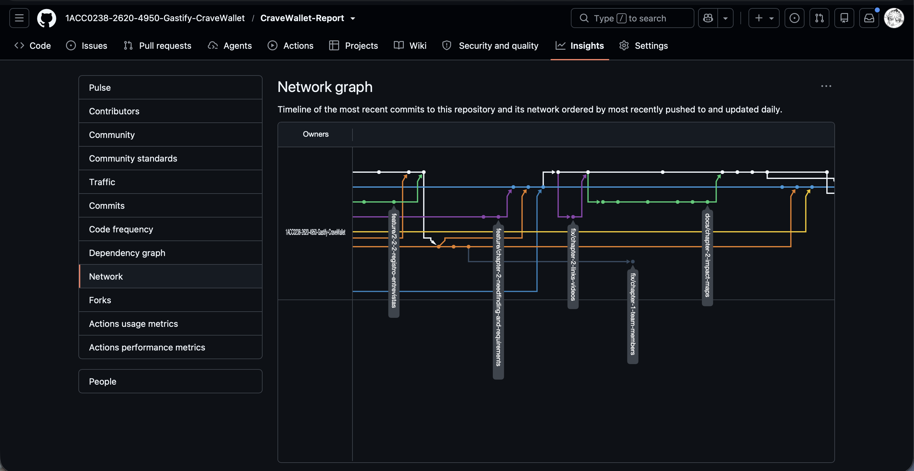

<!-- pdf:omit-start -->

*Figura 106. Network graph de ramas del repositorio CraveWallet-Report en GitHub.*

<!-- pdf:omit-end -->

*Fuente: captura del repositorio en GitHub.*

***

### 4.1.3. Source Code Style Guide & Conventions

Todos los repositorios siguen las mismas convenciones de estilo y nomenclatura. Toda la nomenclatura del código se escribe en **inglés**.

***

#### Convenciones generales de nomenclatura

Cada tipo de elemento usa una convención de capitalización:

* **PascalCase:** Nombres de componentes React, interfaces TypeScript, tipos y clases Java (`UserProfile`, `SubscriptionCard`, `SubscriptionController`).
* **camelCase:** Variables locales, parámetros, métodos Java, hooks y props (`userId`, `isLoading`, `handleSubmit`, `registerSubscription`).
* **lowercase con puntos:** Paquetes Java (`pe.edu.upc.gastify.cravewallet.subscriptions.domain.model`).
* **kebab-case:** Nombres de archivos, rutas de URL, selectores CSS/Tailwind personalizados y nombres de ramas Git (`user-profile.tsx`, `feature/subscription-list`).
* **SCREAMING_SNAKE_CASE:** Constantes globales, constantes `static final` de Java e identificadores de entorno (`API_BASE_URL`, `MAX_SUBSCRIPTIONS`).
* **snake_case:** Tablas y columnas de PostgreSQL (`subscriptions`, `renewal_date`).

***

#### HTML & CSS Style Guide

Basado en la *Google HTML/CSS Style Guide* y las directrices de la W3C:

* **HTML:** Uso obligatorio de etiquetas semánticas (`<header>`, `<main>`, `<section>`, `<footer>`) para mejorar el SEO y la accesibilidad. Indentación de 2 espacios. Uso de comillas dobles para todos los atributos. Los atributos `alt` en imágenes son obligatorios.
* **CSS / Tailwind CSS:** Se prioriza el uso de clases de utilidad de Tailwind CSS sobre hojas de estilo personalizadas. Cuando se requieran estilos globales adicionales, se definen en `globals.css` utilizando variables CSS (`--color-primary`). Se prohíbe el uso de estilos en línea (`style=""`).

***

#### TypeScript & React Style Guide

Siguiendo la *Google JavaScript Style Guide*, las directrices de MDN y la guía oficial de React:

* **TypeScript:** Tipado estricto habilitado (`strict: true` en `tsconfig.json`). Se prefiere `interface` sobre `type` para definir la forma de objetos. Los tipos de retorno de funciones se declaran explícitamente cuando no son evidentes.
* **Sintaxis:** Uso exclusivo de ES6+ (`arrow functions`, `destructuring`, `template literals`, `optional chaining`). Se prefiere `const` para todas las declaraciones; `let` se usa solo cuando la reasignación es estrictamente necesaria. Se prohíbe `var`.
* **React:** Los componentes se escriben exclusivamente como funciones (componentes funcionales). Los nombres de componentes siguen **PascalCase** y multi-word para evitar conflictos con elementos HTML estándar (correcto: `FeatureCard`; incorrecto: `Card`). Los efectos secundarios se gestionan con `useEffect`; el estado local con `useState` o `useReducer`.

***

#### Java & Spring Boot Style Guide

Basado en la *Google Java Style Guide* y las guías de referencia de Spring:

* **Formato:** Indentación de 4 espacios, una clase pública por archivo y llaves en la misma línea de la declaración. Los `import` se declaran de forma explícita, sin comodines (`*`).
* **Capas:** Cada Bounded Context se organiza en los paquetes `domain`, `application`, `interfaces` e `infrastructure`, como se describe en la sección 2.6. La capa `domain` no depende de Spring ni de JPA.
* **Spring:** Inyección de dependencias por constructor (sin `@Autowired` en atributos). Los controladores REST solo traducen peticiones a comandos o consultas y delegan en los servicios de aplicación. Los endpoints usan sustantivos en plural y kebab-case (`/api/v1/subscriptions`, `/api/v1/delivery-expenses`).
* **Modelado:** Los Value Objects y los DTO se declaran como `record` inmutables. Las entidades JPA se mantienen separadas de las entidades de dominio y se convierten mediante mappers.

***

#### Gherkin Conventions

Para la redacción de criterios de aceptación de las User Stories:

* **Formato:** Estructura estricta `Given / When / Then / And`.
* **Lenguaje:** Las especificaciones se redactan desde la perspectiva del negocio y del usuario, evitando detalles técnicos de implementación en los pasos de Gherkin.
* **Idioma:** El contenido de los escenarios se redacta en español para facilitar la validación con stakeholders no técnicos.

***

#### Referencias de estándares adoptados

La tabla 144 relaciona cada tecnología con la guía de estilo de referencia adoptada.

*Tabla 144. Referencias de estándares adoptados.*

| Tecnología | Referencia |
| :--- | :--- |
| HTML / CSS | Google HTML/CSS Style Guide / W3C |
| TypeScript | TypeScript Deep Dive / Microsoft TSConfig Reference |
| JavaScript | Google JS Style Guide / MDN Web Docs |
| React | React Docs — Thinking in React |
| Tailwind CSS | Tailwind CSS Docs — Utility-First Fundamentals |
| Java | Google Java Style Guide |
| Spring Boot | Spring Boot Reference Documentation |
| Gherkin | Gherkin Conventions for Readable Specifications |

*Fuente: elaboración del equipo Gastify.*

***

### 4.1.4. Software Deployment Configuration

Los tres productos del hito TB1 se publican por separado. La tabla 145 resume la plataforma, el mecanismo de despliegue y la dirección pública de cada uno al 9 de octubre de 2026.

*Tabla 145. Plataformas de despliegue de CraveWallet.*

| Producto | Repositorio y rama | Plataforma | Mecanismo de despliegue | Dirección |
| --- | --- | --- | --- | --- |
| Landing page | `cravewallet-landing`, `main` | Vercel (equipo `gastify`) | Build `next build` automático en cada push a `main`. | <https://cravewallet-landing.vercel.app/es> |
| REST API | `CraveWallet-Backend`, `feature/av2-premium-backend` (`feature/cloud-deployment` en TB1) | Render Free (Docker, región Oregon) con PostgreSQL 17 | El `Dockerfile` ejecuta `mvnw verify` y empaqueta el JAR con Java 21; el servicio inicia con el perfil `prod`. | <https://cravewallet-api-av2.onrender.com> (TB1: `cravewallet-api.onrender.com`) |
| Aplicación Android | `CraveWallet-Mobile`, `develop` | Compilación con Gradle | APK `debug` que apunta a la URL del API definida en `API_BASE_URL`. | Descarga publicada desde el [landing de CraveWallet](https://cravewallet-landing.vercel.app/es); el artefacto corresponde al hash registrado en la evidencia móvil. |

*Fuente: [configuración de despliegue del backend](https://github.com/1ACC0238-2620-4950-Gastify-CraveWallet/CraveWallet-Backend/blob/740aba0/docs/cloud-deployment.md), [guía de la aplicación](https://github.com/1ACC0238-2620-4950-Gastify-CraveWallet/CraveWallet-Mobile/blob/e72d283/README.md) y paneles de Vercel y Render.*

#### Landing page en Vercel

**Herramientas y tecnologías desplegadas en el landing page:**

* **Next.js 16:** Framework utilizado como base del landing page, que provee el sistema de build y las optimizaciones de rendimiento en producción.
* **TypeScript:** Lenguaje compilado a JavaScript en tiempo de build; Vercel ejecuta `tsc` y `next build` como parte del pipeline de despliegue.
* **Tailwind CSS 4:** Procesado mediante PostCSS durante el build; los estilos no utilizados son eliminados automáticamente (purge) para reducir el tamaño del bundle.

**Pasos para el despliegue del Landing Page en Vercel:**

1. Conectar el repositorio `cravewallet-landing` a un proyecto en Vercel desde el dashboard de la plataforma.
2. Seleccionar la rama `main` como rama de producción y configurar el framework preset como **Next.js**.
3. Definir las variables de entorno necesarias en la sección *Environment Variables* del proyecto en Vercel.
4. Vercel ejecuta automáticamente `npm run build` (`next build`) al detectar un nuevo push o merge en `main`.
5. Una vez completado el build, el sitio queda publicado en la URL asignada por Vercel y disponible de forma global mediante su CDN.

La figura 107 muestra el panel del proyecto `cravewallet-landing` en Vercel: el deployment de producción en estado `Ready`, la rama `main` como origen y el commit `3cdc4c5`.

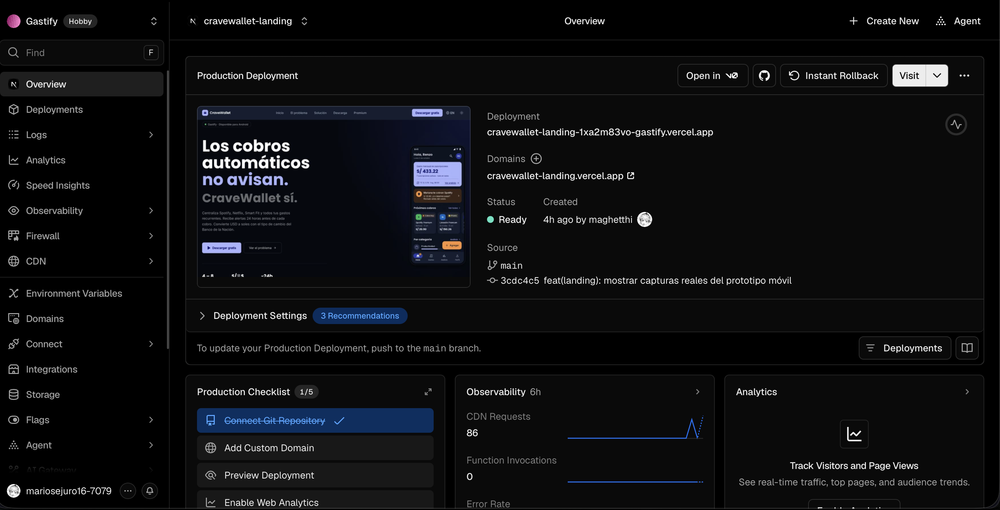

<!-- pdf:omit-start -->

*Figura 107. Panel del proyecto cravewallet-landing en Vercel con el deployment de producción.*

<!-- pdf:omit-end -->

*Fuente: captura del panel de Vercel del equipo Gastify, 9 de octubre de 2026.*

La figura 108 muestra la sección *Settings > Git* del proyecto, con el repositorio `cravewallet-landing` de la organización conectado a Vercel.

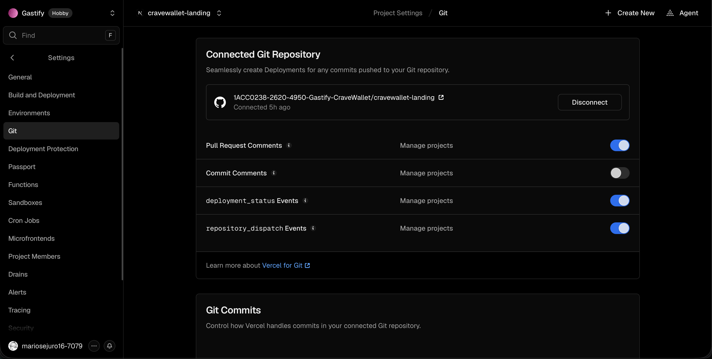

<!-- pdf:omit-start -->

*Figura 108. Repositorio de GitHub conectado al proyecto en Vercel (Settings > Git).*

<!-- pdf:omit-end -->

*Fuente: captura del panel de Vercel del equipo Gastify, 9 de octubre de 2026.*

#### REST API en Render

El REST API se ejecuta localmente con Java 21 y el perfil `local`, que utiliza H2 en memoria y escucha en `127.0.0.1:8080`, y en Render con el perfil `prod` sobre PostgreSQL 17. Flyway aplica V1 para usuarios y sesiones, V2 para suscripciones y V3 para gastos de delivery y presupuestos. La tabla 146 distingue los perfiles de ejecución.

*Tabla 146. Configuración de ejecución del backend.*

| Elemento | Configuración |
| --- | --- |
| Proyecto | `CraveWallet-Backend`, paquete raíz `pe.edu.upc.gastify.cravewallet`. |
| Construcción | Java 21, Spring Boot 3.5.16, Maven Wrapper; comando `mvnw.cmd -B verify`. |
| Perfil `local` | H2 2.3.232 en memoria, `spring.jpa.hibernate.ddl-auto=validate` y Flyway habilitado. Puerto 8080 con `/actuator/health`, `/v3/api-docs` y `/swagger-ui.html`. Sin `JWT_SECRET` se genera una clave efímera. |
| Perfil `postgres` | URL, usuario y contraseña mediante `DATABASE_URL`, `DATABASE_USERNAME` y `DATABASE_PASSWORD`; requiere `JWT_SECRET` de al menos 32 bytes. |
| Perfil `prod` | Contenedor Java 21 sin usuario root, escucha en `0.0.0.0` y lee `PORT`. Conexión interna a PostgreSQL 17, pool de cinco conexiones, variables privadas persistentes en Render. Swagger público habilitado; las operaciones sobre datos del usuario requieren Bearer JWT. |
| Datos y secretos | H2 pierde sus datos al detener el proceso. Las credenciales y el `JWT_SECRET` se definen solo en el proveedor, nunca en Git. |

*Fuente: [configuración, migraciones y guía de ejecución del backend](https://github.com/1ACC0238-2620-4950-Gastify-CraveWallet/CraveWallet-Backend/tree/740aba0) y [resultado de Maven](evidence/backend/maven-verify.txt).*

El plan gratuito de Render suspende el servicio tras un período de inactividad, por lo que la primera solicitud puede tardar unos segundos adicionales, y su base de datos caduca el 7 de noviembre de 2026. La evidencia del despliegue se presenta en la sección 4.2.1.8.

## 4.2. Landing Page & Mobile Application Implementation

El Sprint 1 reúne el landing desplegado, el backend y las pantallas core de Android. Los nueve apartados siguientes registran las tareas y evidencias disponibles al 9 de octubre de 2026.

### 4.2.1. Sprint 1

#### 4.2.1.1. Sprint Planning 1

El Sprint 1 corresponde a la entrega TB1. En la AV1, el Product Backlog priorizado se distribuyó en cuatro sprints en Trello (sección 2.4.3) y el Sprint 1 recibió las historias del landing page. El sprint se planificó del 16 de septiembre al 9 de octubre de 2026. Durante la ejecución se adelantaron servicios y flujos móviles previstos para sprints posteriores; la revisión del Product Backlog del 10 de octubre conserva la asignación inicial y registra el alcance actualizado en la tabla 84. La tabla 147 resume la reunión de planificación; como es el primer sprint, no existen un Review ni una Retrospectiva anteriores.

*Tabla 147. Sprint Planning 1.*

| Campo | Contenido |
| --- | --- |
| Sprint # | Sprint 1 |
| Date | 2026-09-16 |
| Time | 08:00 PM |
| Location | Reunión virtual del equipo. El alcance se tomó del [tablero del Product Backlog](https://trello.com/b/W0MvIjVH/cravewallet-product-backlog) en Trello. |
| Prepared By | Sejuro Medina, Mario Gabriel |
| Attendees (to planning meeting) | Sejuro Medina, Mario Gabriel / Faustino Hurtado, Anghelo Edwin / Roman Zeballos, Sebastian Jared / Carpio Peña, Josué Francisco / Aliaga, Alexander |
| Sprint 0 Review Summary | No aplica: el Sprint 1 es el primer sprint del proyecto. Parte de la AV1, que entregó los capítulos I y II con el Product Backlog de 40 User Stories, 6 Technical Stories y 6 Spike Stories priorizado y estimado. |
| Sprint 0 Retrospective Summary | No aplica: el Sprint 1 es el primer sprint del proyecto. |
| Sprint 1 Goal | **Our focus is on** publicar un landing que presente la propuesta de valor y los planes de CraveWallet, mostrar las pantallas principales de la aplicación Android y exponer servicios de backend documentados y probados. **We believe it delivers** una presentación pública del producto y una base funcional para registrar suscripciones y gastos **to** jóvenes de Lima que hoy descubren un cobro automático al revisar su banco. **This will be confirmed when** el landing responda en una dirección pública, la aplicación navegue sus pantallas principales y las operaciones del backend se ejecuten con éxito en un servidor accesible. |
| Alcance original del Product Backlog | 16 Story Points: SP01 (3), SP03 (3), SP05 (3), US24 (2), US25 (2), US32 (2) y US40 (1), según la tabla 84. |
| Alcance de historias acreditado al cierre | 4 Story Points: US24 (2) y US25 (2). Las otras cinco historias del plan original no cuentan como terminadas en la velocidad: SP01, SP03 y SP05 continúan como investigación, y US32 y US40 se adelantaron parcialmente en el landing sin una trazabilidad completa de aceptación. |
| Trabajo agregado durante el sprint | Aplicación Android, backend y despliegues requeridos por el hito TB1. Este trabajo se documenta en la tabla 149, pero no tenía Story Points asignados en el tablero y por ello no se suma a la velocidad comprometida. |
| Sprint 1 Velocity | 4 de 16 Story Points del plan original (25 %). La diferencia se explica como cambio de alcance y trabajo agregado, no como 16 puntos completados. |
| Sum of Story Points | Línea base AV1: 16 SP. Revisión TB1 del 10/10/2026: 72 SP asignados a 25 historias, conservando sus estimaciones originales (tabla 84). Este total es alcance asignado; incluye historias parciales y no representa velocidad ni puntos aceptados. Las 12 tareas de ingeniería suman 72 horas en la tabla 149; horas y Story Points son unidades distintas. |

*Fuente: elaboración del equipo Gastify.*

#### 4.2.1.2. Aspect Leaders and Collaborators

Los aspectos del Sprint 1 son los tres productos de la TB1: el landing page, la aplicación Android y el backend con su despliegue. La tabla 148 identifica el liderazgo («L») y la colaboración («C») de cada integrante; «—» significa que no consta una asignación. La participación efectiva se contrasta con los commits en la sección 4.2.1.9.

*Tabla 148. Leadership-and-Collaboration Matrix del Sprint 1.*

| Team Member (Last Name, First Name) | GitHub Username | Landing page | Aplicación Android | Backend y despliegue | Informe |
| --- | --- | --- | --- | --- | --- |
| Sejuro Medina, Mario Gabriel | maghetthi | **L** | — | — | C |
| Faustino Hurtado, Anghelo Edwin | Limos05 (`limozz05` en los commits) | — | C | **L** | C |
| Roman Zeballos, Sebastian Jared | Chebas19 | C | **L** | — | C |
| Carpio Peña, Josué Francisco | josf17 | — | — | — | C |
| Aliaga, Alexander | AlexanderAliaga19 | — | — | — | C |

*Fuente: elaboración del equipo Gastify.*

#### 4.2.1.3. Sprint Backlog 1

El Sprint Backlog 1 de CraveWallet se gestionó mediante un tablero de Trello independiente del Product Backlog general del proyecto. Este tablero permite visualizar las tareas del Sprint 1 mediante cuatro estados: To Do, In-Process, To-Review y Done.

La figura 109 presenta el tablero del Sprint Backlog 1. La tabla 149 detalla las 12 tareas registradas para la TB1, incluyendo las actividades del Landing Page, la aplicación móvil Android y los servicios del backend, con sus responsables, estimaciones y estados.


**Enlace al Sprint Backlog 1:** [CraveWallet – Sprint 1 en Trello](https://acortar.link/clKCQj)

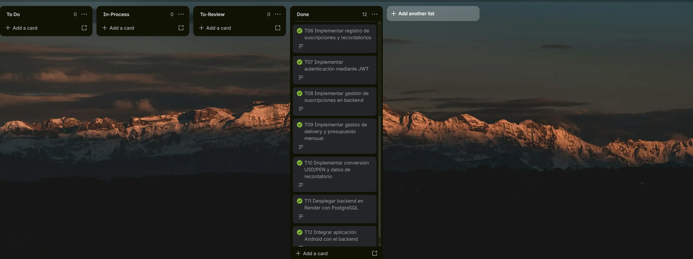

<!-- pdf:omit-start -->

*Figura 109. Tablero del Sprint Backlog 1 de CraveWallet en Trello.*

<!-- pdf:omit-end -->

*Fuente: elaboración del equipo Gastify.*

*Tabla 149. Sprint Backlog 1 y avances de la TB1.*

| User Story Id | Task Id | Task Title | Estimation (Hours) | Assigned To | Status |
| --- | --- | --- | ---: | --- | --- |
| US24 | T01 | Construir el Hero, la barra de navegación y la sección de funciones del landing. | 8 | Mario | Done |
| US24 | T02 | Construir la sección El problema con las cifras de las entrevistas. | 5 | Sebastián | Done |
| US25 | T03 | Construir la sección Planes con la tabla comparativa Free y Premium. | 4 | Sebastián | Done |
| Hito TB1 | T04 | Publicar el landing en Vercel y verificar los deployments de producción. | 4 | Mario | Done |
| Hito TB1 (US05, US08) | T05 | Implementar las pantallas Inicio, Gastos, Análisis y Perfil de la app con Jetpack Compose. | 8 | Sebastián | Done |
| Hito TB1 (US05, US12) | T06 | Implementar el alta de suscripción y los recordatorios de la app. | 6 | Sebastián | Done |
| TS01 | T07 | Implementar la autenticación con sesiones JWT revocables. | 6 | Anghelo | Done |
| TS02 | T08 | Implementar las suscripciones del usuario con su historial de cancelación. | 6 | Anghelo | Done |
| TS05 | T09 | Implementar los gastos de delivery idempotentes y el presupuesto mensual. | 5 | Anghelo | Done |
| TS03, TS04 | T10 | Implementar la cotización USD/PEN con caché y los datos de recordatorio. | 6 | Anghelo | Done |
| Hito TB1 | T11 | Empaquetar el API con Docker y desplegarlo en Render con PostgreSQL. | 6 | Anghelo | Done |
| Hito TB1 | T12 | Conectar la app Android al API público y ejecutar las pruebas de integración. | 8 | Anghelo | Done |

*Fuente: [tablero del Product Backlog](https://trello.com/b/W0MvIjVH/cravewallet-product-backlog) y commits de la sección 4.2.1.4. Las horas son estimaciones hechas al cierre del sprint a partir de ese historial. El Product Backlog conserva las estimaciones originales de las historias y su reasignación al corte TB1 (tabla 84); el tablero independiente del Sprint 1 conserva las tareas T01–T12. Este ajuste no reconstruye una evolución histórica de estados que no se registró durante la ejecución.*

#### 4.2.1.4. Development Evidence for Sprint Review

En el Sprint 1 se implementaron los tres productos de la TB1: el landing page, la aplicación Android y los servicios RESTful. Las tablas siguientes relacionan, por repositorio, los commits de implementación con sus fechas en America/Lima. Los commits de pruebas se complementan en la sección 4.2.1.5.

**Landing page.** La tabla 150 lista los commits de `cravewallet-landing`. El landing, construido con Next.js 16, TypeScript y Tailwind CSS 4, se desarrolló en `main` con el Hero y la vista previa de la aplicación, las secciones El problema (con contadores animados), Solución, Preview, Testimonios, Planes y Descarga, el modo oscuro, la versión en español e inglés y las capturas reales de la aplicación.

*Tabla 150. Commits de implementación de cravewallet-landing.*

| Repository | Branch | Commit Id | Commit Message | Commit Message Body | Committed on (Date) |
| --- | --- | --- | --- | --- | --- |
| `cravewallet-landing` | `main` | [fc8605d](https://github.com/1ACC0238-2620-4950-Gastify-CraveWallet/cravewallet-landing/commit/fc8605d04592a8748ea47190a5934d39f3a3d258) | Initial commit from Create Next App | Sin cuerpo | 25/09/2026 |
| `cravewallet-landing` | `main` | [21d55b2](https://github.com/1ACC0238-2620-4950-Gastify-CraveWallet/cravewallet-landing/commit/21d55b230876b46809b9e6ae6c5952fe3869185d) | feat(landing): build CraveWallet landing page | Hero section with phone mockup, headline y CTAs | 25/09/2026 |
| `cravewallet-landing` | `main` | [07d6200](https://github.com/1ACC0238-2620-4950-Gastify-CraveWallet/cravewallet-landing/commit/07d62009e066d35bd73654e1e71186047b7df137) | chore: remove AGENTS.md and CLAUDE.md, add to .gitignore | Sin cuerpo | 25/09/2026 |
| `cravewallet-landing` | `main` | [cdb8c33](https://github.com/1ACC0238-2620-4950-Gastify-CraveWallet/cravewallet-landing/commit/cdb8c33aaca1a16d48c100b13007f2f9d659a46f) | refactor(landing): redesign with Emil Kowalski principles | Headline a clamp(44px,6.5vw,76px) con leading 1.04 | 25/09/2026 |
| `cravewallet-landing` | `main` | [a841252](https://github.com/1ACC0238-2620-4950-Gastify-CraveWallet/cravewallet-landing/commit/a8412523fa1d3f794849cf3de06fa6e970e08561) | feat(landing): complete landing page from Cap. 3 IA | Secciones añadidas segun navegacion del Cap. 3.1.2.5: | 25/09/2026 |
| `cravewallet-landing` | `main` | [5ece888](https://github.com/1ACC0238-2620-4950-Gastify-CraveWallet/cravewallet-landing/commit/5ece88898fd507295254c41369f1ca9937936ab3) | feat(content): actualizar landing con datos reales de Cap. I y II | Hero: titular y body copy basados en enunciado 5W+2H; stats de Statista 2024 | 25/09/2026 |
| `cravewallet-landing` | `feature/landing-sprint-1` | [07300ce](https://github.com/1ACC0238-2620-4950-Gastify-CraveWallet/cravewallet-landing/commit/07300ceff73fe09027ff21717b08b5078176848b) | feat(landing): add problem, plans, FAQ and newsletter sections | Problem section with interview findings and their sample size (US24) | 08/10/2026 |
| `cravewallet-landing` | `feature/landing-sprint-1` | [a7f89df](https://github.com/1ACC0238-2620-4950-Gastify-CraveWallet/cravewallet-landing/commit/a7f89df8e2b8a56bb7ed75cbd8822796040dcacd) | test(landing): add acceptance criteria for Sprint 1 stories | Gherkin features for US24, US25, US32 and US40, taken from the | 08/10/2026 |
| `cravewallet-landing` | `main` | [eec794d](https://github.com/1ACC0238-2620-4950-Gastify-CraveWallet/cravewallet-landing/commit/eec794d5a2e8bb2f616ba3445e970a9ebab90737) | feat(landing): modo oscuro, i18n es/en y cifras alineadas con Figma | Corrige las estadísticas de la sección El problema (2 meses, 41 %, 100 %) | 08/10/2026 |
| `cravewallet-landing` | `main` | [3cdc4c5](https://github.com/1ACC0238-2620-4950-Gastify-CraveWallet/cravewallet-landing/commit/3cdc4c5d72969732a7f597ad62511a542658104f) | feat(landing): mostrar capturas reales del prototipo móvil | Sin cuerpo | 08/10/2026 |

*Fuente: historial de commits de `cravewallet-landing` en GitHub.*

**Aplicación Android.** La tabla 151 lista los commits de `CraveWallet-Mobile`. La aplicación se implementó en Kotlin y Jetpack Compose a partir de los wireframes y el Design System de la sección 3.1.4, con las pantallas Inicio, Gastos, Análisis, Perfil, alta de suscripción y recordatorios. Los commits posteriores corrigen recursos vectoriales, conectan la autenticación, las suscripciones y los gastos de Delivery con el backend, y apuntan la aplicación al API publicado.

*Tabla 151. Commits de implementación de CraveWallet-Mobile.*

| Repository | Branch | Commit Id | Commit Message | Commit Message Body | Committed on (Date) |
| --- | --- | --- | --- | --- | --- |
| `CraveWallet-Mobile` | `develop` | [2d4200e](https://github.com/1ACC0238-2620-4950-Gastify-CraveWallet/CraveWallet-Mobile/commit/2d4200ec2d951dc5c1e06ccc74ee4c432b3a610c) | App móvil CraveWallet en Kotlin + Jetpack Compose | Implementa los wireframes y el Design System del Figma Mobile UX/UI: | 08/10/2026 |
| `CraveWallet-Mobile` | `develop` | [2c7c2b3](https://github.com/1ACC0238-2620-4950-Gastify-CraveWallet/CraveWallet-Mobile/commit/2c7c2b35b30080c05fa2a7880c60ecdf47ab0f5d) | fix: correct mirrored vector drawable attributes | Sin cuerpo | 08/10/2026 |
| `CraveWallet-Mobile` | `develop` | [27c99a2](https://github.com/1ACC0238-2620-4950-Gastify-CraveWallet/CraveWallet-Mobile/commit/27c99a2dcdae1fe24deeed1c0a7590856b9999f8) | feat: connect mobile authentication subscriptions and delivery to backend | Sin cuerpo | 08/10/2026 |
| `CraveWallet-Mobile` | `develop` | [73c5785](https://github.com/1ACC0238-2620-4950-Gastify-CraveWallet/CraveWallet-Mobile/commit/73c5785591b17bbdb4467035161b603a0fcd7141) | feat: connect Android to public HTTPS API and verify cloud flows | Sin cuerpo | 09/10/2026 |
| `CraveWallet-Mobile` | `develop` | [e72d283](https://github.com/1ACC0238-2620-4950-Gastify-CraveWallet/CraveWallet-Mobile/commit/e72d28302cbc229a234e7d9d46b903a806cee5f0) | docs: record completed cloud APK build | Sin cuerpo | 09/10/2026 |

*Fuente: historial de commits de `CraveWallet-Mobile` en GitHub.*

**Servicios RESTful.** La tabla 152 lista los commits de `CraveWallet-Backend`. Los módulos `subscriptions` y `delivery` separan dominio, aplicación, interfaces e infraestructura, y los modelos de dominio no importan Spring ni JPA. IAM proporciona identidad y sesiones como capacidad técnica; `premium` conserva su estructura de paquetes. Las contraseñas se almacenan con BCrypt y los tokens de renovación con hash SHA-256; renovar revoca la sesión anterior y los bloqueos transaccionales protegen el límite Free, los reintentos de gastos y la actualización del presupuesto.

*Tabla 152. Commits de implementación de CraveWallet-Backend.*

| Repository | Branch | Commit Id | Commit Message | Commit Message Body | Committed on (Date) |
| --- | --- | --- | --- | --- | --- |
| `CraveWallet-Backend` | `develop` | [b507e7d](https://github.com/1ACC0238-2620-4950-Gastify-CraveWallet/CraveWallet-Backend/commit/b507e7da455f87be904bd3a55d1989fa80425acc) | Initial commit | Sin cuerpo | 29/09/2026 |
| `CraveWallet-Backend` | `develop` | [1f1b39b](https://github.com/1ACC0238-2620-4950-Gastify-CraveWallet/CraveWallet-Backend/commit/1f1b39b4bc5ab9cc42f96912579a3dc36e944375) | feat: bootstrap Java 21 backend aligned with report contexts | Sin cuerpo | 08/10/2026 |
| `CraveWallet-Backend` | `develop` | [2c188be](https://github.com/1ACC0238-2620-4950-Gastify-CraveWallet/CraveWallet-Backend/commit/2c188be9fef598d8824f49e4fdd44d27e2b83e9c) | feat: implement authentication profile and revocable JWT sessions | Sin cuerpo | 08/10/2026 |
| `CraveWallet-Backend` | `develop` | [adfea26](https://github.com/1ACC0238-2620-4950-Gastify-CraveWallet/CraveWallet-Backend/commit/adfea26a6318673b3cff46425ff1a6ed9debe7ad) | feat: implement owner-scoped subscriptions and cancellation history | Sin cuerpo | 08/10/2026 |
| `CraveWallet-Backend` | `develop` | [70c3f01](https://github.com/1ACC0238-2620-4950-Gastify-CraveWallet/CraveWallet-Backend/commit/70c3f01b3a1407aca8eea33420a74290d609d4f7) | feat: implement idempotent delivery expenses and monthly budgets | Sin cuerpo | 08/10/2026 |
| `CraveWallet-Backend` | `develop` | [2f36260](https://github.com/1ACC0238-2620-4950-Gastify-CraveWallet/CraveWallet-Backend/commit/2f36260dc1aa9b8e4ef71a7184847795e6cb6867) | feat: add cached exchange rates and subscription reminders | Sin cuerpo | 08/10/2026 |
| `CraveWallet-Backend` | `develop` | [67ede2a](https://github.com/1ACC0238-2620-4950-Gastify-CraveWallet/CraveWallet-Backend/commit/67ede2ae8c2b9cb02bb8151f5a163344a7ef3d4f) | feat: prepare production Docker deployment with managed PostgreSQL | Sin cuerpo | 08/10/2026 |
| `CraveWallet-Backend` | `develop` | [740aba0](https://github.com/1ACC0238-2620-4950-Gastify-CraveWallet/CraveWallet-Backend/commit/740aba087efab41b500c4e26860f10bdcee663e8) | docs: record verified public API and persistence after restart | Sin cuerpo | 09/10/2026 |

*Fuente: historial de commits de `CraveWallet-Backend` en GitHub; la implementación puede revisarse en el [código versionado](https://github.com/1ACC0238-2620-4950-Gastify-CraveWallet/CraveWallet-Backend/tree/740aba0/src/main/java/pe/edu/upc/gastify/cravewallet).*

#### 4.2.1.5. Testing Suite Evidence for Sprint Review

**Backend.** El comando `mvnw.cmd -B verify`, ejecutado con Java 21 el 8 de octubre de 2026, terminó con `BUILD SUCCESS`: 32 pruebas, cero fallos, cero errores y ningún caso omitido. La tabla 153 relaciona cada suite con los comportamientos comprobados. El workflow [build.yaml](https://github.com/1ACC0238-2620-4950-Gastify-CraveWallet/CraveWallet-Backend/blob/740aba0/.github/workflows/build.yaml) ejecuta `verify` en GitHub Actions en cada push (sección 4.2.1.8).

*Tabla 153. Suite de pruebas ejecutada del backend.*

| Tipo de prueba | Clase | Casos | Comprobación principal |
| --- | --- | ---: | --- |
| Integración | `AuthIntegrationTest` | 8 | Registro y hashes, login, perfil propio, rotación concurrente, revocación y rechazo de JWT manipulados o vencidos. |
| Integración | `BackendBootstrapTest` | 3 | Health, documentación OpenAPI con esquemas de alta separados y protección de rutas de negocio. |
| Integración | `SubscriptionIntegrationTest` | 7 | Aislamiento entre cuentas, validación, edición, cancelación repetida, cupos concurrentes, filtros, totales, cotización y recordatorios. |
| Integración | `DeliveryIntegrationTest` | 5 | Presupuesto, períodos, validación, aislamiento, deduplicación y altas simultáneas con un reintento. |
| Unitaria de aplicación | `ExchangeRateServiceTest` | 5 | Caché de 24 horas, respaldo antiguo acotado, retroceso tras fallos, tasa inversa, fechas inválidas y concurrencia. |
| Adaptador HTTP aislado | `OpenExchangeRateAdapterTest` | 2 | Traducción HTTP y rechazo de respuestas inválidas o 429 mediante servidor local. |
| Unitaria de aplicación | `PortfolioConversionTest` | 2 | Conversión antes del redondeo mensual anual y conservación del portafolio cuando falta cotización. |
| **Total** | **7 clases** | **32** | **0 fallos, 0 errores, 0 omitidas.** |

*Fuente: [resumen extraído de Surefire](evidence/backend/test-results.json), [salida de Maven](evidence/backend/maven-verify.txt) y [fuentes de las pruebas](https://github.com/1ACC0238-2620-4950-Gastify-CraveWallet/CraveWallet-Backend/tree/740aba0/src/test/java/pe/edu/upc/gastify/cravewallet).*

**Unit Tests.** Siete casos prueban el servicio de cotización y la conversión del portafolio sin iniciar Spring; otros dos verifican el adaptador del proveedor mediante un servidor HTTP de prueba.

**Integration Tests.** Los 23 casos restantes inician el contexto de Spring y comprueban las rutas, la seguridad, la persistencia y las migraciones con H2, mediante MockMvc y JWT. Incluyen solicitudes simultáneas para validar la rotación de sesiones, el cupo de suscripciones y la deduplicación de gastos.

**Aplicación Android.** La tabla 154 presenta las nueve pruebas de la integración con el backend. Se ejecutaron con `gradlew :app:assembleDebug :app:testDebugUnitTest :app:lintDebug`: primero contra el backend local (H2) y después contra el API público de Render con PostgreSQL, en ambos casos con nueve pruebas, cero fallos y cero errores de lint (24 advertencias en la primera ejecución). La prueba de interfaz usa Robolectric y MockWebServer.

*Tabla 154. Pruebas de integración de la aplicación Android.*

| Tipo de prueba | Clase | Casos | Comprobación principal |
| --- | --- | ---: | --- |
| Integración con el backend | `BackendIntegrationTest` | 8 | Escritura con JSON y conflictos, un solo uso del token de renovación en solicitudes concurrentes, ida y vuelta con el backend real, portafolio sin datos de demostración, sesión persistida y cierre de sesión, conversión no disponible, reintento tras 401 y sesión inválida. |
| Interfaz | `AppConnectionUiTest` | 1 | Inicio y cierre de sesión contra el servidor en lugar del perfil de demostración. |
| **Total** | **2 clases** | **9** | **0 fallos, 0 errores, 0 omitidas.** |

*Fuente: [resultados contra el backend local](https://github.com/1ACC0238-2620-4950-Gastify-CraveWallet/CraveWallet-Mobile/blob/27c99a2/docs/integration-test-results.json) y [resultados contra el API público](https://github.com/1ACC0238-2620-4950-Gastify-CraveWallet/CraveWallet-Mobile/blob/73c5785/docs/cloud-integration-results.json).*

**Reverificación móvil en la PC del compañero, 9 de octubre de 2026.** Se ejecutó `gradlew.bat :app:testDebugUnitTest --no-daemon --console=plain --rerun-tasks` con `CRAVE_LIVE_BACKEND=https://cravewallet-api.onrender.com`: `BUILD SUCCESSFUL`, nueve casos, cero fallos, cero errores y cero omitidos. La prueba contra el servidor público y la prueba de UI en Robolectric tienen alcances distintos de las capturas de LDPlayer. El [registro de pruebas](evidence/mobile/2026-10-09-ldplayer/results.json) y la [salida de Gradle](evidence/mobile/2026-10-09-ldplayer/gradle-tests.txt) conservan esta ejecución; no se volvió a ejecutar lint en este recorrido.

**Landing page.** Los criterios de aceptación de las historias del landing se escribieron como [archivos Gherkin](https://github.com/1ACC0238-2620-4950-Gastify-CraveWallet/cravewallet-landing/tree/a7f89df/tests/features)

La tabla 155 relaciona los commits que incorporan pruebas.

*Tabla 155. Commits relacionados con testing.*

| Repository | Branch | Commit Id | Commit Message | Commit Message Body | Committed on (Date) |
| --- | --- | --- | --- | --- | --- |
| 1ACC0238-2620-4950-Gastify-CraveWallet/CraveWallet-Backend | `develop` | [2c188be](https://github.com/1ACC0238-2620-4950-Gastify-CraveWallet/CraveWallet-Backend/commit/2c188be9fef598d8824f49e4fdd44d27e2b83e9c) | feat: implement authentication profile and revocable JWT sessions | Sin cuerpo | 08/10/2026 |
| 1ACC0238-2620-4950-Gastify-CraveWallet/CraveWallet-Backend | `develop` | [adfea26](https://github.com/1ACC0238-2620-4950-Gastify-CraveWallet/CraveWallet-Backend/commit/adfea26a6318673b3cff46425ff1a6ed9debe7ad) | feat: implement owner-scoped subscriptions and cancellation history | Sin cuerpo | 08/10/2026 |
| 1ACC0238-2620-4950-Gastify-CraveWallet/CraveWallet-Backend | `develop` | [70c3f01](https://github.com/1ACC0238-2620-4950-Gastify-CraveWallet/CraveWallet-Backend/commit/70c3f01b3a1407aca8eea33420a74290d609d4f7) | feat: implement idempotent delivery expenses and monthly budgets | Sin cuerpo | 08/10/2026 |
| 1ACC0238-2620-4950-Gastify-CraveWallet/CraveWallet-Backend | `develop` | [2f36260](https://github.com/1ACC0238-2620-4950-Gastify-CraveWallet/CraveWallet-Backend/commit/2f36260dc1aa9b8e4ef71a7184847795e6cb6867) | feat: add cached exchange rates and subscription reminders | Sin cuerpo | 08/10/2026 |
| 1ACC0238-2620-4950-Gastify-CraveWallet/CraveWallet-Mobile | `develop` | [27c99a2](https://github.com/1ACC0238-2620-4950-Gastify-CraveWallet/CraveWallet-Mobile/commit/27c99a2dcdae1fe24deeed1c0a7590856b9999f8) | feat: connect mobile authentication subscriptions and delivery to backend | Sin cuerpo | 08/10/2026 |
| 1ACC0238-2620-4950-Gastify-CraveWallet/cravewallet-landing | `feature/landing-sprint-1` | [a7f89df](https://github.com/1ACC0238-2620-4950-Gastify-CraveWallet/cravewallet-landing/commit/a7f89df8e2b8a56bb7ed75cbd8822796040dcacd) | test(landing): add acceptance criteria for Sprint 1 stories | Gherkin features for US24, US25, US32 and US40, taken from the acceptance criteria in the report (section 2.4.1). | 08/10/2026 |

*Fuente: historial de commits de los repositorios del equipo en GitHub. Las pruebas de cada commit se detallan en las tablas 153 y 154.*

#### 4.2.1.6. Execution Evidence for Sprint Review

En el Sprint 1 se ejecutaron los tres productos. La figura 110 muestra el landing publicado en Vercel; la figura 111 muestra la pantalla Inicio y la figura 112, la pantalla Análisis de la aplicación en un emulador Android; y las figuras 113 a 116 muestran operaciones del backend en Swagger. Los enlaces de ejecución de cada producto están en la sección 4.2.1.8.

**Landing page.** La figura 110 presenta el Hero del sitio publicado, con la barra de navegación, el selector de idioma, el interruptor de modo oscuro y la vista previa de la aplicación.

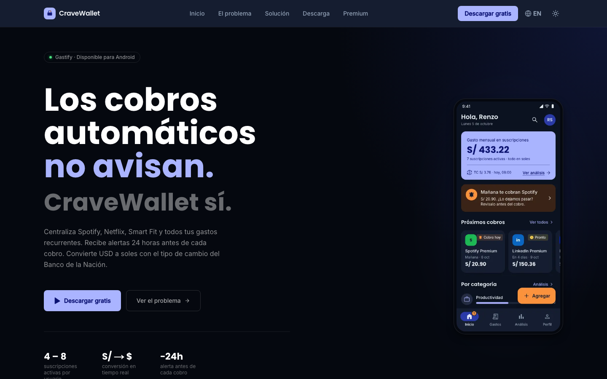

<!-- pdf:omit-start -->

*Figura 110. Hero del landing page publicado en Vercel (Desktop).*

<!-- pdf:omit-end -->

*Fuente: captura de <https://cravewallet-landing.vercel.app/es> del 9 de octubre de 2026, elaboración del equipo Gastify.*

**Aplicación Android.** La aplicación del commit `2d4200e` compiló con `BUILD SUCCESSFUL` y se instaló en un emulador Android. Las pantallas Inicio (figura 111) y Análisis (figura 112) usan datos de demostración.

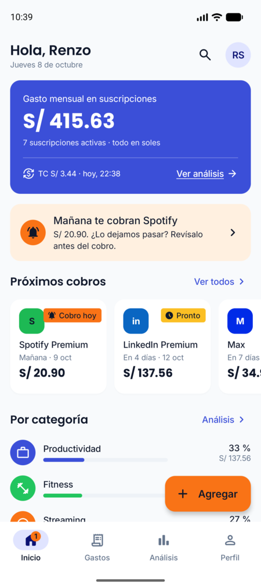

<!-- pdf:omit-start -->

*Figura 111. Inicio de CraveWallet ejecutado en un emulador Android.*

<!-- pdf:omit-end -->

*Fuente: captura propia de `CraveWallet-Mobile` `2d4200e`, 8 de octubre de 2026, con datos de demostración.*

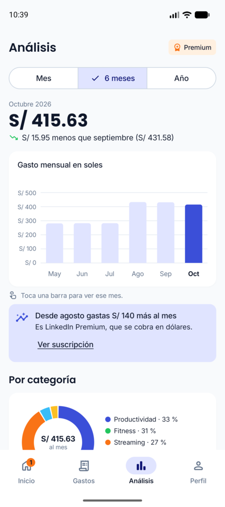

<!-- pdf:omit-start -->

*Figura 112. Análisis de CraveWallet ejecutado en un emulador Android.*

<!-- pdf:omit-end -->

*Fuente: captura propia de `CraveWallet-Mobile` `2d4200e`, 8 de octubre de 2026, con datos de demostración.*

**Versión conectada verificada en LDPlayer, 9 de octubre de 2026.** Se comprobó que el APK instalado coincide por SHA-256 con `CraveWallet-TB1-cloud-debug.apk` documentado y usa `https://cravewallet-api.onrender.com`. En LDPlayer 14, Android 14 (API 34), se registró una cuenta ficticia, se guardó Spotify Premium por USD 20.90 (estimación S/ 71.90), se recuperó el portafolio tras cerrar y volver a abrir el proceso, y se comprobó delivery con presupuesto S/ 100.00, gasto S/ 35.50 y saldo S/ 64.50. Una lectura REST independiente confirmó la suscripción y el resumen. Se verificaron navegación, validación de fecha obligatoria y cierre de sesión. El [registro complementario con acciones, resultados, historias y capturas M1–M6](evidence/mobile/2026-10-09-ldplayer/README.md) distingue cada alcance.

**Limitaciones de esta ejecución móvil.** Solo se implementa el tema claro. Análisis presenta una vista previa de ejemplo bajo el bloqueo Premium; no acredita gráficos del gasto real. Calendario y notificaciones no se ensayaron. Las figuras 111 y 112 también se capturaron en un emulador. **La evidencia versionada acredita LDPlayer, no un teléfono físico.** Para cerrar esa comprobación se requiere un registro independiente con modelo, versión de Android, fecha, hash del APK y resultados de registro, alta, reapertura, consulta y cierre de sesión. El equipo dispone de una [plantilla de evidencia física](evidence/mobile/physical-device-template.md) para registrar esa ejecución sin mezclarla con las capturas del emulador.

**Servicios RESTful.** Se ejecutó el backend local y se probaron sus 16 métodos mediante HTTP. En Swagger se revisaron registro, login, alta y listado de una suscripción USD, recordatorio, cotización, presupuesto, gasto y resumen. La tabla 156 muestra los resultados del ejercicio reproducible registrado en [live-api-results.json](evidence/backend/live-api-results.json).

*Tabla 156. Resultados observados de ejecución del backend local.*

| Flujo | Resultado observado |
| --- | --- |
| Registro y login | 201 y 200, respectivamente; consulta y actualización del perfil autenticado: 200. |
| Suscripciones | Alta: 201; listado, detalle, edición y cancelación local: 200. La consulta del historial conserva el registro cancelado. |
| Cotización y resumen | USD/PEN real consultado al proveedor; el portafolio devuelve total PEN, fuente y fecha. El valor cambia con cada actualización. |
| Recordatorio | 200 para el propietario; `reminderAt` está 24 horas antes de `billingAt`, con zona America/Lima. |
| Delivery y presupuesto | Presupuesto de S/ 100 y gasto ficticio de S/ 35,50: total S/ 35,50 y saldo S/ 64,50. Reintentar el mismo registro devuelve 200 sin duplicar el gasto. |
| Renovación y logout | Renovación: 200; logout: 204; usar luego el token revocado: 401. |

*Fuente: [registro de ejecución HTTP](evidence/backend/live-api-results.json), [especificación OpenAPI](evidence/backend/openapi.json) y pruebas de integración de la tabla 153.*

La información utilizada fue ficticia y se almacenó en H2 local. El endpoint de recordatorio prepara datos; no agenda un evento ni envía notificaciones. Como el modelo conserva una fecha sin hora, la renovación se representa a las 00:00 de America/Lima.

La figura 113 muestra `POST /api/v1/subscriptions` con una suscripción ficticia en PEN: la respuesta contiene el identificador, el estado `ACTIVE`, la fecha de renovación y la cabecera `Location`.

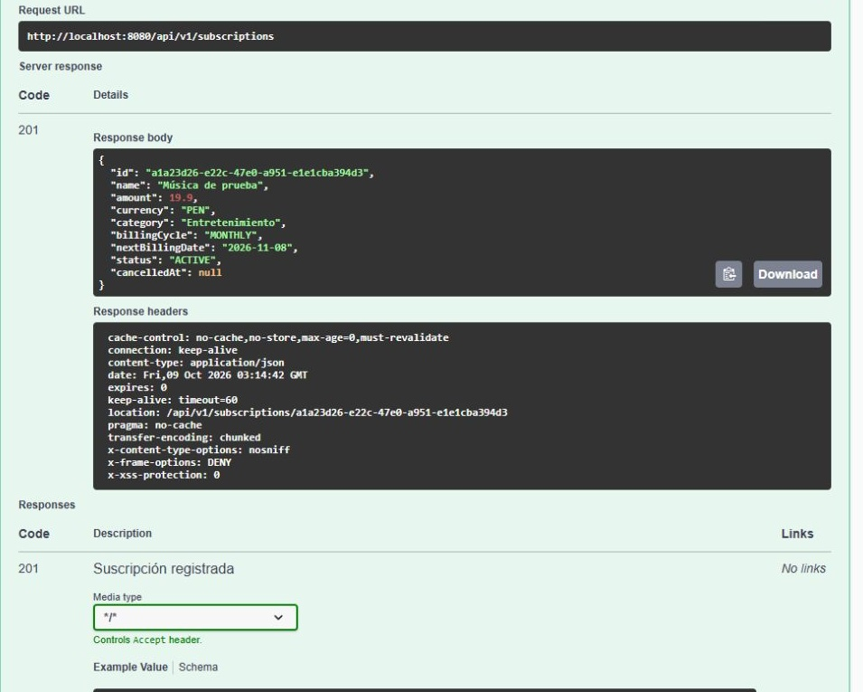

<!-- pdf:omit-start -->

*Figura 113. Registro de una suscripción: HTTP 201 y recurso creado.*

<!-- pdf:omit-end -->

*Fuente: captura propia de Swagger UI, CraveWallet-Backend `2f36260`, entorno local H2, 8 de octubre de 2026 (America/Lima), con datos ficticios.*

Antes del alta, se consultó el portafolio con una suscripción de USD 9,99. El servidor devolvió `monthlyTotalPen=34.37` y `conversionAvailable=true`; la tasa y sus fechas están en el [JSON de la consulta](evidence/backend/swagger-subscriptions-response.json) (figura 114).

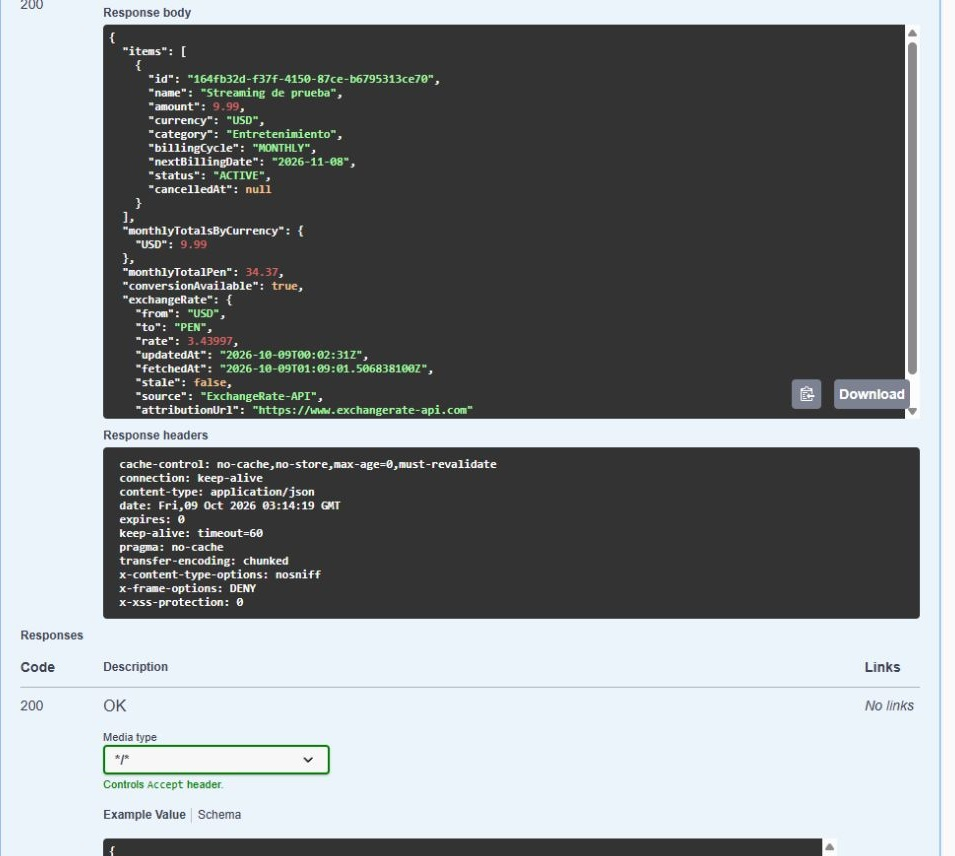

<!-- pdf:omit-start -->

*Figura 114. Consulta del portafolio de suscripciones: HTTP 200 y conversión a PEN.*

<!-- pdf:omit-end -->

*Fuente: captura propia de Swagger UI, CraveWallet-Backend `2f36260`, entorno local H2, 8 de octubre de 2026 (America/Lima), con datos ficticios.*

Con un presupuesto de S/ 100 y un gasto de S/ 35,50 en octubre de 2026, el resumen devuelve el total, el saldo y los desgloses por categoría y semana (figura 115).

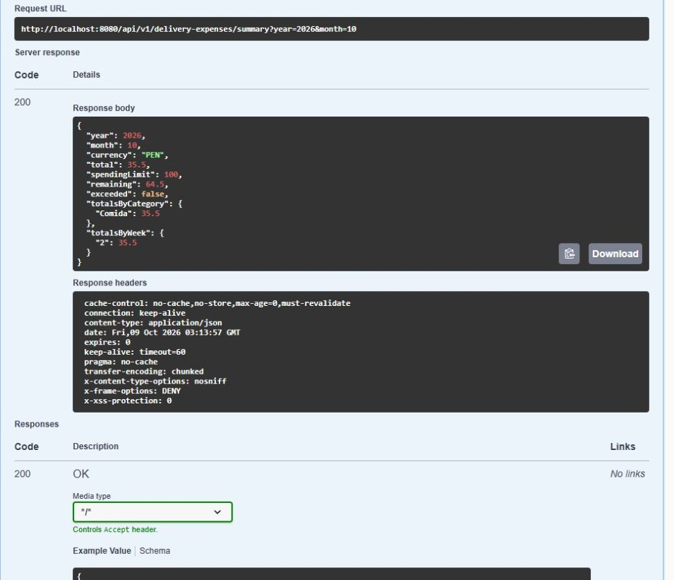

<!-- pdf:omit-start -->

*Figura 115. Resumen de Delivery: HTTP 200, gasto S/ 35,50 y saldo S/ 64,50.*

<!-- pdf:omit-end -->

*Fuente: captura propia de Swagger UI, CraveWallet-Backend `2f36260`, entorno local H2, 8 de octubre de 2026 (America/Lima), con datos ficticios.*

La consulta del recordatorio devuelve `reminderAt=2026-11-07T05:00:00Z` y `billingAt=2026-11-08T05:00:00Z`, con zona `America/Lima` (figura 116).

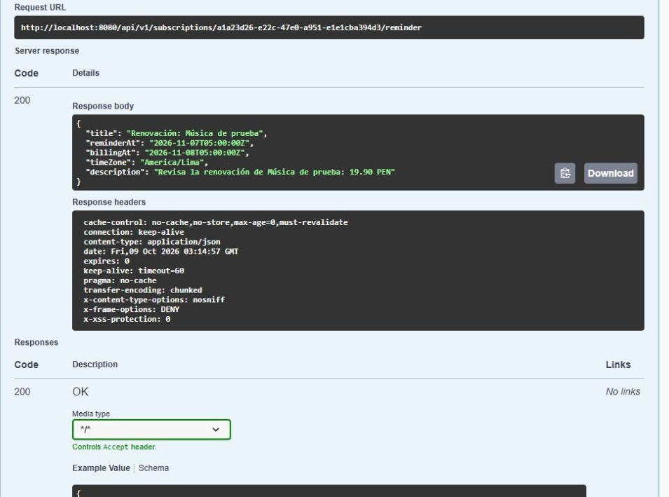

<!-- pdf:omit-start -->

*Figura 116. Datos del recordatorio: HTTP 200 y aviso 24 horas antes de la renovación.*

<!-- pdf:omit-end -->

*Fuente: captura propia de Swagger UI, CraveWallet-Backend `2f36260`, entorno local H2, 8 de octubre de 2026 (America/Lima), con datos ficticios.*

Video de demostración Del Sprint 1

Como evidencia de ejecución del Sprint 1, se presenta un video de demostración del backend de CraveWallet mediante Swagger UI. Se muestra el funcionamiento de los endpoints del Bounded Context Delivery Expense Management, incluyendo la gestión del presupuesto mensual, el registro de gastos de delivery y la consulta del resumen de gastos.

Enlace del video: https://acortar.link/8y5yu3

#### 4.2.1.7. Services Documentation Evidence for Sprint Review

El alcance funcional del backend para TB1 se fija en las 16 operaciones necesarias para TS01–TS05, enumeradas en la tabla 157. La documentación se genera desde el código con springdoc-openapi y, en el corte del 9 de octubre de 2026, estuvo disponible en [Swagger UI público de Render](https://cravewallet-api.onrender.com/swagger-ui/index.html) (figura 117) y en la [especificación OpenAPI pública](https://cravewallet-api.onrender.com/v3/api-docs). Desde el commit `445bee1`, el perfil de producción permite consultar la documentación sin iniciar sesión; ejecutar operaciones sobre los datos del usuario requiere el token Bearer mediante **Authorize**. La [especificación capturada](evidence/backend/openapi.json) conserva la evidencia del entorno local, pero no sustituye la comprobación de disponibilidad pública al momento de exponer.

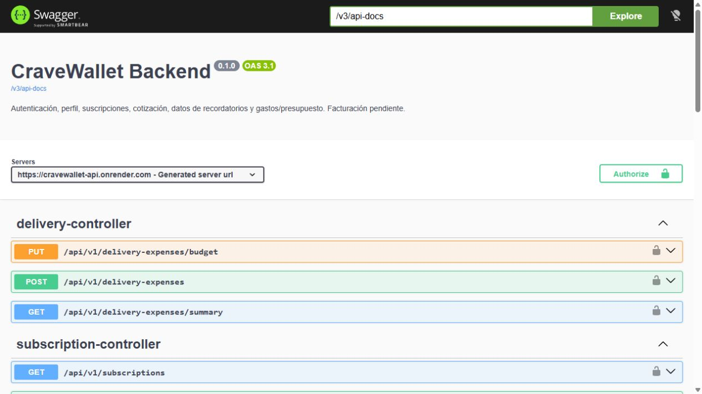

<!-- pdf:omit-start -->

*Figura 117. Documentación OpenAPI del backend CraveWallet en Swagger UI público de Render.*

<!-- pdf:omit-end -->

*Fuente: captura propia de <https://cravewallet-api.onrender.com/swagger-ui/index.html>, CraveWallet-Backend `445bee1`, perfil prod con PostgreSQL 17, 9 de octubre de 2026 (America/Lima), sin credenciales ni datos personales.*

Las rutas parten de `https://cravewallet-api.onrender.com/api/v1` y todas requieren el token Bearer, salvo las de registro, login y renovación. La tabla 157 presenta, por cada operación, el verbo HTTP, la ruta, el acceso, los parámetros y la respuesta exitosa.

*Tabla 157. Matriz de cobertura funcional del alcance REST de TB1.*

| Historia | Método y ruta | Solicitud / acceso | Resultado esperado | Evidencia funcional del corte |
| --- | --- | --- | --- | --- |
| TS01 | `POST /api/v1/auth/register` | Sin JWT; `email`, `password`. | 201; perfil y tokens. | HTTP local y pruebas de integración: aprobado. |
| TS01 | `POST /api/v1/auth/login` | Sin JWT; `email`, `password`. | 200; perfil y tokens. | HTTP local y pruebas de integración: aprobado. |
| TS01 | `POST /api/v1/auth/refresh` | `refreshToken` en el cuerpo. | 200; nuevo par de tokens; anterior revocado. | Pruebas de integración: aprobado. |
| TS01 | `POST /api/v1/auth/logout` | Bearer JWT; sin cuerpo. | 204; sesión revocada. | HTTP local y pruebas de integración: aprobado. |
| TS01 | `GET /api/v1/users/me` | Bearer JWT; usuario obtenido del token. | 200; perfil propio. | HTTP local y pruebas de integración: aprobado. |
| TS01 | `PATCH /api/v1/users/me` | Bearer JWT; `referenceCurrency="PEN"`. | 200; perfil actualizado. | HTTP local y pruebas de integración: aprobado. |
| TS02 | `POST /api/v1/subscriptions` | Bearer JWT; nombre, monto, moneda, categoría, ciclo y fecha. | 201; registro activo y `Location`. | HTTP local, prueba remota histórica y app: aprobado. |
| TS02 | `GET /api/v1/subscriptions` | Bearer JWT; filtros opcionales. | 200; portafolio y estimación PEN. | HTTP local, prueba remota histórica y app: aprobado. |
| TS02 | `GET /api/v1/subscriptions/{id}` | Bearer JWT y propiedad; UUID. | 200; detalle propio. | HTTP local y pruebas de integración: aprobado. |
| TS02 | `PATCH /api/v1/subscriptions/{id}` | Bearer JWT y propiedad; campos editables. | 200; registro actualizado. | HTTP local y pruebas de integración: aprobado. |
| TS02 | `POST /api/v1/subscriptions/{id}/cancel` | Bearer JWT y propiedad; sin cuerpo. | 200; cancelación del registro local, no del proveedor externo. | HTTP local y pruebas de integración: aprobado. |
| TS04 | `GET /api/v1/subscriptions/{id}/reminder` | Bearer JWT y propiedad; sin cuerpo. | 200; datos para preparar el aviso. | HTTP local: aprobado; calendario/notificación Android pendientes. |
| TS03 | `GET /api/v1/exchange-rate` | Bearer JWT; `from`, `to`. | 200; tasa, fuente, fechas y antigüedad. | HTTP local, prueba remota histórica y app: aprobado. |
| TS05 | `POST /api/v1/delivery-expenses` | Bearer JWT; UUID de solicitud, comercio, monto, categoría y fecha. | 201 al crear; 200 en reintento idéntico. | HTTP local, prueba remota histórica y app: aprobado. |
| TS05 | `GET /api/v1/delivery-expenses/summary` | Bearer JWT; año y mes opcionales. | 200; total, límite, saldo, categorías y semanas. | HTTP local, prueba remota histórica y app: aprobado. |
| TS05 | `PUT /api/v1/delivery-expenses/budget` | Bearer JWT; año, mes y límite. | 200; límite y acumulado del período. | HTTP local, prueba remota histórica y app: aprobado. |

*Fuente: [OpenAPI capturado](evidence/backend/openapi.json), [ejecución HTTP reproducible](evidence/backend/live-api-results.json), pruebas de la tabla 153, evidencia móvil y [contratos del backend](https://github.com/1ACC0238-2620-4950-Gastify-CraveWallet/CraveWallet-Backend/tree/740aba0/docs).*

**Cobertura funcional del alcance REST de TB1:** 16 operaciones funcionales de 16 operaciones definidas, es decir, `16 / 16 × 100 = 100 %` en la ejecución registrada. Este indicador mide operaciones del alcance con resultado funcional; no es cobertura de líneas de código, no convierte los 33 casos automatizados en un porcentaje y no garantiza disponibilidad actual del servicio. La operación de recordatorio entrega datos, pero la integración de calendario/notificaciones en Android permanece fuera de esta cobertura.

La especificación OpenAPI archivada es parcial: diez operaciones carecen de `summary`, ninguna contiene `description` y no incluye ejemplos explícitos para todos los cuerpos y respuestas. Los contratos Markdown y los ejemplos siguientes completan la lectura del corte, pero el backend todavía debe incorporar esa información en las anotaciones OpenAPI y volver a publicar la especificación para que Swagger sea autosuficiente.

Los contratos ampliados se encuentran en [autenticación y perfil](https://github.com/1ACC0238-2620-4950-Gastify-CraveWallet/CraveWallet-Backend/blob/740aba0/docs/auth-api.md), [suscripciones](https://github.com/1ACC0238-2620-4950-Gastify-CraveWallet/CraveWallet-Backend/blob/740aba0/docs/subscriptions-api.md), [Delivery](https://github.com/1ACC0238-2620-4950-Gastify-CraveWallet/CraveWallet-Backend/blob/740aba0/docs/delivery-api.md) y [cotización y recordatorios](https://github.com/1ACC0238-2620-4950-Gastify-CraveWallet/CraveWallet-Backend/blob/740aba0/docs/exchange-and-reminders-api.md); describen cuerpos JSON, límites, filtros y errores. Los importes usan `BigDecimal` y no se suman monedas diferentes sin cotización.

Los errores incluyen 400 para datos inválidos, 401 para autenticación no válida, 404 para recursos inexistentes o ajenos y 409 para conflictos de estado, cupos o reintentos con contenido distinto. La cotización devuelve 503 si no hay un valor utilizable; en ese caso el portafolio conserva los importes originales y devuelve `monthlyTotalPen=null` con `conversionAvailable=false`.

La caché USD/PEN dura 24 horas por instancia; ante un fallo, puede usar una tasa anterior de menos de siete días indicando `stale=true`. La [documentación del proveedor](https://www.exchangerate-api.com/docs/free) exige atribución para el endpoint Open Access, por lo que el contrato devuelve `attributionUrl` para que la interfaz la muestre.

**Comprobación del avance del backend al cierre de TB1.** La tabla 157 acredita 16 operaciones implementadas. Para calcular el avance por cantidad de operaciones se toma como base el [inventario de 22 contratos REST](https://github.com/1ACC0238-2620-4950-Gastify-CraveWallet/CraveWallet-Backend/blob/445bee1/docs/tb1-endpoint-coverage.md), derivado de TS01–TS06 y de las Interface Layers de la sección 2.6:

- Autenticación y perfil: 6 de 6 operaciones implementadas (registro, login, renovación, logout, consulta y edición del perfil).
- Suscripciones y recordatorios: 6 de 6 (alta, listado, detalle, edición, cancelación y consulta de datos del recordatorio).
- Cotización: 1 de 1 (consulta USD/PEN).
- Delivery: 3 de 4 (registro de gasto, resumen mensual y presupuesto); la consulta de sugerencias de comercios permanece pendiente.
- Premium & Billing: 0 de 5; permanecen pendientes checkout, consulta de estado, cancelación, historial de pagos y webhook de Stripe.

El cálculo sobre este inventario es **16 ÷ 22 × 100 = 72,7 %**. Se cuenta una operación por combinación de método HTTP y ruta; health, Swagger, OpenAPI, filtros y reintentos no incrementan el total. Las operaciones implementadas se documentan en la tabla 157 y su ejecución y despliegue se sustentan en las secciones 4.2.1.6 y 4.2.1.8.

Este porcentaje mide únicamente los contratos REST enumerados, no el cumplimiento completo de historias de usuario ni el avance de toda la aplicación. El catálogo remoto y la edición/eliminación de gastos de Delivery, mencionados en otros casos de uso, no forman parte de este inventario de 22 contratos; si se incorporan al alcance evaluado, debe ampliarse el denominador y recalcularse el porcentaje. Obtener los datos de un recordatorio tampoco acredita su ejecución en el calendario o la entrega de una notificación en Android.

**Ejemplo de alta de suscripción.** La figura 118 muestra el cuerpo enviado desde Swagger a `POST /api/v1/subscriptions`, con `Content-Type: application/json` y una sesión Bearer autorizada. Los seis campos son obligatorios: `currency` admite PEN/USD, `billingCycle` admite MONTHLY/ANNUAL y la fecha debe ser actual o futura en America/Lima.

```json
{
  "name": "Música de prueba",
  "amount": 19.9,
  "currency": "PEN",
  "category": "Entretenimiento",
  "billingCycle": "MONTHLY",
  "nextBillingDate": "2026-11-08"
}
```

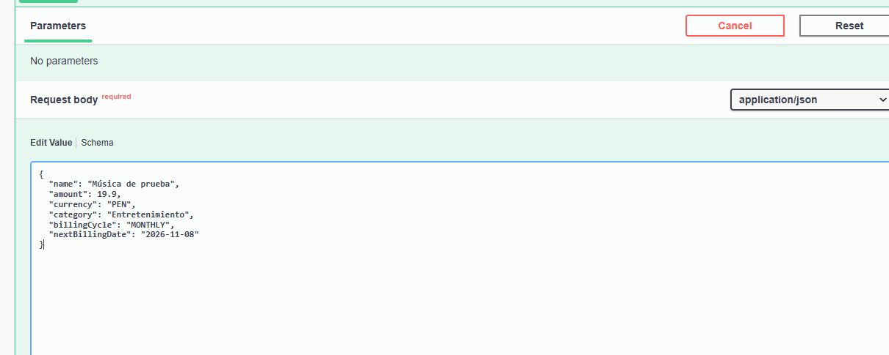

<!-- pdf:omit-start -->

*Figura 118. Cuerpo JSON de alta de una suscripción en Swagger UI.*

<!-- pdf:omit-end -->

*Fuente: captura propia del backend local `2f36260`, 8 de octubre de 2026 (America/Lima). La respuesta real se presenta en la figura 113 y en [swagger-subscription-created.json](evidence/backend/swagger-subscription-created.json).*

**Ejemplo de consulta del resumen mensual.** La figura 119 muestra los parámetros de `GET /api/v1/delivery-expenses/summary?year=2026&month=10`. El propietario se obtiene de la sesión y los importes se expresan en PEN.

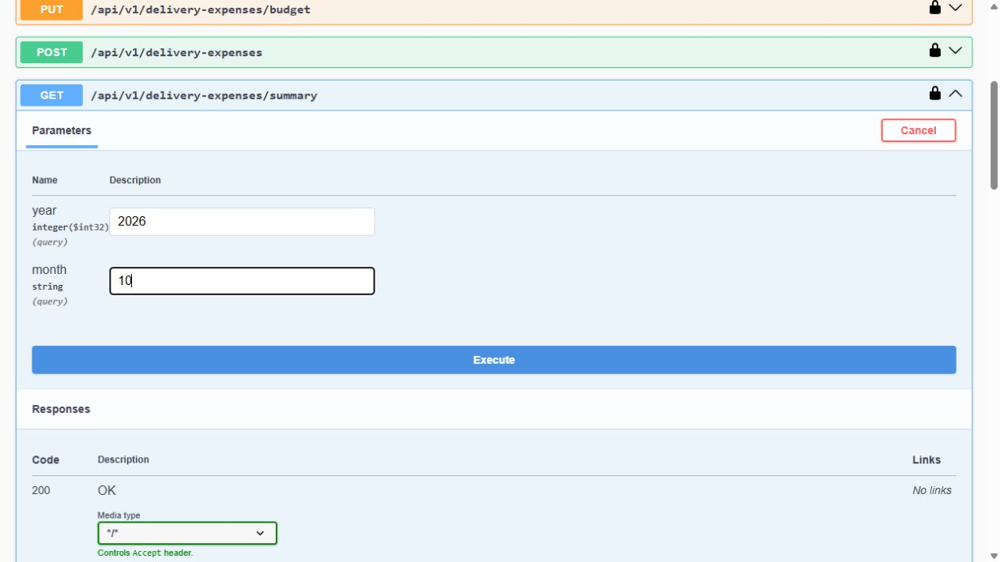

<!-- pdf:omit-start -->

*Figura 119. Parámetros year y month para consultar el resumen de Delivery.*

<!-- pdf:omit-end -->

*Fuente: captura propia del backend local `2f36260`, 8 de octubre de 2026 (America/Lima).*

La respuesta HTTP 200 de la figura 115 contiene el siguiente JSON, [conservado desde Swagger](evidence/backend/swagger-summary-response.json):

```json
{
  "currency": "PEN",
  "exceeded": false,
  "month": 10,
  "remaining": 64.5,
  "spendingLimit": 100,
  "total": 35.5,
  "totalsByCategory": {
    "Comida": 35.5
  },
  "totalsByWeek": {
    "2": 35.5
  },
  "year": 2026
}
```

#### 4.2.1.8. Software Deployment Evidence for Sprint Review

En el Sprint 1 se publicaron el landing page, disponible en <https://cravewallet-landing.vercel.app/es>, y el REST API, disponible en <https://cravewallet-api.onrender.com>; la aplicación Android se compiló como APK y se conectó al API público. La tabla 158 resume el estado de cada producto al 9 de octubre de 2026 y las secciones siguientes presentan su evidencia.

*Tabla 158. Estado de ejecución y despliegue al 9 de octubre de 2026.*

| Producto | Estado | Evidencia |
| --- | --- | --- |
| Landing page | Publicado en Vercel desde `main`; HTTP 200. | [cravewallet-landing.vercel.app/es](https://cravewallet-landing.vercel.app/es); dos deployments `Production` correctos (tabla 159 y figura 107). |
| REST API | Publicado en Render con PostgreSQL 17 y perfil `prod`; health `UP` y Swagger público comprobados el 9 de octubre de 2026. La disponibilidad del 10 de octubre quedó inconclusa por timeout. | [Health público](https://cravewallet-api.onrender.com/actuator/health), [Swagger UI](https://cravewallet-api.onrender.com/swagger-ui/index.html) y [OpenAPI](https://cravewallet-api.onrender.com/v3/api-docs); figuras 117 y 121 a 124. |
| Base de datos | PostgreSQL 17 en Render; Flyway V1–V3. | 22 comprobaciones HTTP remotas y siete tras el reinicio del servicio ([resultados](https://github.com/1ACC0238-2620-4950-Gastify-CraveWallet/CraveWallet-Backend/blob/740aba0/docs/evidence/cloud/remote-api-results.json)). |
| Aplicación Android | APK `debug` generado, publicado desde el landing y probado contra el API público; recorrido conectado documentado únicamente en LDPlayer. La prueba verificable en teléfono físico permanece pendiente. | [Resultados de compilación](https://github.com/1ACC0238-2620-4950-Gastify-CraveWallet/CraveWallet-Mobile/blob/73c5785/docs/cloud-integration-results.json); APK `CraveWallet-TB1-cloud-debug.apk`; [evidencia en emulador](evidence/mobile/2026-10-09-ldplayer/README.md). |

*Fuente: paneles de Vercel y Render, GitHub Actions y los resultados versionados en los repositorios.*

**Landing page.** Se publica con Vercel desde la rama `main` de `cravewallet-landing`, en <https://cravewallet-landing.vercel.app/es>, con la configuración de las figuras 107 y 108 (sección 4.1.4). La figura 120 muestra el sitio servido en esa dirección.

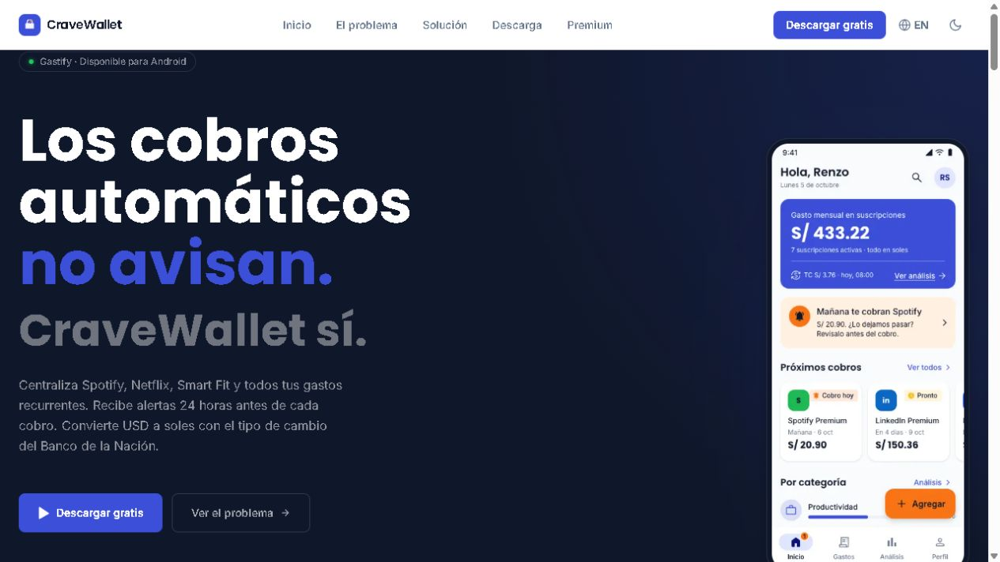

<!-- pdf:omit-start -->

*Figura 120. Landing de CraveWallet publicada en Vercel.*

<!-- pdf:omit-end -->

*Fuente: captura del equipo Gastify de <https://cravewallet-landing.vercel.app/es>, 9 de octubre de 2026; procedencia en [capturas.json](evidence/deployment/capturas.json).*

Cada push a `main` genera un deployment de producción; la tabla 159 lista los que registra GitHub.

*Tabla 159. Deployments de producción del landing page en Vercel.*

| Commit | Fecha (America/Lima) | Entorno | Estado |
| --- | --- | --- | --- |
| [eec794d](https://github.com/1ACC0238-2620-4950-Gastify-CraveWallet/cravewallet-landing/commit/eec794d5a2e8bb2f616ba3445e970a9ebab90737) | 08/10/2026 21:58 | Production | Correcto |
| [3cdc4c5](https://github.com/1ACC0238-2620-4950-Gastify-CraveWallet/cravewallet-landing/commit/3cdc4c5d72969732a7f597ad62511a542658104f) | 08/10/2026 22:19 | Production | Correcto |

*Fuente: [Deployments de GitHub](https://github.com/1ACC0238-2620-4950-Gastify-CraveWallet/cravewallet-landing/deployments) creados por Vercel para el repositorio `cravewallet-landing` y [registro del deployment Production](evidence/deployment/vercel-production.json).*

**Servicios RESTful.** Se publicaron en Render como servicio Docker `cravewallet-api` en el plan gratuito (región Oregon), junto con una base PostgreSQL 17. El despliegue inicial corresponde al commit `67ede2a`; el 9 de octubre se publicó el commit [445bee1](https://github.com/1ACC0238-2620-4950-Gastify-CraveWallet/CraveWallet-Backend/commit/445bee1cebfa9953be5bb7a664d7155a9f7ee7a1) desde `feature/cloud-deployment` para habilitar Swagger público y queda disponible por HTTPS en <https://cravewallet-api.onrender.com>. La figura 121 muestra el servicio en estado Live y la figura 122, el historial de eventos con el despliegue y el reinicio solicitado.

Después de publicar `445bee1`, se verificaron respuestas HTTP 200 en `/swagger-ui/index.html` y `/v3/api-docs`; OpenAPI identifica el servidor `https://cravewallet-api.onrender.com`. Consultar `/api/v1/subscriptions` sin token devolvió HTTP 401. La figura 117 muestra la documentación cargada en el navegador. La ejecución de `mvnw.cmd -B verify` para este cambio terminó con 33 pruebas, cero fallos, cero errores y ningún caso omitido, incluida [ProductionDocumentationTest](https://github.com/1ACC0238-2620-4950-Gastify-CraveWallet/CraveWallet-Backend/blob/445bee1/src/test/java/pe/edu/upc/gastify/cravewallet/ProductionDocumentationTest.java), que verifica documentación pública y protección de suscripciones y perfil bajo el perfil `prod`. Las figuras 121 y 122 conservan la evidencia del despliegue inicial y del reinicio anterior.

Esos resultados corresponden al 9 de octubre de 2026. En la comprobación del 10 de octubre las solicitudes a health, Swagger, OpenAPI y suscripciones agotaron el tiempo de espera, por lo que la disponibilidad actual quedó inconclusa y no se infiere un estado `UP` permanente. Antes de la exposición se debe verificar desde otra conexión: (1) health, (2) carga de Swagger, (3) descarga de OpenAPI, (4) respuesta 401 de una ruta protegida sin token y (5) una operación autenticada. La fecha, duración, código HTTP y commit desplegado deben incorporarse mediante la [plantilla de verificación pública](evidence/backend/public-api-verification-template.md).

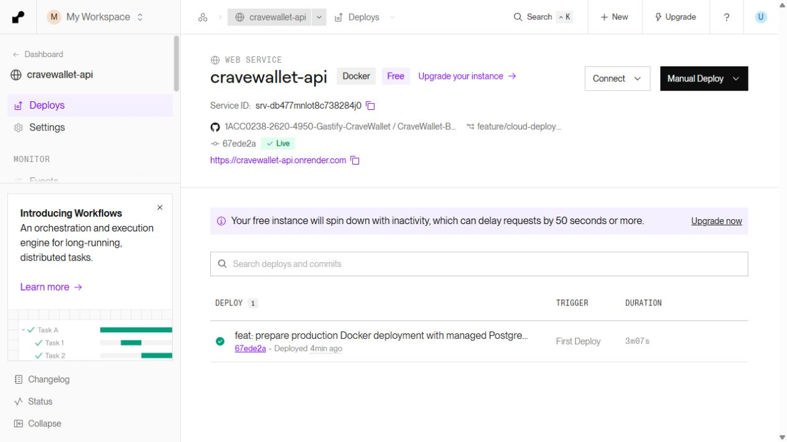

<!-- pdf:omit-start -->

*Figura 121. Servicio cravewallet-api en estado Live en Render.*

<!-- pdf:omit-end -->

*Fuente: captura del panel de Render del equipo Gastify, commit `67ede2a`, 8 de octubre de 2026.*

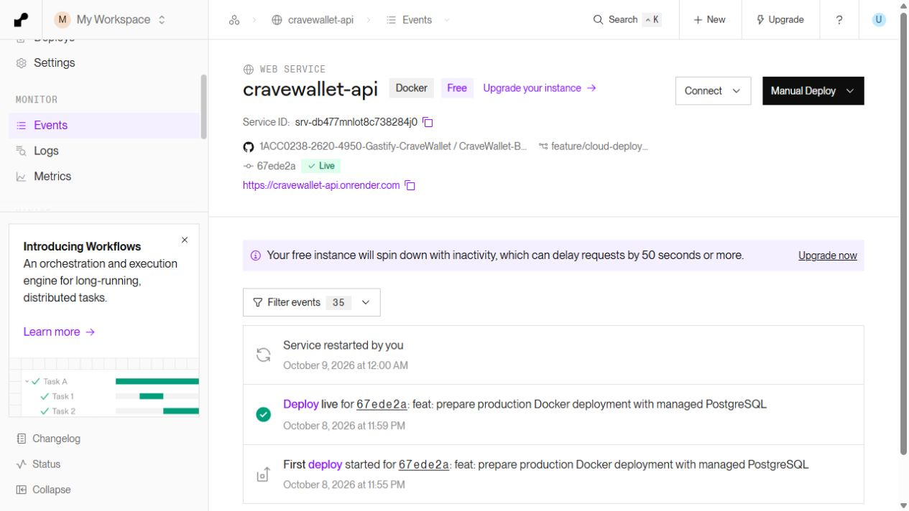

<!-- pdf:omit-start -->

*Figura 122. Eventos del servicio cravewallet-api en Render: despliegue y reinicio.*

<!-- pdf:omit-end -->

*Fuente: captura del panel de Render del equipo Gastify, 9 de octubre de 2026.*

La figura 123 muestra la pantalla de arranque que Render presenta al abrir el health público de un servicio del plan gratuito tras un período de inactividad; la siguiente petición respondió HTTP 200 y `UP` a las 00:57:35 (America/Lima).

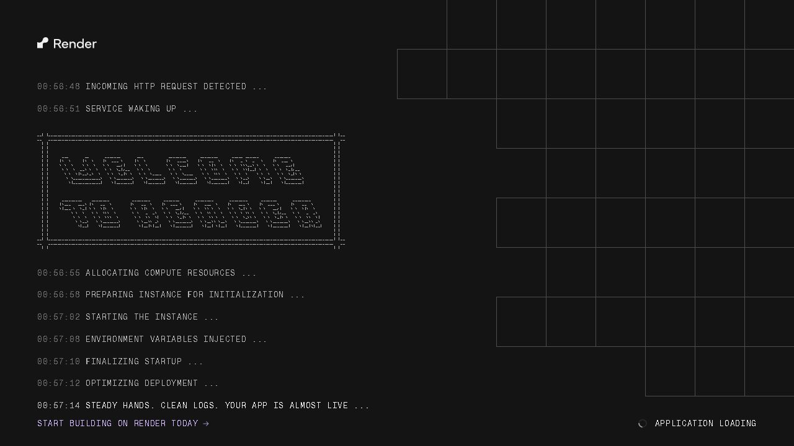

<!-- pdf:omit-start -->

*Figura 123. Pantalla de arranque de Render al acceder al health público.*

<!-- pdf:omit-end -->

*Fuente: captura del equipo Gastify de <https://cravewallet-api.onrender.com/actuator/health>, 9 de octubre de 2026; procedencia en [capturas.json](evidence/deployment/capturas.json).*

Tras el reinicio se comprobó que se conservaron la sesión, la suscripción editada y el presupuesto con su gasto, y que el cierre de sesión revocó el acceso. La figura 124 muestra la respuesta pública de `/actuator/health`.

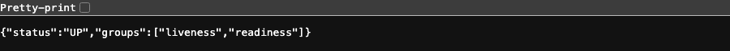

<!-- pdf:omit-start -->

*Figura 124. Respuesta pública de /actuator/health del REST API: estado UP.*

<!-- pdf:omit-end -->

*Fuente: captura de <https://cravewallet-api.onrender.com/actuator/health>, 9 de octubre de 2026; [respuesta registrada](evidence/deployment/health-publico.json).*

La construcción del backend se verifica en GitHub Actions: el workflow `Backend build` terminó con éxito en sus siete ejecuciones, entre el commit `1f1b39b` y el `740aba0`, sobre `develop` y `feature/cloud-deployment` (figura 125).

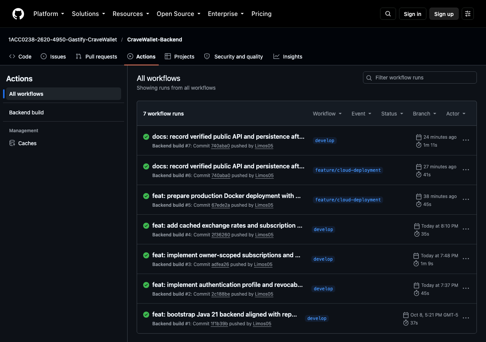

<!-- pdf:omit-start -->

*Figura 125. Ejecuciones del workflow Backend build en GitHub Actions.*

<!-- pdf:omit-end -->

*Fuente: captura de GitHub Actions del repositorio `CraveWallet-Backend`, 9 de octubre de 2026.*

**Aplicación Android.** El APK se genera con Gradle y apunta a la URL pública del API mediante `API_BASE_URL`. La compilación `CraveWallet-TB1-cloud-debug.apk` pesa 15 121 075 bytes y su huella SHA-256 es `5e2ab68b5056adc4a08db0c4cc4ffc2e2e90d5bff6b912fc95bc9b87767c0ec3`. La suite de la tabla 154 se ejecutó contra el API de Render y terminó sin fallos. El APK se descarga desde el landing, pero corresponde al artefacto anterior a la corrección del precio Premium: `develop` mantiene S/ 9.90 y la corrección a S/ 9.99 está en `fix/premium-price-9-99` (`6f0ca26`). Antes de sustituir la descarga se debe integrar esa rama, recompilar, comprobar el precio visible y actualizar tamaño, hash y evidencia.

#### 4.2.1.9. Team Collaboration Insights during Sprint

El historial de los repositorios muestra el aporte de cada integrante en el Sprint 1. La tabla 160 presenta los commits de cada uno por repositorio entre el 16 de septiembre y el 9 de octubre de 2026 (informe hasta el commit `3dbbc36`), y excluye los commits de merge. La figura 126 presenta los mismos datos. Los commits de Anghelo Faustino en los repositorios de código figuran con el usuario `limozz05` y los del informe, con su cuenta `Limos05`.

*Tabla 160. Commits de cada integrante por repositorio en el Sprint 1.*

| Integrante | Landing page | Aplicación Android | Servicios RESTful | Informe |
| --- | ---: | ---: | ---: | ---: |
| Sejuro Medina, Mario Gabriel | 8 | 0 | 0 | 32 |
| Faustino Hurtado, Anghelo Edwin | 0 | 4 | 7 | 32 |
| Roman Zeballos, Sebastian Jared | 2 | 1 | 1 | 30 |
| Carpio Peña, Josué Francisco | 0 | 0 | 0 | 7 |
| Aliaga, Alexander | 0 | 0 | 0 | 3 |

*Fuente: historial de commits de `cravewallet-landing`, `CraveWallet-Mobile`, `CraveWallet-Backend` y `CraveWallet-Report` en GitHub.*

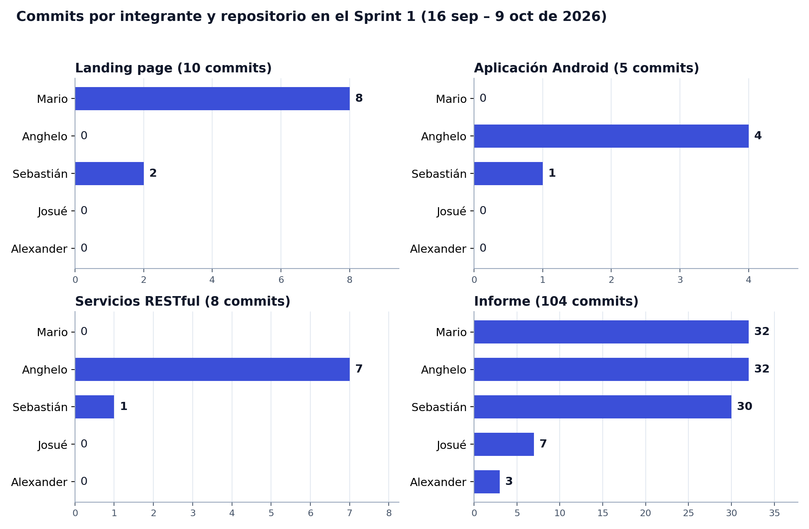

<!-- pdf:omit-start -->

*Figura 126. Commits por integrante y repositorio en el Sprint 1.*

<!-- pdf:omit-end -->

*Fuente: elaboración del equipo Gastify a partir del historial Git de todas las ramas de los cuatro repositorios.*

La figura 127 muestra la pestaña Contributors de `CraveWallet-Mobile` en GitHub, que registra los 4 commits de `limozz05` y el commit de `Chebas19` de la rama `develop`.

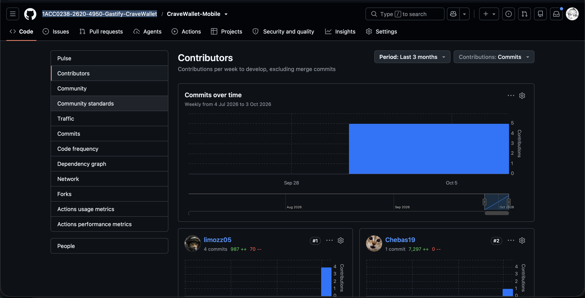

<!-- pdf:omit-start -->

*Figura 127. Contribuciones al repositorio CraveWallet-Mobile en GitHub (Insights > Contributors).*

<!-- pdf:omit-end -->

*Fuente: captura de GitHub Insights del repositorio `CraveWallet-Mobile`, 9 de octubre de 2026.*

La implementación se concentra en tres integrantes. Mario Sejuro desarrolló el landing publicado; Sebastián Roman escribió las secciones adicionales del landing, inicializó el repositorio del backend y desarrolló la aplicación Android; y Anghelo Faustino implementó el backend, el despliegue en Render y la conexión de la aplicación con el API.

### 4.2.2. Sprint 2

#### 4.2.2.1. Sprint Planning 2

El Sprint 2 corresponde a la entrega de la semana 12 (AV2) y abarca el trabajo ejecutado entre el 11 de octubre y el 13 de noviembre de 2026. Su planificación parte del inventario revisado en TB1 (tabla 84 de la sección 2.4.3), que asigna al Sprint 2 ocho historias de usuario (`US03`, `US04`, `US26`, `US09`, `US10`, `US11`, `US27` y `US35`, por un total de 17 Story Points), e incorpora en paralelo la integración de pagos recurrentes para CraveWallet Premium con Mercado Pago (`TS06`, `US21`, `US22`, `US23`, `US31`, `US39`, `SP05` y `SP06`), las sugerencias de comercios de delivery con Google Places (`US18` y `TS05`), la actualización de la aplicación nativa Android en Kotlin (`CraveWallet-Mobile`) y la construcción de la aplicación móvil multiplataforma en Flutter (`CraveWallet-Flutter`). La tabla 161 sintetiza el acta de planificación del Sprint 2 siguiendo el formato del curso y la plantilla de Sprint Goal de Scrum.org.

*Tabla 161. Sprint Planning 2.*

| Aspecto | Detalle |
| --- | --- |
| **Sprint #** | Sprint 2 |
| **Sprint Planning Background** | |
| Date | 2026-10-11 (fecha de referencia para la planificación) |
| Time | 08:00 PM (hora de Lima) |
| Location | Discord (plataforma indicada para la reunión) |
| Prepared By | Josué Francisco Carpio Peña |
| Attendees (to planning meeting) | Participantes previstos: Alexander Aliaga, Anghelo Edwin Faustino Hurtado, Josué Francisco Carpio Peña, Mario Gabriel Sejuro Medina y Sebastián Jared Roman Zeballos. |
| Sprint 1 Review Summary | En la revisión del Sprint 1 (TB1) se presentó el landing page bilingüe desplegado en Vercel (`cravewallet-landing.vercel.app`), el backend RESTful en Java 21 y Spring Boot desplegado en Render con PostgreSQL 17 y Flyway V1–V3 (16 endpoints operativos y 32 pruebas automatizadas para IAM, suscripciones, cotización USD/PEN y resumen de delivery) y la aplicación Android en Kotlin y Jetpack Compose verificada en LDPlayer con 9 pruebas de integración. Se identificó la necesidad de completar la agrupación por categoría y el ahorro estimado en suscripciones, implementar la pasarela de cobro recurrente en soles para el plan Premium, incorporar las sugerencias de comercios con Google Places y disponer de la versión multiplataforma en Flutter junto con la aplicación nativa en Kotlin. |
| Sprint 1 Retrospective Summary | Síntesis reconstruida a partir del cierre de TB1 (secciones 4.1.1 y 4.2.1.1–4.2.1.4). Se publicó la landing y se adelantaron servicios del backend y flujos de Android. El trabajo añadido durante el sprint dificultó comparar el resultado con el alcance original: se acreditaron 4 de los 16 SP iniciales y quedó evidencia insuficiente del cambio de estado de cada tarea. Para los siguientes sprints, el informe establece el seguimiento de las tareas en Trello mediante *To Do*, *In Process*, *To Review* y *Done*, con actividad fechada. La revisión del Product Backlog del 10 de octubre conserva además la asignación inicial y el alcance actualizado. |
| **Sprint Goal & User Stories** | |
| Sprint 2 Goal | **Our focus is on** consolidar el análisis del portafolio de suscripciones (totales por categoría, orden por próxima renovación, búsqueda, historial de canceladas y ahorro estimado al cancelar), habilitar la suscripción recurrente al plan Premium en soles mediante Mercado Pago y ofrecer la experiencia móvil completa tanto en Android nativo (Kotlin) como en multiplataforma (Flutter). **We believe it delivers** transparencia sobre el gasto recurrente por rubro y acceso sin fricción cambiaria ni límite de registros **to** los estudiantes universitarios y profesionales jóvenes de Lima que administran compromisos en soles y dólares. **This will be confirmed when** un usuario autenticado pueda consultar sus subtotales por categoría y el ahorro estimado al cancelar una suscripción, iniciar y verificar su membresía Premium de S/ 9.99 con Mercado Pago (desbloqueando más de 5 suscripciones y la vista de análisis) y recorrer los flujos principales en las aplicaciones Kotlin y Flutter conectadas al backend REST. |
| Sprint 2 Velocity | Capacidad acordada sin registro en el informe. Referencia histórica: **4 SP acreditados en el Sprint 1** sobre 16 SP del plan original (tabla 147), con trabajo añadido sin estimación en SP. Para el Sprint 2, la tabla 84 registra **17 SP de alcance planificado** en ocho historias. |
| Sum of Story Points | **17 Story Points** en las 8 User Stories de la línea base del Sprint 2 (tabla 84): `US03` (1 SP), `US04` (3 SP), `US26` (1 SP), `US09` (3 SP), `US10` (2 SP), `US11` (2 SP), `US27` (2 SP) y `US35` (3 SP). Adicionalmente, el sprint ejecuta el incremento técnico y funcional de Premium con Mercado Pago (`TS06`, `US21`–`US23`, `US31`, `US39`, `SP05`–`SP06`), sugerencias de comercios con Google Places (`US18`, `TS05`), actualización de `CraveWallet-Mobile` (Kotlin) y migración multiplataforma en `CraveWallet-Flutter`. |

*Fuente: elaboración del equipo Gastify a partir del Product Backlog revisado (tabla 84) y los repositorios del proyecto.*

#### 4.2.2.2. Aspect Leaders and Collaborators

La tabla 162 registra el liderazgo (`L`) y la colaboración (`C`) en los productos y actividades del Sprint 2. Josué Carpio lideró los dos aspectos del backend y colaboró en Flutter, Kotlin y el informe. Alexander Aliaga lideró Flutter. Anghelo Faustino lideró la aplicación Android en Kotlin, con la colaboración de Josué Carpio, Mario Sejuro y Sebastián Roman. Anghelo también lideró el cierre documental del informe. Josué lideró Validación y Videos, con la colaboración de Alexander, Anghelo, Mario y Sebastián. Anghelo contribuyó al diseño de la validación y de la evaluación heurística. Las secciones 4.2.2.4 y 4.2.2.9 registran las contribuciones técnicas y el historial de colaboración. Anghelo lideró la landing con el apoyo de Alexander, Josué, Sebastián y Mario. Anghelo, Sebastián y Mario colaboraron con Josué en ambos aspectos del backend. Sebastián y Mario también colaboraron en Flutter y en el informe.

*Tabla 162. Leadership-and-Collaboration Matrix del Sprint 2.*

| Miembro del equipo (Apellidos, Nombres) | Usuario GitHub | App Flutter (`CraveWallet-Flutter`) | App Android Kotlin (`CraveWallet-Mobile`) | Backend Premium y Mercado Pago | Backend Suscripciones y Comercios | Landing Page (`cravewallet-landing`) | Informe (`CraveWallet-Report`) | Validación y Videos |
| --- | --- | :---: | :---: | :---: | :---: | :---: | :---: | :---: |
| Aliaga, Alexander | `AlexanderAliaga19` | L | C | — | — | C | — | C |
| Carpio Peña, Josué Francisco | `josf17` | C | C | L | L | C | C | L |
| Faustino Hurtado, Anghelo Edwin | `Limos05` / `limozz05` | C | L | C | C | L | L | C |
| Roman Zeballos, Sebastian Jared | `Chebas19` | C | C | C | C | C | C | C |
| Sejuro Medina, Mario Gabriel | `maghetthi` | C | C | C | C | C | C | C |

*Fuente: historial de commits del Sprint 2, [revisión de contribuciones en las ramas de los cinco repositorios](https://github.com/1ACC0238-2620-4950-Gastify-CraveWallet/CraveWallet-Report/pull/29) y confirmación del equipo sobre la distribución de roles, y el registro de Student Outcome sobre el diseño de validación.*

#### 4.2.2.3. Sprint Backlog 2

El Sprint Backlog 2 desglosa las ocho historias de usuario de la línea base del Sprint 2 (`US03`, `US04`, `US26`, `US09`, `US10`, `US11`, `US27` y `US35`, con 17 Story Points en la tabla 84) junto con las historias y tareas técnicas ejecutadas en los repositorios `CraveWallet-Backend`, `CraveWallet-Mobile` y `CraveWallet-Flutter` durante el corte de AV2.

**Enlace público del Sprint Backlog 2:** [CraveWallet – Sprint 2 en Trello](https://trello.com/b/vRFQdQKJ/cravewallet-sprint-2).

Para TB2, se reconstruyó el tablero del Sprint 2 a partir de las 13 tareas de la tabla 163. El tablero conserva las listas *To Do*, *In Process*, *To Review* y *Done*. Las tarjetas `S2-T01` a `S2-T13` están en *Done* según el estado de cierre consignado en el informe de AV2. Las horas de la tabla son estimaciones retrospectivas del esfuerzo de implementación, integración y pruebas, calculadas a partir del alcance de cada tarea.

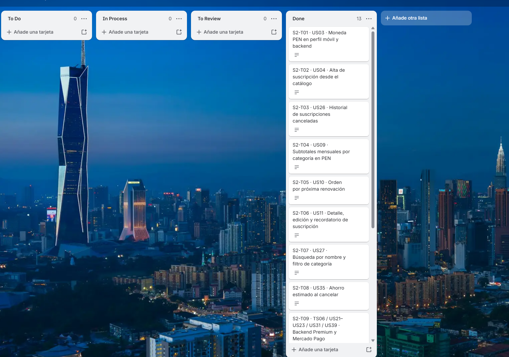

<!-- pdf:omit-start -->

*Figura TB2-1. Tablero del Sprint Backlog 2 de CraveWallet en Trello.*

<!-- pdf:omit-end -->

*Fuente: captura del tablero público de Trello del equipo Gastify.*

La tabla 163 detalla el control de estado de los elementos del Sprint Backlog 2, vinculando cada historia con sus tareas de ingeniería, responsable según la evidencia de commits y estado al cierre del sprint.

*Tabla 163. Sprint Backlog 2 y control de estado de tareas.*

| Sprint # | User Story Id | User Story Title | Task Id | Task Title | Description | Estimation (Hours) | Assigned To | Status |
| :---: | :---: | --- | :---: | --- | --- | :---: | --- | :---: |
| 2 | US03 | Configurar mi moneda de referencia | S2-T01 | Confirmación de moneda PEN en perfil móvil y backend | Exponer y consumir `GET` y `PATCH /api/v1/users/me` con `referenceCurrency = PEN` en Kotlin y Flutter, validando rechazo de monedas no soportadas. | 6 | Josué Carpio (`josf17`) / Alexander Aliaga (`AlexanderAliaga19`) | Done |
| 2 | US04 | Registrar una suscripción desde el catálogo precargado | S2-T02 | Alta de suscripción y sugerencias rápidas en interfaz móvil | Implementar el formulario de alta de suscripción con selección rápida e integración con `POST /api/v1/subscriptions` en Flutter y Kotlin. | 10 | Alexander Aliaga (`AlexanderAliaga19`) | Done |
| 2 | US26 | Ver el historial de suscripciones canceladas | S2-T03 | Filtro y vista de suscripciones en estado CANCELLED | Consumir `GET /api/v1/subscriptions?status=CANCELLED` y presentar la lista de bajas previas con su último monto en Flutter y Kotlin. | 6 | Alexander Aliaga (`AlexanderAliaga19`) | Done |
| 2 | US09 | Ver mis suscripciones agrupadas por categoría | S2-T04 | Cálculo de subtotales mensuales por categoría en PEN | Agregar `monthlyTotalsByCategory` en `GET /api/v1/subscriptions` (`8461f02`) y su visualización por rubro en las pantallas de Inicio y Análisis. | 10 | Josué Carpio (`josf17`) / Alexander Aliaga (`AlexanderAliaga19`) | Done |
| 2 | US10 | Ver mis suscripciones ordenadas por próxima fecha de renovación | S2-T05 | Ordenamiento ascendente por `nextBillingDate` | Ordenar las suscripciones activas por fecha de próximo cobro ascendente en el backend y en las vistas de portafolio y próximos cobros de Kotlin y Flutter. | 5 | Josué Carpio (`josf17`) / Alexander Aliaga (`AlexanderAliaga19`) | Done |
| 2 | US11 | Ver el detalle de una suscripción desde el Dashboard | S2-T06 | Vista de detalle, edición y recordatorio de suscripción | Conectar `GET /api/v1/subscriptions/{id}`, `PATCH /{id}` y `GET /{id}/reminder` con la pantalla de detalle de suscripción en Flutter y Kotlin. | 12 | Alexander Aliaga (`AlexanderAliaga19`) | Done |
| 2 | US27 | Buscar una suscripción por nombre en el Dashboard | S2-T07 | Buscador incremental por nombre y filtro de categoría | Integrar el parámetro `search` y `category` de `GET /api/v1/subscriptions` con la barra de búsqueda en la pantalla de Gastos en Flutter y Kotlin. | 7 | Alexander Aliaga (`AlexanderAliaga19`) | Done |
| 2 | US35 | Ver el ahorro estimado por cancelar una suscripción antes de su renovación | S2-T08 | Cálculo de `estimatedSavings` al cancelar una suscripción | Incorporar el objeto `estimatedSavings` (`amount`, `currency`, `amountPen`, `exchangeRate`) en `POST /api/v1/subscriptions/{id}/cancel` (`8461f02`) cuando la baja ocurre antes de la fecha de renovación en zona `America/Lima`. | 8 | Josué Carpio (`josf17`) | Done |
| 2 | TS06 / US21–US23 / US31 / US39 | Servicio de suscripción Premium, cupo del plan Free y pasarela Mercado Pago | S2-T09 | Dominio, persistencia V4–V5, adaptador Mercado Pago y webhook firmado | Implementar `PremiumMembership`, migraciones V4 y V5, límite de 5 suscripciones en plan Free (`d417efb`), `MercadoPagoPaymentAdapter`, `MercadoPagoWebhookSignature` y endpoints `/api/v1/premium/*`. | 32 | Josué Carpio (`josf17`) | Done |
| 2 | US18 / TS05 | Sugerencias de comercios de delivery con Google Places | S2-T10 | Adaptador ACL de Google Places Text Search y endpoint de sugerencias | Implementar `GooglePlacesAdapter` (`b152bf6`) y exponer `GET /api/v1/delivery-expenses/merchants/suggestions` (`f6f85d2`, `e0fd574`) con validación de longitud y autenticación JWT. | 10 | Josué Carpio (`josf17`) | Done |
| 2 | US21–US23 / US39 | Integración de CraveWallet Premium en aplicación Android nativa (Kotlin) | S2-T11 | Estado Premium, `PremiumSheet`, desbloqueo de Análisis y estado en Perfil en Kotlin | Actualizar `CraveWallet-Mobile` (rama `feature/premium`, PR #1 `c94e795`) con `PremiumStatus`, consumo de `/api/v1/premium/*`, hoja modal de pago con Mercado Pago y prueba de integración. | 16 | Josué Carpio (`josf17`) | Done |
| 2 | Transversal / US21–US23 / US31 | Aplicación móvil multiplataforma en Flutter e integración con Mercado Pago | S2-T12 | Migración a Flutter 3 y flujo completo de checkout, estado e historial Premium | Construir `CraveWallet-Flutter` (`853687c`, `d32ecc0`) con autenticación, suscripciones, delivery, `PremiumScreen`, apertura de checkout en Mercado Pago y suite `premium_flow_test.dart`. | 36 | Alexander Aliaga (`AlexanderAliaga19`) | Done |
| 2 | Transversal | Configuración de despliegue en Render y CORS para clientes web/móviles | S2-T13 | Blueprint `render.yaml`, CORS para Flutter Web y documentación de despliegue | Añadir `render.yaml` (`a7e1437`), soporte CORS para puertos locales de Flutter Web (`014c83d`) y guías técnicas en `docs/` del backend. | 8 | Josué Carpio (`josf17`) | Done |

*Fuente: elaboración del equipo Gastify a partir del Product Backlog y los commits de `CraveWallet-Backend`, `CraveWallet-Mobile` y `CraveWallet-Flutter`.*

#### 4.2.2.4. Development Evidence for Sprint Review

Durante el Sprint 2 el desarrollo abarcó tres repositorios de código productivo: la aplicación móvil nativa para Android en Kotlin y Jetpack Compose (`CraveWallet-Mobile`), la aplicación móvil multiplataforma en Dart y Flutter (`CraveWallet-Flutter`) y el backend de servicios RESTful en Java 21 y Spring Boot (`CraveWallet-Backend`). Disponer tanto de la implementación nativa en Kotlin como de la implementación multiplataforma en Flutter responde al alcance de ingeniería móvil del proyecto y se alinea con la literatura reciente sobre frameworks multiplataforma, que destaca a Flutter por su consistencia visual mediante motor de renderizado propio y su coexistencia con arquitecturas nativas orientadas a rendimiento y acceso directo a APIs del sistema [@jost2025crossplatform].

**Aplicación Android nativa (`CraveWallet-Mobile`, Kotlin y Jetpack Compose).** En la rama `feature/premium`, integrada a `develop` mediante el [PR #1 (`c94e795`)](https://github.com/1ACC0238-2620-4950-Gastify-CraveWallet/CraveWallet-Mobile/commit/c94e795), se completó la integración del módulo Premium de extremo a extremo con el backend. Se añadieron los modelos `PlanType`, `MembershipStatus`, `PremiumStatus` y `PremiumCheckoutSession` (`687b6cf`), las operaciones HTTP `getPremiumStatus`, `startPremiumCheckout` y `cancelPremium` en `ApiClient` (`6699ca1`) y su coordinación en `Repository` y `AppState` (`0b5d75f`, `cdd1905`). En la capa de interfaz se implementó el componente `PremiumSheet` (`982956f`), que presenta el detalle del plan de S/ 9.99/mes, abre el checkout alojado de Mercado Pago en el navegador del dispositivo, permite verificar el estado confirmado por el servidor y gestionar la cancelación al cierre del período; además, se conectó el bloqueo/desbloqueo de la pestaña `AnalysisScreen` (`359b035`, `3d40aa8`) y la visualización del estado de membresía en `ProfileScreen` (`ea4b12d`). Asimismo, se integró en `develop` la corrección del precio mensual a S/ 9.99 (`6f0ca26`).

**Aplicación móvil multiplataforma (`CraveWallet-Flutter`, Dart y Flutter 3).** El [commit de migración `853687c`](https://github.com/1ACC0238-2620-4950-Gastify-CraveWallet/CraveWallet-Flutter/commit/853687cd1e54466b6c39a84d114480441f0da725) incorporó la aplicación multiplataforma en Dart con Material 3 y la arquitectura de estado `CraveWalletController`. Los commits [`079f9ce`](https://github.com/1ACC0238-2620-4950-Gastify-CraveWallet/CraveWallet-Flutter/commit/079f9ce8504fa0fc86f0dad9b0c05355852a30d6) y [`ad7ace8`](https://github.com/1ACC0238-2620-4950-Gastify-CraveWallet/CraveWallet-Flutter/commit/ad7ace8de934938d79f8301e96c7c9656cd8b4e3) alinearon las dependencias de Material y `intl`, y el commit [`d32ecc0`](https://github.com/1ACC0238-2620-4950-Gastify-CraveWallet/CraveWallet-Flutter/commit/d32ecc0) (integrado en `develop` mediante el PR #1 `40ee310`) incorporó el flujo completo de CraveWallet Premium con Mercado Pago (`PremiumScreen`, validación de dominio de checkout, refresco automático al reanudar la aplicación con `WidgetsBindingObserver`, cancelación de renovación e historial de pagos). Los commits [`838b270`](https://github.com/1ACC0238-2620-4950-Gastify-CraveWallet/CraveWallet-Flutter/commit/838b270) y [`28cbe4d`](https://github.com/1ACC0238-2620-4950-Gastify-CraveWallet/CraveWallet-Flutter/commit/28cbe4d) incorporan la publicación reproducible de Flutter Web y su `base-href` configurable. La figura AV2-1 muestra el historial inicial de commits en la rama `develop` de `CraveWallet-Flutter`.

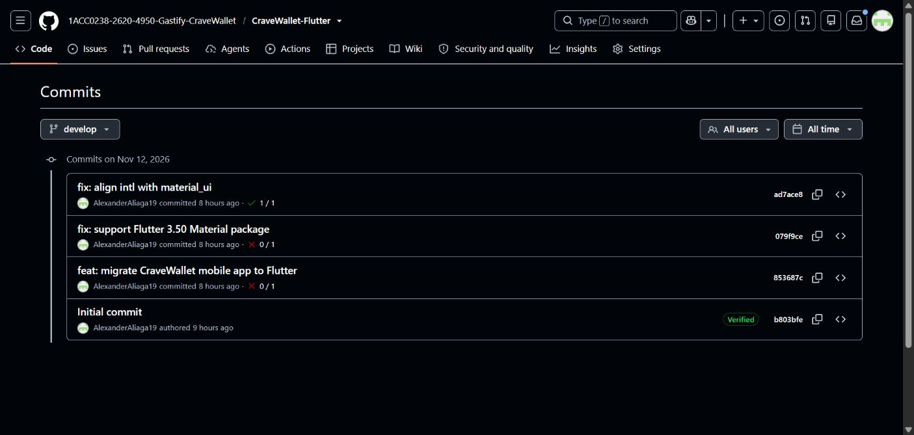

<!-- pdf:omit-start -->

*Figura AV2-1. Historial de commits de CraveWallet-Flutter en develop.*

<!-- pdf:omit-end -->

*Fuente: captura del [historial de Flutter en GitHub](https://github.com/1ACC0238-2620-4950-Gastify-CraveWallet/CraveWallet-Flutter/commits/develop/), 13 de noviembre de 2026.*

Los módulos implementados en `CraveWallet-Flutter` cubren los siguientes flujos:

- **Acceso y sesión:** registro e inicio de sesión por correo, rotación automática de JWT ante respuestas `401`, persistencia local en `shared_preferences` y modo demostración aislado cuando no hay sesión remota.
- **Inicio y suscripciones:** resumen mensual con conversión a PEN, alta por formulario, búsqueda incremental por nombre o categoría, orden por próximo cobro, vista de detalle, edición, cancelación y consulta de suscripciones canceladas.
- **Delivery:** formulario de registro de gasto con categoría y fecha, resumen mensual por categoría y semana, y edición del presupuesto mensual conectado al backend.
- **Análisis, Premium, perfil y recordatorios:** bloqueo de la vista de análisis para cuentas en plan `FREE` con redirección a `PremiumScreen`, mapa de calor de próximos cobros y desglose por categoría para cuentas `PREMIUM`, checkout con Mercado Pago mediante `url_launcher`, historial de cobros y configuración de recordatorios.

**Servicios RESTful (`CraveWallet-Backend`, Java 21 y Spring Boot 3).** En las ramas `feature/av2-premium-backend` y `feature/av2-mercadopago`, integradas en `develop` mediante el [PR #1 (`3a59d60`)](https://github.com/1ACC0238-2620-4950-Gastify-CraveWallet/CraveWallet-Backend/pull/1) y el [PR #2 (`a0aeabc`)](https://github.com/1ACC0238-2620-4950-Gastify-CraveWallet/CraveWallet-Backend/pull/2) junto con el ajuste `072be4d`, el backend incorporó:

1. **Bounded Context `Premium & Billing` y control de cupo por plan:** modelo de dominio (`PremiumMembership`, `MembershipStatus`, `PlanType`), migraciones Flyway `V4__add_premium_memberships.sql` y `V5__add_premium_billing.sql`, adaptador `PremiumPlanAccessAdapter` que impone el límite de 5 suscripciones activas en el plan `FREE` con bloqueo pesimista por usuario (`d417efb`), y los cinco endpoints bajo `/api/v1/premium`.
2. **Subtotales por categoría y ahorro estimado por cancelación (`US09`, `US35`):** extensión de `GET /api/v1/subscriptions` con el mapa `monthlyTotalsByCategory` en PEN y de `POST /api/v1/subscriptions/{id}/cancel` con el cálculo de `estimatedSavings` cuando la suscripción se cancela antes de su fecha de renovación en la zona horaria `America/Lima` (`8461f02`).
3. **Sugerencias de comercios con Google Places (`US18`, `TS05`):** puerto `MerchantSearchPort`, servicio `MerchantSearchService`, adaptador anticorrupción `GooglePlacesAdapter` hacia `https://places.googleapis.com/v1/places:searchText` (`b152bf6`) y endpoint protegido `GET /api/v1/delivery-expenses/merchants/suggestions` (`f6f85d2`, `e0fd574`).
4. **Seguridad y despliegue:** configuración de CORS para clientes Flutter Web locales (`014c83d`) y descriptor `render.yaml` para despliegue automatizado en Render (`a7e1437`).

La figura AV2-2 muestra el commit que incorpora el contrato del puerto de pago recurrente y la figura AV2-3 presenta el pull request de integración de Mercado Pago en el backend.

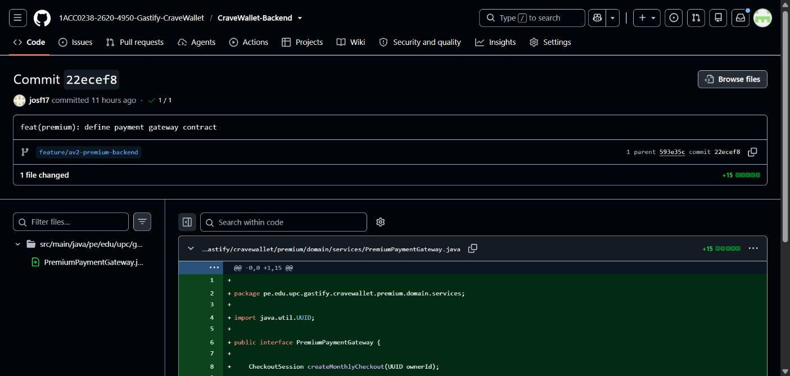

<!-- pdf:omit-start -->

*Figura AV2-2. Commit del contrato de checkout mensual de Premium.*

<!-- pdf:omit-end -->

*Fuente: captura del [commit 22ecef8 de CraveWallet-Backend](https://github.com/1ACC0238-2620-4950-Gastify-CraveWallet/CraveWallet-Backend/commit/22ecef8808a3bfc1bf103014e9ff4448c544c03a), 13 de noviembre de 2026.*

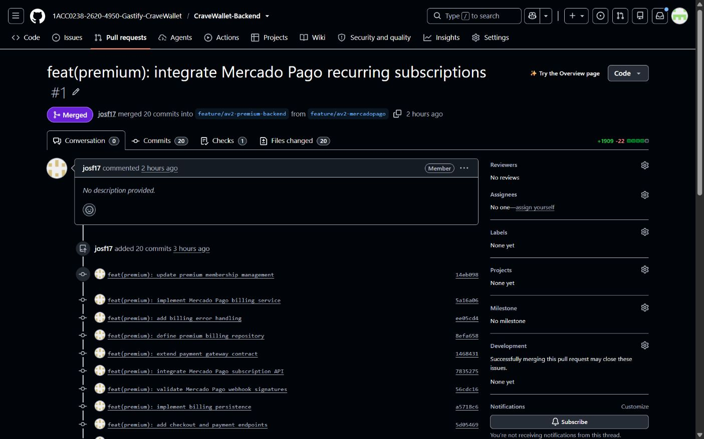

<!-- pdf:omit-start -->

*Figura AV2-3. Integración de Mercado Pago en el backend de AV2.*

<!-- pdf:omit-end -->

*Fuente: captura del [PR #1 de CraveWallet-Backend](https://github.com/1ACC0238-2620-4950-Gastify-CraveWallet/CraveWallet-Backend/pull/1), 13 de noviembre de 2026.*

##### Aprendizaje autónomo: Integración de pagos recurrentes con Mercado Pago Suscripciones

Como componente de aprendizaje autónomo del curso (vinculado al *Student Outcome 7* y a los spikes `SP05` y `SP06`), el equipo investigó e implementó la facturación recurrente del plan CraveWallet Premium utilizando la API de Suscripciones y Webhooks de Mercado Pago [@mercadoPagoSubscriptions; @mercadoPagoWebhooks]:

- **Justificación de la elección frente a Stripe:** durante AV1 y TB1 se modeló la integración con Stripe Billing. Al prototipar el flujo para el mercado peruano en el Sprint 2, el equipo verificó que Mercado Pago ofrece soporte nativo en Perú para cobros recurrentes directamente en soles peruanos (`PEN`, S/ 9.99 mensuales) mediante un checkout alojado (`init_point`), evitando recargos por conversión de divisa en las tarjetas locales de los dos segmentos objetivo.
- **Aspectos técnicos investigados y aprendidos:** el equipo estudió el ciclo de vida del recurso `preapproval` en Mercado Pago y la diferencia operativa entre suscripciones asociadas a un plan predefinido (`preapproval_plan_id`, que exigen enviar `card_token_id` en la creación) y suscripciones directas creadas en estado `pending` mediante `POST /preapproval` con `auto_recurring` (`frequency = 1`, `frequency_type = months`, `transaction_amount = 9.99`, `currency_id = PEN`), las cuales devuelven la URL `init_point` para que el usuario autorice el medio de pago en el entorno seguro del proveedor. Asimismo, se investigaron las particularidades del entorno de pruebas de Mercado Pago (cuentas de prueba vendedor/comprador y comportamiento del campo `live_mode` en notificaciones de suscripciones) y el esquema criptográfico de verificación de webhooks mediante el encabezado `x-signature` (`ts` y firma `v1` HMAC-SHA256 sobre el manifiesto `id:[data.id];request-id:[x-request-id];ts:[ts];`).
- **Aplicación en la arquitectura de CraveWallet:** para proteger el dominio conforme a la Estrategia 4 (sección 2.1.2) y el patrón *Anti-Corruption Layer* (sección 2.5.2), se definió el puerto `PremiumPaymentGateway` en la capa de dominio y se implementó en infraestructura mediante `MercadoPagoPaymentAdapter` y `MercadoPagoWebhookSignature`. El servicio `PremiumBillingService` y el repositorio transaccional `JdbcPremiumBillingRepository` aseguran que: (1) iniciar un checkout (`POST /api/v1/premium/checkout`) solo reserve o reutilice una sesión `PENDING` sin otorgar privilegios Premium; (2) el acceso `ACTIVE` solo se conceda cuando `POST /api/v1/premium/webhook` valide la firma HMAC-SHA256, consulte el pago/factura en la API de Mercado Pago y confirme que está aprobado por S/ 9.99 `PEN` y vinculado a una suscripción autorizada; y (3) las entregas repetidas o fuera de orden se dedupliquen mediante restricciones únicas sobre `external_id` e `invoice_id` en PostgreSQL/H2. Tanto en Kotlin (`CraveWallet-Mobile`) como en Flutter (`CraveWallet-Flutter`), el cliente móvil abre el `checkoutUrl` externo y consulta `GET /api/v1/premium/status` al retomar el foco para reflejar exclusivamente el estado confirmado por el servidor.

##### Registro de commits de desarrollo del Sprint 2

Las tablas 164, 165 y 166 registran todos los commits de implementación realizados durante el Sprint 2 (11 de octubre al 13 de noviembre de 2026) en `CraveWallet-Flutter`, `CraveWallet-Mobile` y `CraveWallet-Backend`, excluyendo los commits dedicados únicamente a pruebas automatizadas (que se listan en la sección 4.2.2.5). El repositorio `cravewallet-landing` mantiene en producción el corte publicado al cierre del Sprint 1 (último commit `634f5e7` del 9 de octubre de 2026).

*Tabla 164. Commits de desarrollo en CraveWallet-Flutter durante el Sprint 2.*

| Repository | Branch | Commit Id | Commit Message | Commit Message Body | Committed on (Date) |
| --- | --- | --- | --- | --- | --- |
| `CraveWallet-Flutter` | `main` | [`b803bfe`](https://github.com/1ACC0238-2620-4950-Gastify-CraveWallet/CraveWallet-Flutter/commit/b803bfe) | `Initial commit` | Sin cuerpo | 12/11/2026 |
| `CraveWallet-Flutter` | `develop` | [`853687c`](https://github.com/1ACC0238-2620-4950-Gastify-CraveWallet/CraveWallet-Flutter/commit/853687c) | `feat: migrate CraveWallet mobile app to Flutter` | Sin cuerpo | 12/11/2026 |
| `CraveWallet-Flutter` | `develop` | [`079f9ce`](https://github.com/1ACC0238-2620-4950-Gastify-CraveWallet/CraveWallet-Flutter/commit/079f9ce) | `fix: support Flutter 3.50 Material package` | Sin cuerpo | 12/11/2026 |
| `CraveWallet-Flutter` | `develop` | [`ad7ace8`](https://github.com/1ACC0238-2620-4950-Gastify-CraveWallet/CraveWallet-Flutter/commit/ad7ace8) | `fix: align intl with material_ui` | Sin cuerpo | 12/11/2026 |
| `CraveWallet-Flutter` | `feature/av2-premium-flutter` | [`d32ecc0`](https://github.com/1ACC0238-2620-4950-Gastify-CraveWallet/CraveWallet-Flutter/commit/d32ecc0) | `feat: integrate Premium and Mercado Pago in Flutter` | Sin cuerpo | 13/11/2026 |

*Fuente: historial Git del repositorio `CraveWallet-Flutter`.*

*Tabla 165. Commits de desarrollo en CraveWallet-Mobile (Kotlin) durante el Sprint 2.*

| Repository | Branch | Commit Id | Commit Message | Commit Message Body | Committed on (Date) |
| --- | --- | --- | --- | --- | --- |
| `CraveWallet-Mobile` | `feature/premium` | [`cdd1905`](https://github.com/1ACC0238-2620-4950-Gastify-CraveWallet/CraveWallet-Mobile/commit/cdd1905) | `feat(premium): integrate premium state management` | Sin cuerpo | 13/11/2026 |
| `CraveWallet-Mobile` | `feature/premium` | [`6699ca1`](https://github.com/1ACC0238-2620-4950-Gastify-CraveWallet/CraveWallet-Mobile/commit/6699ca1) | `feat(api): add premium backend endpoints` | Sin cuerpo | 13/11/2026 |
| `CraveWallet-Mobile` | `feature/premium` | [`687b6cf`](https://github.com/1ACC0238-2620-4950-Gastify-CraveWallet/CraveWallet-Mobile/commit/687b6cf) | `feat(models): add premium subscription models` | Sin cuerpo | 13/11/2026 |
| `CraveWallet-Mobile` | `feature/premium` | [`0b5d75f`](https://github.com/1ACC0238-2620-4950-Gastify-CraveWallet/CraveWallet-Mobile/commit/0b5d75f) | `feat(data): implement premium repository operations` | Sin cuerpo | 13/11/2026 |
| `CraveWallet-Mobile` | `feature/premium` | [`359b035`](https://github.com/1ACC0238-2620-4950-Gastify-CraveWallet/CraveWallet-Mobile/commit/359b035) | `feat(analysis): update premium analytics features` | Sin cuerpo | 13/11/2026 |
| `CraveWallet-Mobile` | `feature/premium` | [`3d40aa8`](https://github.com/1ACC0238-2620-4950-Gastify-CraveWallet/CraveWallet-Mobile/commit/3d40aa8) | `feat(ui): integrate premium navigation and access` | Sin cuerpo | 13/11/2026 |
| `CraveWallet-Mobile` | `feature/premium` | [`982956f`](https://github.com/1ACC0238-2620-4950-Gastify-CraveWallet/CraveWallet-Mobile/commit/982956f) | `feat(premium): implement premium subscription interface` | Sin cuerpo | 13/11/2026 |
| `CraveWallet-Mobile` | `feature/premium` | [`ea4b12d`](https://github.com/1ACC0238-2620-4950-Gastify-CraveWallet/CraveWallet-Mobile/commit/ea4b12d) | `feat(profile): display premium membership status` | Sin cuerpo | 13/11/2026 |

*Fuente: historial Git del repositorio `CraveWallet-Mobile`.*

*Tabla 166. Commits de desarrollo en CraveWallet-Backend durante el Sprint 2.*

| Repository | Branch | Commit Id | Commit Message | Commit Message Body | Committed on (Date) |
| --- | --- | --- | --- | --- | --- |
| `CraveWallet-Backend` | `feature/av2-premium-backend` | [`6501fbd`](https://github.com/1ACC0238-2620-4950-Gastify-CraveWallet/CraveWallet-Backend/commit/6501fbd) | `feat(premium): define membership lifecycle states` | Sin cuerpo | 12/11/2026 |
| `CraveWallet-Backend` | `feature/av2-premium-backend` | [`c7e6893`](https://github.com/1ACC0238-2620-4950-Gastify-CraveWallet/CraveWallet-Backend/commit/c7e6893) | `feat(premium): implement membership domain model` | Sin cuerpo | 12/11/2026 |
| `CraveWallet-Backend` | `feature/av2-premium-backend` | [`e622701`](https://github.com/1ACC0238-2620-4950-Gastify-CraveWallet/CraveWallet-Backend/commit/e622701) | `feat(database): add premium membership migration` | Sin cuerpo | 12/11/2026 |
| `CraveWallet-Backend` | `feature/av2-premium-backend` | [`e25b915`](https://github.com/1ACC0238-2620-4950-Gastify-CraveWallet/CraveWallet-Backend/commit/e25b915) | `feat(premium): add membership JPA entity` | Sin cuerpo | 12/11/2026 |
| `CraveWallet-Backend` | `feature/av2-premium-backend` | [`c7d4dcc`](https://github.com/1ACC0238-2620-4950-Gastify-CraveWallet/CraveWallet-Backend/commit/c7d4dcc) | `feat(premium): define membership repository contract` | Sin cuerpo | 12/11/2026 |
| `CraveWallet-Backend` | `feature/av2-premium-backend` | [`b3d095d`](https://github.com/1ACC0238-2620-4950-Gastify-CraveWallet/CraveWallet-Backend/commit/b3d095d) | `feat(premium): implement membership persistence` | Sin cuerpo | 12/11/2026 |
| `CraveWallet-Backend` | `feature/av2-premium-backend` | [`95fc3cf`](https://github.com/1ACC0238-2620-4950-Gastify-CraveWallet/CraveWallet-Backend/commit/95fc3cf) | `feat(premium): implement membership status service` | Sin cuerpo | 12/11/2026 |
| `CraveWallet-Backend` | `feature/av2-premium-backend` | [`0a09c26`](https://github.com/1ACC0238-2620-4950-Gastify-CraveWallet/CraveWallet-Backend/commit/0a09c26) | `feat(premium): expose membership status endpoint` | Sin cuerpo | 12/11/2026 |
| `CraveWallet-Backend` | `feature/av2-premium-backend` | [`b8c46bb`](https://github.com/1ACC0238-2620-4950-Gastify-CraveWallet/CraveWallet-Backend/commit/b8c46bb) | `feat(security): protect premium status endpoint` | Sin cuerpo | 12/11/2026 |
| `CraveWallet-Backend` | `feature/av2-premium-backend` | [`2d0c1a6`](https://github.com/1ACC0238-2620-4950-Gastify-CraveWallet/CraveWallet-Backend/commit/2d0c1a6) | `feat(subscriptions): define plan access contract` | Sin cuerpo | 12/11/2026 |
| `CraveWallet-Backend` | `feature/av2-premium-backend` | [`5a3c5f8`](https://github.com/1ACC0238-2620-4950-Gastify-CraveWallet/CraveWallet-Backend/commit/5a3c5f8) | `feat(premium): expose active membership access` | Sin cuerpo | 12/11/2026 |
| `CraveWallet-Backend` | `feature/av2-premium-backend` | [`d417efb`](https://github.com/1ACC0238-2620-4950-Gastify-CraveWallet/CraveWallet-Backend/commit/d417efb) | `feat(subscriptions): enforce plan-based registration limits` | Sin cuerpo | 12/11/2026 |
| `CraveWallet-Backend` | `feature/av2-premium-backend` | [`6bc89c1`](https://github.com/1ACC0238-2620-4950-Gastify-CraveWallet/CraveWallet-Backend/commit/6bc89c1) | `feat(delivery): add merchant suggestion domain model` | Sin cuerpo | 12/11/2026 |
| `CraveWallet-Backend` | `feature/av2-premium-backend` | [`593e35c`](https://github.com/1ACC0238-2620-4950-Gastify-CraveWallet/CraveWallet-Backend/commit/593e35c) | `feat(delivery): define merchant search port` | Sin cuerpo | 12/11/2026 |
| `CraveWallet-Backend` | `feature/av2-premium-backend` | [`22ecef8`](https://github.com/1ACC0238-2620-4950-Gastify-CraveWallet/CraveWallet-Backend/commit/22ecef8) | `feat(premium): define payment gateway contract` | Sin cuerpo | 12/11/2026 |
| `CraveWallet-Backend` | `feature/av2-premium-backend` | [`d3becd2`](https://github.com/1ACC0238-2620-4950-Gastify-CraveWallet/CraveWallet-Backend/commit/d3becd2) | `feat(delivery): implement merchant search application service` | Sin cuerpo | 12/11/2026 |
| `CraveWallet-Backend` | `feature/av2-premium-backend` | [`b152bf6`](https://github.com/1ACC0238-2620-4950-Gastify-CraveWallet/CraveWallet-Backend/commit/b152bf6) | `feat(delivery): implement Google Places search adapter` | Sin cuerpo | 12/11/2026 |
| `CraveWallet-Backend` | `feature/av2-premium-backend` | [`8461f02`](https://github.com/1ACC0238-2620-4950-Gastify-CraveWallet/CraveWallet-Backend/commit/8461f02) | `feat(subscriptions): add category totals and estimated cancellation savings` | Sin cuerpo | 12/11/2026 |
| `CraveWallet-Backend` | `feature/av2-mercadopago` | [`14eb098`](https://github.com/1ACC0238-2620-4950-Gastify-CraveWallet/CraveWallet-Backend/commit/14eb098) | `feat(premium): update premium membership management` | Sin cuerpo | 12/11/2026 |
| `CraveWallet-Backend` | `feature/av2-mercadopago` | [`5a16a06`](https://github.com/1ACC0238-2620-4950-Gastify-CraveWallet/CraveWallet-Backend/commit/5a16a06) | `feat(premium): implement Mercado Pago billing service` | Sin cuerpo | 12/11/2026 |
| `CraveWallet-Backend` | `feature/av2-mercadopago` | [`ee05cd4`](https://github.com/1ACC0238-2620-4950-Gastify-CraveWallet/CraveWallet-Backend/commit/ee05cd4) | `feat(premium): add billing error handling` | Sin cuerpo | 12/11/2026 |
| `CraveWallet-Backend` | `feature/av2-mercadopago` | [`8efa658`](https://github.com/1ACC0238-2620-4950-Gastify-CraveWallet/CraveWallet-Backend/commit/8efa658) | `feat(premium): define premium billing repository` | Sin cuerpo | 12/11/2026 |
| `CraveWallet-Backend` | `feature/av2-mercadopago` | [`1468431`](https://github.com/1ACC0238-2620-4950-Gastify-CraveWallet/CraveWallet-Backend/commit/1468431) | `feat(premium): extend payment gateway contract` | Sin cuerpo | 12/11/2026 |
| `CraveWallet-Backend` | `feature/av2-mercadopago` | [`7835275`](https://github.com/1ACC0238-2620-4950-Gastify-CraveWallet/CraveWallet-Backend/commit/7835275) | `feat(premium): integrate Mercado Pago subscription API` | Sin cuerpo | 12/11/2026 |
| `CraveWallet-Backend` | `feature/av2-mercadopago` | [`56cdc16`](https://github.com/1ACC0238-2620-4950-Gastify-CraveWallet/CraveWallet-Backend/commit/56cdc16) | `feat(premium): validate Mercado Pago webhook signatures` | Sin cuerpo | 12/11/2026 |
| `CraveWallet-Backend` | `feature/av2-mercadopago` | [`a5718c6`](https://github.com/1ACC0238-2620-4950-Gastify-CraveWallet/CraveWallet-Backend/commit/a5718c6) | `feat(premium): implement billing persistence` | Sin cuerpo | 12/11/2026 |
| `CraveWallet-Backend` | `feature/av2-mercadopago` | [`5d05469`](https://github.com/1ACC0238-2620-4950-Gastify-CraveWallet/CraveWallet-Backend/commit/5d05469) | `feat(premium): add checkout and payment endpoints` | Sin cuerpo | 12/11/2026 |
| `CraveWallet-Backend` | `feature/av2-mercadopago` | [`a5feb7a`](https://github.com/1ACC0238-2620-4950-Gastify-CraveWallet/CraveWallet-Backend/commit/a5feb7a) | `feat(premium): implement payment webhook endpoint` | Sin cuerpo | 12/11/2026 |
| `CraveWallet-Backend` | `feature/av2-mercadopago` | [`cee4ad0`](https://github.com/1ACC0238-2620-4950-Gastify-CraveWallet/CraveWallet-Backend/commit/cee4ad0) | `fix(security): configure premium webhook access` | Sin cuerpo | 12/11/2026 |
| `CraveWallet-Backend` | `feature/av2-mercadopago` | [`b6ccef5`](https://github.com/1ACC0238-2620-4950-Gastify-CraveWallet/CraveWallet-Backend/commit/b6ccef5) | `feat(premium): handle payment integration errors` | Sin cuerpo | 12/11/2026 |
| `CraveWallet-Backend` | `feature/av2-mercadopago` | [`1fa0158`](https://github.com/1ACC0238-2620-4950-Gastify-CraveWallet/CraveWallet-Backend/commit/1fa0158) | `feat(database): add premium billing migration` | Sin cuerpo | 12/11/2026 |
| `CraveWallet-Backend` | `feature/av2-mercadopago` | [`8522793`](https://github.com/1ACC0238-2620-4950-Gastify-CraveWallet/CraveWallet-Backend/commit/8522793) | `chore(config): enable persistent local database for premium testing` | Sin cuerpo | 12/11/2026 |
| `CraveWallet-Backend` | `feature/av2-premium-backend` | [`a7e1437`](https://github.com/1ACC0238-2620-4950-Gastify-CraveWallet/CraveWallet-Backend/commit/a7e1437) | `chore(deploy): configure Render deployment` | Sin cuerpo | 13/11/2026 |
| `CraveWallet-Backend` | `feature/av2-premium-backend` | [`f6f85d2`](https://github.com/1ACC0238-2620-4950-Gastify-CraveWallet/CraveWallet-Backend/commit/f6f85d2) | `feat(delivery): add merchant suggestions endpoint` | Sin cuerpo | 13/11/2026 |
| `CraveWallet-Backend` | `feature/av2-premium-backend` | [`e0fd574`](https://github.com/1ACC0238-2620-4950-Gastify-CraveWallet/CraveWallet-Backend/commit/e0fd574) | `fix(security): secure merchant suggestions endpoint` | Sin cuerpo | 13/11/2026 |
| `CraveWallet-Backend` | `feature/av2-premium-backend` | [`014c83d`](https://github.com/1ACC0238-2620-4950-Gastify-CraveWallet/CraveWallet-Backend/commit/014c83d) | `fix(security): configure CORS for Flutter Web` | Sin cuerpo | 13/11/2026 |
| `CraveWallet-Backend` | `develop` | [`072be4d`](https://github.com/1ACC0238-2620-4950-Gastify-CraveWallet/CraveWallet-Backend/commit/072be4d) | `fix(premium): bug after you cancelled` | Sin cuerpo | 13/11/2026 |

*Fuente: historial Git del repositorio `CraveWallet-Backend`.*

#### 4.2.2.5. Testing Suite Evidence for Sprint Review

Estudios empíricos sobre proyectos Android demuestran que la ausencia de pruebas automatizadas sobre flujos asíncronos, red y estados de interfaz es una de las principales causas de regresiones en aplicaciones móviles [@mahmud2025android]. Por ello, durante el Sprint 2 el equipo amplió la suite de pruebas automatizadas tanto en el backend (`CraveWallet-Backend`, pasando de 32 pruebas en TB1 a **72 pruebas** en 13 clases de prueba sobre `develop`) como en las dos aplicaciones móviles: **10 pruebas** en `CraveWallet-Mobile` (Kotlin) y **8 pruebas** en `CraveWallet-Flutter` (Dart/Flutter).

El [repositorio Flutter](https://github.com/1ACC0238-2620-4950-Gastify-CraveWallet/CraveWallet-Flutter/tree/28cbe4d64422857319148338ed45431140bbe688) versiona ocho pruebas. Dos cubren la normalización mensual y el mapeo REST de suscripciones; seis cubren el ciclo Pending/Active de Premium, cancelación, historial, compatibilidad con un backend anterior, rechazo de un checkout ajeno a Mercado Pago y los estados visuales Free/Premium. La ejecución local del 13 de noviembre terminó con `flutter analyze` sin observaciones y las ocho pruebas correctas. El workflow de publicación repite análisis y pruebas antes de compilar la versión web. La rama de backend versiona pruebas para estado Premium, autenticación, límite por plan, totales por categoría, ahorro estimado y CORS.

La figura AV2-4 muestra la ejecución satisfactoria del workflow `Flutter CI` (`flutter pub get`, `flutter analyze` y `flutter test`) en GitHub Actions, y la figura AV2-5 muestra la ejecución satisfactoria de `Backend build` (`mvnw -B verify`) en GitHub Actions.

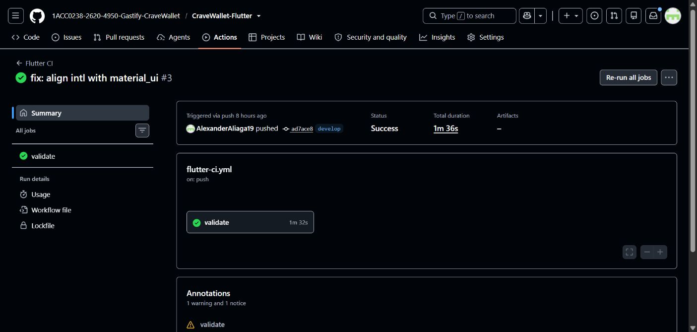

<!-- pdf:omit-start -->

*Figura AV2-4. Flutter CI finalizado con éxito para el commit ad7ace8.*

<!-- pdf:omit-end -->

*Fuente: captura de [Flutter CI, ejecución 43304678864](https://github.com/1ACC0238-2620-4950-Gastify-CraveWallet/CraveWallet-Flutter/actions/runs/43304678864), 13 de noviembre de 2026.*

La figura AV2-5 registra la primera validación del incremento. Además, [`Backend build` 43548940361](https://github.com/1ACC0238-2620-4950-Gastify-CraveWallet/CraveWallet-Backend/actions/runs/43548940361) completó correctamente `mvnw -B verify` para `5575bca`. La suite de Premium usa H2, MockMvc y respuestas simuladas del proveedor para cubrir el ciclo de cobro recurrente; el nuevo caso verifica el preflight desde el origen de GitHub Pages. La evidencia de un pago de extremo a extremo en el entorno de prueba de Mercado Pago sigue pendiente.

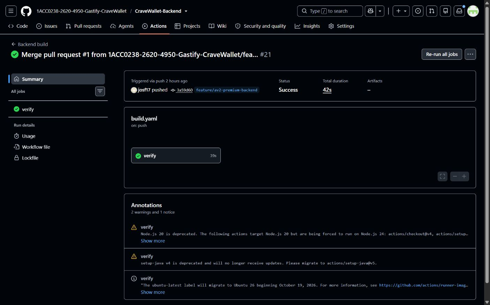

<!-- pdf:omit-start -->

*Figura AV2-5. Backend build finalizado con éxito para el commit 3a59d60.*

<!-- pdf:omit-end -->

*Fuente: captura de [Backend build, ejecución 43355415595](https://github.com/1ACC0238-2620-4950-Gastify-CraveWallet/CraveWallet-Backend/actions/runs/43355415595), 13 de noviembre de 2026.*

La tabla 167 detalla las 13 clases de prueba del backend en `src/test/java/pe/edu/upc/gastify/cravewallet/` y los comportamientos verificados en cada una.

*Tabla 167. Suite de pruebas automatizadas del backend en el Sprint 2.*

| Clase de prueba | Casos | Comportamientos verificados |
| --- | :---: | --- |
| `AuthIntegrationTest` | 9 | Registro normalizado, rechazo de correo duplicado e inválido, opacidad de error en login, inicio en plan `FREE` (`GET /api/v1/premium/status`), rotación y revocación de `refreshToken`, actualización de moneda `PEN` (`US03`), rechazo de JWT manipulado/expirado y serialización de refresh concurrente. |
| `BackendBootstrapTest` | 4 | Respuesta a preflight CORS desde puertos locales de Flutter Web, disponibilidad pública de `/actuator/health`, exposición de rutas de autenticación en OpenAPI y protección `401` de rutas de negocio sin token. |
| `SubscriptionIntegrationTest` | 7 | Aislamiento por propietario, edición/cancelación/historial (`US26`) y liberación de cupo en plan `FREE`, validación de solicitudes vacías o inválidas, cálculo de subtotales `monthlyTotalsByCategory` (`US09`) y `estimatedSavings` al cancelar (`US35`), recordatorio 24 horas antes (`US12`), endpoint de tipo de cambio y bloqueo concurrente del límite de 5 suscripciones en plan `FREE` (`US39`). |
| `DeliveryIntegrationTest` | 7 | Autenticación y validación de longitud en búsqueda de comercios, traducción de sugerencias de Google Places y manejo de error `503` (`US18`), resumen mensual y límites de período, idempotencia por `requestId` y conflicto `409`, aislamiento por usuario, validación de entradas y acumulación bajo escrituras simultáneas. |
| `ExchangeRateServiceTest` | 5 | Reutilización de caché de 24 horas, respaldo (*fallback*) de hasta 7 días ante caída del proveedor, error `503` sin caché e identidad `1.0` para monedas iguales, rechazo de marcas de tiempo inválidas y deduplicación de consultas concurrentes. |
| `OpenExchangeRateAdapterTest` | 2 | Traducción del JSON de ExchangeRate-API al modelo de dominio y rechazo controlado de respuestas HTTP de error, `429` o JSON malformado. |
| `PortfolioConversionTest` | 5 | Normalización de suscripciones anuales en USD a costo mensual en PEN antes de redondear, preservación del portafolio sin tasa disponible, cálculo del ahorro anual completo en `estimatedSavings` antes de la fecha de renovación en Lima (`US35`), ahorro en moneda original sin tasa y ahorro nulo cuando se cancela en la fecha de cobro o después. |
| `PremiumIntegrationTest` | 2 | Rechazo `401` a consultas anónimas en `/api/v1/premium/status` y estado inicial `FREE` (`monthlyPrice = 9.99`, `currency = PEN`) para cuentas nuevas. |
| `PremiumPlanAccessIntegrationTest` | 2 | Permiso para registrar una sexta suscripción activa cuando la membresía Premium está `ACTIVE` y bloqueo `409` al sexto registro cuando la membresía ha expirado (`EXPIRED`). |
| `PremiumBillingIntegrationTest` | 16 | Autenticación y reutilización de checkout `PENDING`, protección ante resultados inciertos del proveedor, bloqueo de concurrencia en creación de checkout, recuperación por `external_reference`, rechazo de firmas HMAC-SHA256 inválidas, expiradas o con cuerpo alterado, validación de `data.id` y `ts` en milisegundos, activación e historial de pagos ante cobro aprobado, rechazo de pagos pendientes/rechazados/con monto o moneda distintos o sin suscripción autorizada, prevención de apropiación cruzada de suscripciones, idempotencia ante pagos fuera de orden, conservación de vigencia hasta `periodEndsAt` tras cancelar (`US23`) y creación de nueva sesión tras cancelar un checkout pendiente. |
| `PremiumPaymentModeTest` | 3 | Activación cuando `live_mode` coincide con el modo esperado, reprocesamiento idempotente de entregas previas y rechazo cuando `live_mode` no coincide o está ausente. |
| `MercadoPagoPaymentAdapterTest` | 9 | Creación de suscripción alojada con términos fijos (`S/ 9.99 PEN`) y lectura de `init_point`, ordenamiento por fecha de modificación en búsquedas de recuperación, registro diagnóstico seguro ante rechazos HTTP o no-JSON, consulta separada de facturas (`authorized_payments`) y pagos (`/v1/payments`), coincidencia exacta de `external_reference`, cancelación remota y manejo de credenciales ausentes. |
| `ProductionDocumentationTest` | 1 | Exposición pública de Swagger UI y OpenAPI en el perfil `prod` manteniendo protegidos con JWT los endpoints de perfil y sugerencias de comercios. |

*Fuente: código fuente de pruebas en `CraveWallet-Backend` (`src/test/java/pe/edu/upc/gastify/cravewallet/`).*

La tabla 168 resume las pruebas automatizadas ejecutadas en las dos aplicaciones móviles (`CraveWallet-Mobile` en Kotlin y `CraveWallet-Flutter` en Dart/Flutter).

*Tabla 168. Suite de pruebas automatizadas de las aplicaciones móviles (Kotlin y Flutter) en el Sprint 2.*

| Repositorio | Archivo / Clase de prueba | Casos | Comportamientos verificados |
| --- | --- | :---: | --- |
| `CraveWallet-Mobile` (Kotlin) | `BackendIntegrationTest.kt` | 9 | Escritura JSON y manejo de conflictos, rotación de `refreshToken` bajo concurrencia, recorrido completo contra el backend, portafolio vacío sin datos demo para cuentas reales, sesión persistida y logout, manejo de cotización no disponible, reintento automático tras `401`, limpieza de sesión inválida y **`premiumCheckoutKeepsAccessLockedUntilTheServerConfirmsPayment`** (verifica `503` sin configurar, creación de checkout en `/api/v1/premium/checkout`, mantenimiento del plan `FREE` mientras el estado es `PENDING` y desbloqueo de `PREMIUM` a S/ 9.99 solo tras confirmación del servidor). |
| `CraveWallet-Mobile` (Kotlin) | `AppConnectionUiTest.kt` | 1 | Prueba instrumentada de interfaz en Jetpack Compose para inicio y cierre de sesión contra el servidor. |
| `CraveWallet-Flutter` (Dart) | `test/models_test.dart` | 2 | Normalización a costo mensual en PEN de una suscripción anual en USD (`Subscription.monthlyAmountInPen`) y deserialización de `Subscription.fromApi` desde el contrato REST. |
| `CraveWallet-Flutter` (Dart) | `test/premium_flow_test.dart` | 6 | (1) El checkout mantiene el plan en `FREE` mientras el estado es `PENDING` y activa `PREMIUM` solo cuando el backend confirma `ACTIVE`; (2) `cancelPremium` conserva acceso hasta `periodEndsAt` y carga el historial de pagos; (3) una respuesta `404` en endpoints de Premium preserva la sesión autenticada y muestra mensaje de respaldo; (4) el controlador rechaza URLs de checkout fuera de los dominios de Mercado Pago; (5) prueba de widgets que verifica que la pestaña `Análisis` muestra el bloqueo `Ver Premium` en cuentas gratuitas y navega a `CraveWallet Premium`; (6) prueba de widgets que verifica que la pestaña `Análisis` despliega el `Mapa de calor de próximos cobros` cuando el usuario es `PREMIUM`. |

*Fuente: archivos de prueba en `CraveWallet-Mobile` y `CraveWallet-Flutter`.*

##### Especificaciones de aceptación en Gherkin (`.feature`) del Sprint 2

A continuación se presentan las especificaciones de aceptación en sintaxis Gherkin correspondientes a las historias de usuario del Sprint 2 (`US03`, `US04`, `US26`, `US09`, `US10`, `US11`, `US27`, `US35` y `US22`), derivadas directamente de los criterios de aceptación de la sección 2.4.1 y verificadas por las suites de las tablas 167 y 168:

```gherkin
# language: es
Característica: Configuración de perfil y portafolio de suscripciones en el Sprint 2

  Escenario: US03 - Confirmación por defecto de la moneda de referencia en soles
    Dado que el usuario completa su perfil por primera vez
    Cuando consulta o confirma su moneda de referencia en "/api/v1/users/me"
    Entonces el sistema muestra el sol peruano ("PEN") preseleccionado y permite confirmarlo

  Escenario: US04 - Selección y registro de una suscripción desde el catálogo precargado
    Dado que el usuario abre el catálogo precargado en la aplicación móvil
    Cuando selecciona un servicio como Spotify o Netflix e ingresa el monto y la fecha de su próximo cobro
    Entonces el sistema registra la suscripción con el nombre y la moneda de facturación definidos

  Escenario: US26 - Consulta del historial de suscripciones canceladas
    Dado que el usuario tiene al menos una suscripción en estado "CANCELLED"
    Cuando abre la sección de suscripciones canceladas
    Entonces el sistema lista cada suscripción cancelada con la fecha de cancelación y su último monto registrado

  Escenario: US09 - Agrupación de suscripciones activas por categoría con subtotales en soles
    Dado que el usuario tiene suscripciones activas en más de una categoría
    Cuando consulta el portafolio en el Dashboard o en la vista de Análisis
    Entonces el sistema agrupa las suscripciones por categoría y expone en "monthlyTotalsByCategory" el subtotal mensual en soles de cada grupo

  Escenario: US10 - Orden ascendente de suscripciones activas por próxima fecha de renovación
    Dado que el usuario tiene varias suscripciones activas con distintas fechas de cobro
    Cuando abre el Dashboard en la vista de próximos cobros
    Entonces el sistema las lista en orden ascendente según "nextBillingDate"

  Escenario: US11 - Apertura del detalle de una suscripción desde el Dashboard
    Dado que el usuario está en el Dashboard
    Cuando selecciona una suscripción de la lista
    Entonces el sistema abre su vista de detalle con el monto original, la moneda, el equivalente en soles, la categoría y la fecha de renovación

  Escenario: US27 - Búsqueda de suscripción por nombre en el Dashboard con y sin coincidencias
    Dado que el usuario tiene varias suscripciones activas registradas
    Cuando escribe parte del nombre en el buscador del Dashboard
    Entonces el sistema filtra la lista mostrando las coincidencias o informa que no se encontraron resultados si ninguna coincide

  Escenario: US35 - Visualización del ahorro estimado al cancelar una suscripción antes de su renovación
    Dado que el usuario cancela una suscripción activa antes de su próxima fecha de cobro en Lima
    Cuando confirma la cancelación en "POST /api/v1/subscriptions/{id}/cancel"
    Entonces el sistema devuelve en "estimatedSavings" el ahorro potencial estimado del ciclo en moneda original y en soles

  Escenario: US22 - Suscripción al plan CraveWallet Premium mediante Mercado Pago
    Dado que el usuario autenticado en el plan "FREE" inicia el checkout en "POST /api/v1/premium/checkout"
    Cuando completa el pago en Mercado Pago y el backend verifica la notificación firmada en "POST /api/v1/premium/webhook"
    Entonces el sistema cambia el estado de la membresía a "ACTIVE", habilita el plan "PREMIUM" y elimina el límite de cinco suscripciones
```

La tabla 169 enumera los commits específicos de pruebas automatizadas registrados durante el Sprint 2.

*Tabla 169. Commits de pruebas automatizadas en el Sprint 2.*

| Repository | Branch | Commit Id | Commit Message | Commit Message Body | Committed on (Date) |
| --- | --- | --- | --- | --- | --- |
| `CraveWallet-Backend` | `feature/av2-premium-backend` | [`a345595`](https://github.com/1ACC0238-2620-4950-Gastify-CraveWallet/CraveWallet-Backend/commit/a345595) | `test(premium): verify free membership status and authentication` | Sin cuerpo | 12/11/2026 |
| `CraveWallet-Backend` | `feature/av2-premium-backend` | [`d534b8a`](https://github.com/1ACC0238-2620-4950-Gastify-CraveWallet/CraveWallet-Backend/commit/d534b8a) | `test(premium): verify plan-based subscription limits` | Sin cuerpo | 12/11/2026 |
| `CraveWallet-Backend` | `feature/av2-premium-backend` | [`7285ed5`](https://github.com/1ACC0238-2620-4950-Gastify-CraveWallet/CraveWallet-Backend/commit/7285ed5) | `test(subscriptions): verify category totals and currency conversion` | Sin cuerpo | 12/11/2026 |
| `CraveWallet-Backend` | `feature/av2-premium-backend` | [`a8264f0`](https://github.com/1ACC0238-2620-4950-Gastify-CraveWallet/CraveWallet-Backend/commit/a8264f0) | `test(subscriptions): verify estimated savings on cancellation` | Sin cuerpo | 12/11/2026 |
| `CraveWallet-Backend` | `feature/av2-mercadopago` | [`5f581f9`](https://github.com/1ACC0238-2620-4950-Gastify-CraveWallet/CraveWallet-Backend/commit/5f581f9) | `test(auth): validate authentication flow` | Sin cuerpo | 12/11/2026 |
| `CraveWallet-Backend` | `feature/av2-mercadopago` | [`ebf8146`](https://github.com/1ACC0238-2620-4950-Gastify-CraveWallet/CraveWallet-Backend/commit/ebf8146) | `test(premium): validate payment modes` | Sin cuerpo | 12/11/2026 |
| `CraveWallet-Backend` | `feature/av2-mercadopago` | [`d17b5c9`](https://github.com/1ACC0238-2620-4950-Gastify-CraveWallet/CraveWallet-Backend/commit/d17b5c9) | `test(premium): cover Mercado Pago API integration` | Sin cuerpo | 12/11/2026 |
| `CraveWallet-Backend` | `feature/av2-mercadopago` | [`80e55b0`](https://github.com/1ACC0238-2620-4950-Gastify-CraveWallet/CraveWallet-Backend/commit/80e55b0) | `test(premium): validate recurring payment lifecycle` | Sin cuerpo | 12/11/2026 |
| `CraveWallet-Backend` | `feature/av2-mercadopago` | [`90ccaa1`](https://github.com/1ACC0238-2620-4950-Gastify-CraveWallet/CraveWallet-Backend/commit/90ccaa1) | `test(config): add isolated H2 configuration for integration tests` | Sin cuerpo | 12/11/2026 |
| `CraveWallet-Backend` | `feature/av2-premium-backend` | [`9d9065f`](https://github.com/1ACC0238-2620-4950-Gastify-CraveWallet/CraveWallet-Backend/commit/9d9065f) | `test(delivery): cover merchant search functionality` | Sin cuerpo | 13/11/2026 |
| `CraveWallet-Backend` | `feature/av2-premium-backend` | [`6e80537`](https://github.com/1ACC0238-2620-4950-Gastify-CraveWallet/CraveWallet-Backend/commit/6e80537) | `test(docs): validate production API endpoints` | Sin cuerpo | 13/11/2026 |
| `CraveWallet-Backend` | `feature/av2-premium-backend` | [`299c800`](https://github.com/1ACC0238-2620-4950-Gastify-CraveWallet/CraveWallet-Backend/commit/299c800) | `test(security): validate backend CORS configuration` | Sin cuerpo | 13/11/2026 |
| `CraveWallet-Mobile` | `feature/premium` | [`3536360`](https://github.com/1ACC0238-2620-4950-Gastify-CraveWallet/CraveWallet-Mobile/commit/3536360) | `test(api): validate premium backend integration` | Sin cuerpo | 13/11/2026 |
| `CraveWallet-Flutter` | `develop` | [`853687c`](https://github.com/1ACC0238-2620-4950-Gastify-CraveWallet/CraveWallet-Flutter/commit/853687c) | `feat: migrate CraveWallet mobile app to Flutter` (incluye `test/models_test.dart`) | Sin cuerpo | 12/11/2026 |
| `CraveWallet-Flutter` | `feature/av2-premium-flutter` | [`d32ecc0`](https://github.com/1ACC0238-2620-4950-Gastify-CraveWallet/CraveWallet-Flutter/commit/d32ecc0) | `feat: integrate Premium and Mercado Pago in Flutter` (incluye `test/premium_flow_test.dart`) | Sin cuerpo | 13/11/2026 |

*Fuente: historial Git de `CraveWallet-Backend`, `CraveWallet-Mobile` y `CraveWallet-Flutter`.*

#### 4.2.2.6. Execution Evidence for Sprint Review

Ambas aplicaciones móviles (`CraveWallet-Flutter` y `CraveWallet-Mobile` en Kotlin) permiten recorrer los flujos principales de la solución conectadas al backend RESTful y disponen además de un modo de demostración con datos locales cuando no se ha iniciado sesión contra el servidor. La tabla 170 sintetiza las pantallas y flujos alcanzables desde la navegación principal en ambas implementaciones según el código versionado en `develop`.

El recorrido de revisión comienza en Flutter Web, Android o iOS. El usuario se registra o inicia sesión; el backend emite access y refresh tokens y deriva el propietario de cada operación desde el JWT. Luego registra una suscripción en dólares, consulta su importe mensual en soles, registra un gasto de delivery y revisa el presupuesto mensual. Esos datos se escriben en PostgreSQL mediante Spring Data/JDBC y nunca se conectan directamente desde Flutter.

En Premium, Flutter consulta primero `GET /api/v1/premium/status`. `POST /checkout` crea una operación pendiente y devuelve una URL alojada por Mercado Pago. El cliente no activa beneficios después de abrir esa URL: al regresar vuelve a consultar el estado. El backend verifica proveedor, propietario, importe, moneda y modo antes de persistir una membresía activa; recién entonces Flutter habilita el análisis y elimina el límite Free. El modo demostración permite recorrer las pantallas con datos locales, pero no constituye evidencia de persistencia remota ni de pago.

*Tabla 170. Pantallas y flujos de ejecución verificables en CraveWallet-Flutter y CraveWallet-Mobile.*

| Pantalla / Flujo | Implementación en `CraveWallet-Flutter` (`lib/src/app.dart`) | Implementación en `CraveWallet-Mobile` (`ui/Screens.kt`, `PremiumSheet.kt`) | Endpoints REST consumidos |
| --- | --- | --- | --- |
| **1. Acceso (Login / Registro)** | `LoginScreen`: pestañas `Iniciar sesión` y `Crear cuenta`, validación de correo/contraseña y acceso opcional al modo demo. | `LoginScreen`: formulario en Jetpack Compose con alternancia entre login y registro y persistencia en `SharedPreferences`. | `POST /api/v1/auth/register`, `POST /api/v1/auth/login`, `GET /api/v1/users/me` |
| **2. Inicio (Dashboard)** | `HomeScreen`: total mensual consolidado en PEN, contador de cupo (`X/5` en plan `FREE`), próximos cobros ordenados ascendentemente y resumen rápido de delivery. | `HomeScreen`: tarjeta principal en PEN, alerta del límite del plan gratuito, lista de próximas renovaciones y acceso al alta. | `GET /api/v1/subscriptions`, `GET /api/v1/delivery-expenses/summary`, `GET /api/v1/premium/status` |
| **3. Alta de suscripción** | `AddSubscriptionScreen`: selección rápida o manual de nombre, monto, moneda (`PEN`/`USD`), ciclo (`MONTHLY`/`ANNUAL`), categoría y fecha de próximo cobro; redirige a `PremiumScreen` si se alcanza el cupo `5/5`. | `AddSubscriptionScreen`: formulario de 3 pasos con previsualización en soles y apertura automática de `PremiumSheet` ante respuesta HTTP `409` por límite del plan gratuito. | `POST /api/v1/subscriptions`, `GET /api/v1/exchange-rate` |
| **4. Gastos, búsqueda y detalle** | `ExpensesScreen` y `SubscriptionDetailScreen`: buscador por nombre/categoría (`US27`), filtro por categoría, vista de detalle (`US11`), edición, cancelación y lista de suscripciones canceladas (`US26`). | `ExpensesScreen` y `SubscriptionDetailScreen`: barra de búsqueda incremental, chips de categoría, detalle con conversión USD/PEN, cancelación y consulta de bajas. | `GET /api/v1/subscriptions`, `GET /api/v1/subscriptions/{id}`, `PATCH /api/v1/subscriptions/{id}`, `POST /api/v1/subscriptions/{id}/cancel` |
| **5. Delivery y presupuesto mensual** | `DeliveryScreen`: formulario de gasto con comercio, monto en PEN, categoría y fecha; tarjeta de presupuesto mensual (`US38`) y desglose por categoría y semana. | `DeliveryScreen`: registro idempotente por `requestId`, edición de tope mensual y barra de progreso del presupuesto del mes. | `POST /api/v1/delivery-expenses`, `GET /api/v1/delivery-expenses/summary`, `PUT /api/v1/delivery-expenses/budget`, `GET /api/v1/delivery-expenses/merchants/suggestions` |
| **6. Análisis por categoría y mapa de calor** | `AnalysisScreen`: vista bloqueada con CTA `Ver Premium` para usuarios `FREE`; al estar `ACTIVE` en `PREMIUM`, despliega el `Mapa de calor de próximos cobros` y la distribución por categoría (`US09`). | `AnalysisScreen`: paywall conectado a `PremiumSheet` en cuentas gratuitas y visualización desbloqueada de distribución por rubro y calendario de cobros en cuentas `PREMIUM`. | `GET /api/v1/subscriptions`, `GET /api/v1/premium/status` |
| **7. Checkout y gestión de CraveWallet Premium** | `PremiumScreen`: detalle del plan de S/ 9.99/mes (`US21`), botón `Ir a Mercado Pago` (`US22`), verificación de estado (`Actualizar estado`), cancelación al fin del período (`US23`) e historial de pagos (`US31`). | `PremiumSheet`: hoja modal en Material 3 con comparativa de beneficios, lanzamiento de `checkoutUrl` de Mercado Pago, refresco de vigencia y botón de cancelación. | `GET /api/v1/premium/status`, `POST /api/v1/premium/checkout`, `POST /api/v1/premium/cancel`, `GET /api/v1/premium/payments` |
| **8. Perfil y recordatorios** | `ProfileScreen` y `RemindersScreen`: correo autenticado, moneda de referencia `PEN` (`US03`), insignia del plan (`FREE`/`PREMIUM`), configuración de anticipación de recordatorios y cierre de sesión (`US33`). | `ProfileScreen` y `RemindersScreen`: estado de membresía y fecha `periodEndsAt`, ajustes de recordatorio 24 h antes y botón de cierre de sesión. | `GET /api/v1/users/me`, `PATCH /api/v1/users/me`, `GET /api/v1/subscriptions/{id}/reminder`, `POST /api/v1/auth/logout` |

*Fuente: inspección del código fuente en `CraveWallet-Flutter` (`lib/src/app.dart`) y `CraveWallet-Mobile` (`app/src/main/java/com/gastify/cravewallet/ui/`).*

**[COMPLETAR: insertar capturas de pantalla de la ejecución en CraveWallet-Flutter y CraveWallet-Mobile (Kotlin) para las ocho vistas de la tabla 170: (1) Login/Registro, (2) Inicio/Dashboard, (3) Alta de suscripción, (4) Gastos y Detalle con ahorro estimado, (5) Delivery y presupuesto mensual, (6) Análisis por categoría y mapa de calor, (7) Checkout Premium con Mercado Pago y (8) Perfil y estado de membresía]**

**Enlace al video de demostración de visualización y navegación del Sprint 2:** **[COMPLETAR: insertar URL pública (YouTube / OneDrive) del video de ejecución y navegación de las aplicaciones móviles del Sprint 2]**

#### 4.2.2.7. Services Documentation Evidence for Sprint Review

En el corte de AV2 (`origin/develop`), el backend en `CraveWallet-Backend` expone y documenta mediante OpenAPI 3 / Swagger UI un total de **22 endpoints REST** (`16` operaciones del corte TB1 más `6` operaciones nuevas incorporadas en el Sprint 2: cinco en `/api/v1/premium` y una en `/api/v1/delivery-expenses/merchants/suggestions`), cubriendo el **100 % (22 / 22)** del inventario de servicios del proyecto.

El [cliente REST de Flutter](https://github.com/1ACC0238-2620-4950-Gastify-CraveWallet/CraveWallet-Flutter/blob/28cbe4d64422857319148338ed45431140bbe688/lib/src/api_client.dart) permite configurar `API_BASE_URL`. Sus servicios cubren autenticación, perfil, suscripciones, gastos de delivery y Premium, conservan la renovación de JWT y envuelven respuestas de colección para mantener una forma interna consistente. El despliegue de referencia publicó la [documentación Swagger](https://cravewallet-api-av2.onrender.com/swagger-ui/index.html) y la [especificación OpenAPI](https://cravewallet-api-av2.onrender.com/v3/api-docs).

- **URL de Swagger UI público (AV2):** <https://cravewallet-api-av2.onrender.com/swagger-ui/index.html>
- **URL de especificación OpenAPI 3 (JSON):** <https://cravewallet-api-av2.onrender.com/v3/api-docs>
- **URL de verificación de salud (`/actuator/health`):** <https://cravewallet-api-av2.onrender.com/actuator/health> (`200 OK`, `{"status":"UP","groups":["liveness","readiness"]}`)
- **Documentación técnica versionada en el repositorio del backend:** [`docs/premium-api.md`](https://github.com/1ACC0238-2620-4950-Gastify-CraveWallet/CraveWallet-Backend/blob/a0aeabc/docs/premium-api.md), [`docs/subscriptions-api.md`](https://github.com/1ACC0238-2620-4950-Gastify-CraveWallet/CraveWallet-Backend/blob/a0aeabc/docs/subscriptions-api.md), [`docs/delivery-places.md`](https://github.com/1ACC0238-2620-4950-Gastify-CraveWallet/CraveWallet-Backend/blob/a0aeabc/docs/delivery-places.md), [`docs/flutter-integration.md`](https://github.com/1ACC0238-2620-4950-Gastify-CraveWallet/CraveWallet-Backend/blob/a0aeabc/docs/flutter-integration.md) y [`docs/mobile-integration.md`](https://github.com/1ACC0238-2620-4950-Gastify-CraveWallet/CraveWallet-Backend/blob/a0aeabc/docs/mobile-integration.md).

La tabla 171 documenta los 22 endpoints del REST API en la rama `develop`, especificando método HTTP, ruta, parámetros o cuerpo de entrada, estructura de respuesta y enlace a la documentación interactiva.

*Tabla 171. Documentación de los endpoints del REST API en el corte de AV2.*

| # | Verbo | Ruta | Parámetros / Cuerpo y Autenticación | Respuesta y descripción | Enlace de documentación |
| :---: | :---: | --- | --- | --- | --- |
| 1 | `POST` | `/api/v1/auth/register` | Público. Body JSON: `{"email", "password"}` (contraseña 8–72 caracteres). | `201 Created`: `AuthenticationResource` (`accessToken`, `refreshToken`, `expiresIn`, `user: {id, email, referenceCurrency: "PEN"}`). `409` si el correo ya existe. | [Swagger UI](https://cravewallet-api-av2.onrender.com/swagger-ui/index.html) |
| 2 | `POST` | `/api/v1/auth/login` | Público. Body JSON: `{"email", "password"}`. | `200 OK`: `AuthenticationResource` con par de tokens emitidos. `401` con mensaje opaco si las credenciales son inválidas. | [Swagger UI](https://cravewallet-api-av2.onrender.com/swagger-ui/index.html) |
| 3 | `POST` | `/api/v1/auth/refresh` | Público. Body JSON: `{"refreshToken"}`. | `200 OK`: `AuthenticationResource` rotando el `refreshToken` de un solo uso. `401` si el token fue usado, expiró o fue revocado. | [Swagger UI](https://cravewallet-api-av2.onrender.com/swagger-ui/index.html) |
| 4 | `POST` | `/api/v1/auth/logout` | Bearer JWT. Body opcional: `{"refreshToken"}`. | `204 No Content`: revoca las sesiones activas del usuario autenticado. | [Swagger UI](https://cravewallet-api-av2.onrender.com/swagger-ui/index.html) |
| 5 | `GET` | `/api/v1/users/me` | Bearer JWT. Sin parámetros. | `200 OK`: `ProfileResource` (`{"id", "email", "referenceCurrency": "PEN"}`). | [Swagger UI](https://cravewallet-api-av2.onrender.com/swagger-ui/index.html) |
| 6 | `PATCH` | `/api/v1/users/me` | Bearer JWT. Body JSON: `{"referenceCurrency": "PEN"}`. | `200 OK`: `ProfileResource` confirmando la moneda de referencia `PEN` (`US03`). `400` para otra divisa. | [Swagger UI](https://cravewallet-api-av2.onrender.com/swagger-ui/index.html) |
| 7 | `POST` | `/api/v1/subscriptions` | Bearer JWT. Body JSON: `{"name", "amount", "currency", "category", "billingCycle", "nextBillingDate"}`. | `201 Created`: `SubscriptionResource` con `estimatedPenAmount` y metadatos de tasa. `409 Conflict` si el usuario está en plan `FREE` y ya tiene 5 suscripciones activas (`US39`). | [subscriptions-api.md](https://github.com/1ACC0238-2620-4950-Gastify-CraveWallet/CraveWallet-Backend/blob/a0aeabc/docs/subscriptions-api.md) |
| 8 | `GET` | `/api/v1/subscriptions` | Bearer JWT. Query opcionales: `status` (`ACTIVE`/`CANCELLED`), `search`, `category`. | `200 OK`: `Portfolio` con `items` ordenados por `nextBillingDate` (`US10`), `monthlyTotalsByCurrency`, `monthlyTotalPen`, `conversionAvailable`, `exchangeRate` y `monthlyTotalsByCategory` en PEN (`US09`). | [subscriptions-api.md](https://github.com/1ACC0238-2620-4950-Gastify-CraveWallet/CraveWallet-Backend/blob/a0aeabc/docs/subscriptions-api.md) |
| 9 | `GET` | `/api/v1/subscriptions/{id}` | Bearer JWT. Path: `id` (UUID). | `200 OK`: `SubscriptionResource` del propietario (`US11`). `404` si no existe o pertenece a otro usuario. | [subscriptions-api.md](https://github.com/1ACC0238-2620-4950-Gastify-CraveWallet/CraveWallet-Backend/blob/a0aeabc/docs/subscriptions-api.md) |
| 10 | `PATCH` | `/api/v1/subscriptions/{id}` | Bearer JWT. Path: `id` (UUID). Body JSON parcial: `{"amount", "category", "nextBillingDate"}`. | `200 OK`: `SubscriptionResource` actualizado (`US06`). `400` si el cuerpo no incluye cambios. | [subscriptions-api.md](https://github.com/1ACC0238-2620-4950-Gastify-CraveWallet/CraveWallet-Backend/blob/a0aeabc/docs/subscriptions-api.md) |
| 11 | `POST` | `/api/v1/subscriptions/{id}/cancel` | Bearer JWT. Path: `id` (UUID). Sin body. | `200 OK`: `CancellationResource` con estado `CANCELLED`, `cancelledAt` y `estimatedSavings` (`{"amount", "currency", "amountPen", "exchangeRate"}`) si se cancela antes de `nextBillingDate` en Lima (`US35`). | [subscriptions-api.md](https://github.com/1ACC0238-2620-4950-Gastify-CraveWallet/CraveWallet-Backend/blob/a0aeabc/docs/subscriptions-api.md) |
| 12 | `GET` | `/api/v1/subscriptions/{id}/reminder` | Bearer JWT. Path: `id` (UUID). | `200 OK`: `ReminderResource` (`{"subscriptionId", "title", "reminderAt", "billingAt", "timeZone": "America/Lima", "description"}`) 24 h antes del cobro (`TS04`, `US12`). | [subscriptions-api.md](https://github.com/1ACC0238-2620-4950-Gastify-CraveWallet/CraveWallet-Backend/blob/a0aeabc/docs/subscriptions-api.md) |
| 13 | `GET` | `/api/v1/exchange-rate` | Bearer JWT. Query: `from` (default `USD`), `to` (default `PEN`). | `200 OK`: `Rate` (`{"from", "to", "rate", "updatedAt", "fetchedAt", "stale", "source", "attributionUrl"}`). `503` si el proveedor falla y no hay caché válida. | [Swagger UI](https://cravewallet-api-av2.onrender.com/swagger-ui/index.html) |
| 14 | `POST` | `/api/v1/delivery-expenses` | Bearer JWT. Body JSON: `{"requestId", "merchant", "amount", "category", "expenseDate"}`. | `201 Created` (nuevo) o `200 OK` (reintento idempotente con igual payload): `ExpenseResource`. `409` si `requestId` se reutiliza con datos distintos. | [Swagger UI](https://cravewallet-api-av2.onrender.com/swagger-ui/index.html) |
| 15 | `GET` | `/api/v1/delivery-expenses/summary` | Bearer JWT. Query: `year`, `month` (1–12). | `200 OK`: `Summary` (`{"year", "month", "currency": "PEN", "total", "spendingLimit", "remaining", "exceeded", "totalsByCategory", "totalsByWeek"}`). | [Swagger UI](https://cravewallet-api-av2.onrender.com/swagger-ui/index.html) |
| 16 | `PUT` | `/api/v1/delivery-expenses/budget` | Bearer JWT. Body JSON: `{"year", "month", "spendingLimit"}`. | `200 OK`: `BudgetResource` (`{"id", "year", "month", "spendingLimit", "accumulated", "exceeded"}`). | [Swagger UI](https://cravewallet-api-av2.onrender.com/swagger-ui/index.html) |
| 17 | `GET` | `/api/v1/delivery-expenses/merchants/suggestions` | Bearer JWT. Query: `query` (2–100 caracteres). | `200 OK`: `List<MerchantSuggestion>` (`[{"externalId", "name", "address"}]`) vía Google Places Text Search (`US18`). `503` si la clave o el proveedor no están disponibles. | [delivery-places.md](https://github.com/1ACC0238-2620-4950-Gastify-CraveWallet/CraveWallet-Backend/blob/a0aeabc/docs/delivery-places.md) |
| 18 | `GET` | `/api/v1/premium/status` | Bearer JWT. Sin parámetros. | `200 OK`: `PremiumStatusView` (`{"plan": "FREE"\|"PREMIUM", "premium": boolean, "membershipStatus", "periodEndsAt", "cancelAtPeriodEnd", "monthlyPrice": 9.99, "currency": "PEN"}`). | [premium-api.md](https://github.com/1ACC0238-2620-4950-Gastify-CraveWallet/CraveWallet-Backend/blob/a0aeabc/docs/premium-api.md) |
| 19 | `POST` | `/api/v1/premium/checkout` | Bearer JWT. Sin body (el servidor fija `S/ 9.99 PEN` y toma el correo de IAM). | `200 OK`: `CheckoutView` (`{"sessionId", "checkoutUrl", "status": "PENDING", "amount": 9.99, "currency": "PEN"}`) creando o reutilizando la suscripción en Mercado Pago (`US22`). | [premium-api.md](https://github.com/1ACC0238-2620-4950-Gastify-CraveWallet/CraveWallet-Backend/blob/a0aeabc/docs/premium-api.md) |
| 20 | `POST` | `/api/v1/premium/cancel` | Bearer JWT. Sin body. | `200 OK`: `PremiumStatusView` con `membershipStatus = "CANCELLED"` y `cancelAtPeriodEnd = true`, conservando el acceso Premium hasta `periodEndsAt` (`US23`). | [premium-api.md](https://github.com/1ACC0238-2620-4950-Gastify-CraveWallet/CraveWallet-Backend/blob/a0aeabc/docs/premium-api.md) |
| 21 | `GET` | `/api/v1/premium/payments` | Bearer JWT. Sin parámetros. | `200 OK`: `List<PaymentEntry>` (`[{"externalId", "invoiceId", "amount", "currency", "status", "paidAt", "recordedAt"}]`) ordenada de más reciente a más antiguo (`US31`). | [premium-api.md](https://github.com/1ACC0238-2620-4950-Gastify-CraveWallet/CraveWallet-Backend/blob/a0aeabc/docs/premium-api.md) |
| 22 | `POST` | `/api/v1/premium/webhook` | Público con firma HMAC-SHA256. Headers: `x-signature`, `x-request-id`. Query: `data.id`. Body JSON de notificación de Mercado Pago. | `200 OK`: `{"processed": boolean, "duplicate": boolean, "status": string}` tras verificar la firma y consultar el pago/factura en Mercado Pago. `401` si la firma es inválida. | [premium-api.md](https://github.com/1ACC0238-2620-4950-Gastify-CraveWallet/CraveWallet-Backend/blob/a0aeabc/docs/premium-api.md) |

*Fuente: controladores REST en `src/main/java/pe/edu/upc/gastify/cravewallet/**/interfaces/rest/*.java` y guías en `docs/*.md` de `CraveWallet-Backend`.*

**[COMPLETAR: insertar capturas de pantalla de la interacción en Swagger UI con datos de muestra para los nuevos endpoints del Sprint 2: (1) GET /api/v1/premium/status, (2) POST /api/v1/premium/checkout, (3) POST /api/v1/premium/cancel, (4) GET /api/v1/premium/payments y (5) GET /api/v1/delivery-expenses/merchants/suggestions]**

La tabla 172 registra los commits de documentación técnica realizados en los repositorios de código durante el Sprint 2.

*Tabla 172. Commits de documentación técnica en el Sprint 2.*

| Repository | Branch | Commit Id | Commit Message | Commit Message Body | Committed on (Date) |
| --- | --- | --- | --- | --- | --- |
| `CraveWallet-Backend` | `feature/av2-premium-backend` | [`27ee5ed`](https://github.com/1ACC0238-2620-4950-Gastify-CraveWallet/CraveWallet-Backend/commit/27ee5ed) | `docs(subscriptions): document category totals and cancellation savings` | Sin cuerpo | 12/11/2026 |
| `CraveWallet-Backend` | `feature/av2-mercadopago` | [`4919bb0`](https://github.com/1ACC0238-2620-4950-Gastify-CraveWallet/CraveWallet-Backend/commit/4919bb0) | `docs(premium): document Mercado Pago integration` | Sin cuerpo | 12/11/2026 |
| `CraveWallet-Backend` | `feature/av2-premium-backend` | [`1f5edaf`](https://github.com/1ACC0238-2620-4950-Gastify-CraveWallet/CraveWallet-Backend/commit/1f5edaf) | `docs(deploy): document Render and PostgreSQL deployment` | Sin cuerpo | 13/11/2026 |
| `CraveWallet-Backend` | `feature/av2-premium-backend` | [`d833674`](https://github.com/1ACC0238-2620-4950-Gastify-CraveWallet/CraveWallet-Backend/commit/d833674) | `docs(delivery): document Google Places merchant search` | Sin cuerpo | 13/11/2026 |
| `CraveWallet-Backend` | `feature/av2-premium-backend` | [`be8fe23`](https://github.com/1ACC0238-2620-4950-Gastify-CraveWallet/CraveWallet-Backend/commit/be8fe23) | `docs(subscriptions): update subscriptions API documentation` | Sin cuerpo | 13/11/2026 |
| `CraveWallet-Backend` | `feature/av2-premium-backend` | [`5e16c27`](https://github.com/1ACC0238-2620-4950-Gastify-CraveWallet/CraveWallet-Backend/commit/5e16c27) | `docs(mobile): document backend integration for mobile apps` | Sin cuerpo | 13/11/2026 |
| `CraveWallet-Backend` | `feature/av2-premium-backend` | [`04b94d0`](https://github.com/1ACC0238-2620-4950-Gastify-CraveWallet/CraveWallet-Backend/commit/04b94d0) | `docs(readme): update project setup and deployment instructions` | Sin cuerpo | 13/11/2026 |
| `CraveWallet-Backend` | `feature/av2-premium-backend` | [`47c7e1c`](https://github.com/1ACC0238-2620-4950-Gastify-CraveWallet/CraveWallet-Backend/commit/47c7e1c) | `docs(mobile): document Flutter backend integration` | Sin cuerpo | 13/11/2026 |
| `CraveWallet-Mobile` | `feature/premium` | [`cca6c2d`](https://github.com/1ACC0238-2620-4950-Gastify-CraveWallet/CraveWallet-Mobile/commit/cca6c2d) | `docs(api): document premium mobile integration` | Sin cuerpo | 13/11/2026 |

*Fuente: historial Git de `CraveWallet-Backend` y `CraveWallet-Mobile`.*

La revisión toma como referencia la versión vigente de las [Zalando RESTful API Guidelines](https://opensource.zalando.com/restful-api-guidelines/): API First, OpenAPI publicado, seguridad, semántica HTTP, errores explícitos y compatibilidad. No se presentan sus convenciones particulares como requisitos universales. Se conserva `/api/v1` y el camelCase ya consumido por Android y Flutter porque cambiar un contrato publicado sin coordinación rompería consumidores; la propia guía distingue las API existentes de las nuevas reglas.

#### 4.2.2.8. Software Deployment Evidence for Sprint Review

El despliegue de los componentes de CraveWallet en el Sprint 2 abarca el landing page en Vercel, el servicio web RESTful con PostgreSQL en Render y el empaquetado de las dos aplicaciones móviles (Android nativo en Kotlin y multiplataforma en Flutter).

El [landing de CraveWallet](https://cravewallet-landing.vercel.app/es) respondió HTTP 200 en la revisión del 12 de noviembre de 2026. Para la AV2, el 13 de noviembre Render publicó Flutter Web como sitio estático desde `feature/av2-premium-flutter`, commit `056d33b`. El build generó `build/web` con `--base-href /` y `API_BASE_URL=https://cravewallet-api.onrender.com`. Se verificó en navegador la carga pública de la pantalla de inicio de sesión. [Aplicación publicada](https://cravewallet-flutter.onrender.com/) · [Compilación y pruebas en GitHub Actions](https://github.com/1ACC0238-2620-4950-Gastify-CraveWallet/CraveWallet-Flutter/actions/runs/43550656544).

El backend se construyó correctamente en [`5575bca`](https://github.com/1ACC0238-2620-4950-Gastify-CraveWallet/CraveWallet-Backend/commit/5575bca), y `render.yaml` apunta a `feature/av2-premium-backend`. En el servicio del API, `FLUTTER_WEB_ORIGIN` debe contener `https://cravewallet-flutter.onrender.com`, sin barra final. El 13 de noviembre la pantalla de estado del API permaneció en el arranque de Render y las consultas HTTP de health y preflight agotaron el tiempo de espera. Quedan por verificar CORS, las migraciones V1–V5 y el guardado y la recuperación de datos en PostgreSQL desde la aplicación.

##### 1. Despliegue del Landing Page en Vercel

El sitio informativo [`cravewallet-landing`](https://cravewallet-landing.vercel.app/es) se despliega automáticamente en Vercel desde la rama `main` con soporte bilingüe (`/es` y `/en`) y enlace directo de descarga del instalador Android. La figura AV2-6 muestra la página publicada y verificada con respuesta HTTP 200.

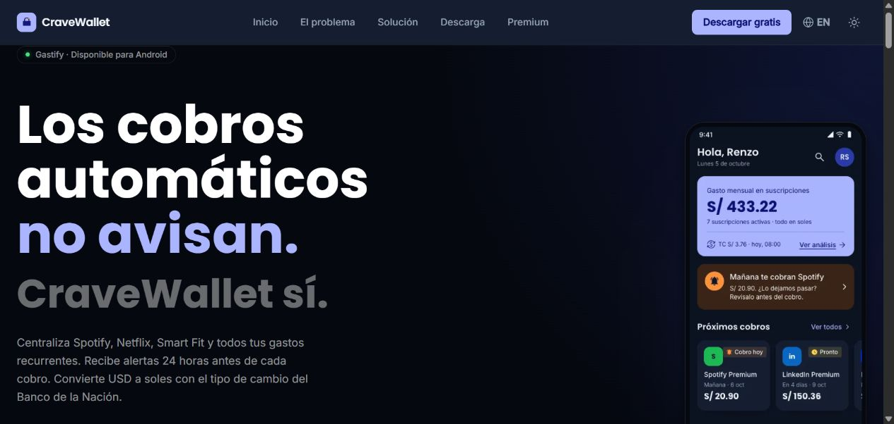

<!-- pdf:omit-start -->

*Figura AV2-6. Landing público de CraveWallet.*

<!-- pdf:omit-end -->

*Fuente: captura del [landing público de CraveWallet](https://cravewallet-landing.vercel.app/es), 13 de noviembre de 2026.*

##### 2. Configuración y despliegue de los servicios RESTful (`CraveWallet-Backend`) en Render y PostgreSQL

El backend incluye los descriptores [`Dockerfile`](https://github.com/1ACC0238-2620-4950-Gastify-CraveWallet/CraveWallet-Backend/blob/a0aeabc/Dockerfile), [`render.yaml`](https://github.com/1ACC0238-2620-4950-Gastify-CraveWallet/CraveWallet-Backend/blob/a0aeabc/render.yaml), [`compose.yaml`](https://github.com/1ACC0238-2620-4950-Gastify-CraveWallet/CraveWallet-Backend/blob/a0aeabc/compose.yaml) y [`.env.example`](https://github.com/1ACC0238-2620-4950-Gastify-CraveWallet/CraveWallet-Backend/blob/a0aeabc/.env.example), documentados paso a paso en [`docs/deploy-render.md`](https://github.com/1ACC0238-2620-4950-Gastify-CraveWallet/CraveWallet-Backend/blob/a0aeabc/docs/deploy-render.md):

1. **Empaquetado multi-etapa con Docker (`Dockerfile`):** la primera etapa (`eclipse-temurin:21-jdk-jammy`) copia el wrapper de Maven y el código fuente y ejecuta `./mvnw -B verify` para compilar, ejecutar las 72 pruebas y empaquetar el JAR; la segunda etapa (`eclipse-temurin:21-jre-jammy`) crea el usuario sin privilegios `appuser`, expone el puerto `8080` y arranca la aplicación con `SPRING_PROFILES_ACTIVE=prod` respetando la variable `PORT` inyectada por Render.
2. **Esquema de base de datos y migraciones Flyway V1–V5:** al iniciar con el perfil `prod`, Flyway aplica automáticamente las cinco migraciones versionadas en `src/main/resources/db/migration` sobre PostgreSQL 17, mientras Hibernate valida el esquema (`ddl-auto: validate`). Las migraciones `V1` a `V3` crean `iam_users`, `iam_sessions`, `subscriptions`, `exchange_rates`, `delivery_expenses` y `monthly_budgets`; `V4` crea `premium_memberships`; y `V5` crea `premium_checkouts`, `premium_payments` y `premium_webhook_deliveries` con restricciones únicas de idempotencia. La figura AV2-7 muestra el directorio de migraciones V1–V5.
3. **Descriptor de infraestructura (`render.yaml`) y comprobación de salud:** define el servicio web Docker en Render (desplegado en AV2 en <https://cravewallet-api-av2.onrender.com>) con ruta de salud `/actuator/health` (`200 OK`, `{"status":"UP","groups":["liveness","readiness"]}`) y conexión a PostgreSQL 17.

**Base de datos de AV2.** La figura AV2-7 muestra las migraciones Flyway versionadas. V1–V3 definen usuarios, sesiones, suscripciones, gastos y presupuestos. V4 crea `premium_memberships`. V5 agrega `premium_checkouts`, `premium_payments` y `premium_webhook_deliveries`. Sus restricciones únicas evitan registrar dos veces el mismo pago o una factura aprobada. El perfil `prod` recibe `DATABASE_URL`, `DATABASE_USERNAME` y `DATABASE_PASSWORD` únicamente desde Render, aplica Flyway y usa `ddl-auto: validate`. La aplicación de V1–V5 en una nueva PostgreSQL de Render queda pendiente de comprobar en los logs y mediante un recorrido autenticado después de reiniciar.

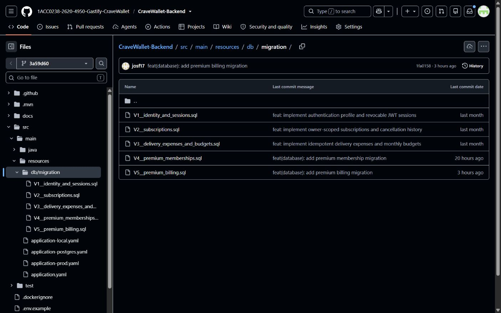

<!-- pdf:omit-start -->

*Figura AV2-7. Migraciones Flyway V1–V5 del backend de AV2.*

<!-- pdf:omit-end -->

*Fuente: captura del [directorio de migraciones en el commit 3a59d60](https://github.com/1ACC0238-2620-4950-Gastify-CraveWallet/CraveWallet-Backend/tree/3a59d60a8c15eebe29546e5bd69ef75b7ab776fd/src/main/resources/db/migration), 13 de noviembre de 2026.*

La tabla 173 detalla las variables de entorno requeridas para el despliegue del servicio en Render conforme a `.env.example` y `render.yaml` (sin exponer valores secretos).

*Tabla 173. Variables de entorno del servicio CraveWallet-Backend para el despliegue de AV2.*

| Variable de entorno | Propósito en el despliegue | Ejemplo / Formato (sin secretos) |
| --- | --- | --- |
| `SPRING_PROFILES_ACTIVE` | Activa la configuración de producción (`application-prod.yml`), PostgreSQL y Flyway. | `prod` |
| `DATABASE_URL` | Cadena JDBC de conexión a la instancia PostgreSQL 17 en Render. | `jdbc:postgresql://<host>:5432/cravewallet` |
| `DATABASE_USERNAME` | Usuario de conexión a PostgreSQL. | `cravewallet` |
| `DATABASE_PASSWORD` | Contraseña de la base de datos PostgreSQL. | `<secreto administrado en Render>` |
| `JWT_SECRET` | Clave secreta HMAC-SHA256 de al menos 32 bytes para firmar y verificar tokens JWT. | `<cadena aleatoria >= 32 caracteres>` |
| `GOOGLE_PLACES_API_KEY` | Clave de Google Places API (New) para `GET /api/v1/delivery-expenses/merchants/suggestions`. | `<API Key de Google Cloud>` |
| `MERCADOPAGO_ACCESS_TOKEN` | Token de acceso del vendedor en Mercado Pago para crear y consultar suscripciones y pagos. | `APP_USR-...` / `TEST-...` |
| `MERCADOPAGO_WEBHOOK_SECRET` | Secreto de firma webhook de Mercado Pago para validar el encabezado `x-signature`. | `<secreto de webhook de Mercado Pago>` |
| `MERCADOPAGO_BACK_URL` | URL HTTPS pública de retorno tras autorizar el checkout en Mercado Pago. | `https://cravewallet-landing.vercel.app/es` |
| `MERCADOPAGO_EXPECTED_LIVE_MODE` | Indica si el webhook debe aceptar notificaciones de prueba (`false`) o de producción (`true`). | `false` (pruebas) / `true` (producción) |

*Fuente: archivos `.env.example`, `render.yaml` y `docs/deploy-render.md` en `CraveWallet-Backend`.*

**[COMPLETAR: insertar capturas del panel de Render mostrando el servicio cravewallet-api-av2 en estado Live con el commit de AV2 desplegado, la respuesta HTTP 200 de https://cravewallet-api-av2.onrender.com/actuator/health y la tabla flyway_schema_history con las migraciones V1–V5 aplicadas en PostgreSQL]**

##### 3. Compilación y empaquetado de las aplicaciones móviles (Kotlin y Flutter)

Ambas aplicaciones móviles parametrizan la dirección del backend mediante `API_BASE_URL` y se empaquetan como archivos APK instalables en dispositivos Android:

- **Aplicación Android nativa (`CraveWallet-Mobile`, Kotlin):** se compila con Gradle inyectando la propiedad del proyecto `API_BASE_URL`:
  ```powershell
  .\gradlew.bat :app:assembleDebug "-PAPI_BASE_URL=https://cravewallet-api-av2.onrender.com"
  ```
  El artefacto se genera en `app/build/outputs/apk/debug/app-debug.apk`.
- **Aplicación móvil multiplataforma (`CraveWallet-Flutter`, Dart/Flutter):** se compila con el SDK de Flutter inyectando la constante de compilación `--dart-define`:
  ```powershell
  flutter build apk --debug --dart-define=API_BASE_URL=https://cravewallet-api-av2.onrender.com
  ```
  El artefacto se genera en `build/app/outputs/flutter-apk/app-debug.apk`.

**[COMPLETAR: insertar capturas y metadatos de la compilación e instalación de los APK de Kotlin y Flutter en dispositivo Android, indicando modelo del dispositivo, versión de Android y hash SHA-256 del artefacto utilizado en la demostración]**

##### 4. Verificación posterior del despliegue (26 de noviembre de 2026)

La tabla 174 resume una verificación HTTP de los servicios públicos, hecha después del cierre del Sprint 2 para conciliar las notas del 13 de noviembre con el estado vigente.

*Tabla 174. Estado de los servicios públicos de CraveWallet el 26 de noviembre de 2026.*

| Componente | URL | Resultado | Observación |
| --- | --- | --- | --- |
| Landing page | <https://cravewallet-landing.vercel.app/es> | HTTP 200 | Versión publicada desde `main`. |
| REST API (AV2) | <https://cravewallet-api-av2.onrender.com/actuator/health> | `{"status":"UP"}` tras el arranque en frío de Render | El servicio de AV2 está operativo. |
| Especificación OpenAPI | <https://cravewallet-api-av2.onrender.com/v3/api-docs> | HTTP 200, OpenAPI 3.1.0 con 22 operaciones | Coincide con el inventario de 22 endpoints de la sección 4.2.2.7. |
| REST API anterior | `https://cravewallet-api.onrender.com` | Sin respuesta | Ya no es el servicio de referencia. |
| Flutter Web | <https://cravewallet-flutter.onrender.com/> | HTTP 200 | La compilación publicada apunta al API anterior; se corrige en `CraveWallet-Flutter` PR #2. |
| CORS desde Flutter Web | Preflight `OPTIONS /api/v1/auth/login` | HTTP 401 sin `Access-Control-Allow-Origin` | La configuración de origen de producción se integra en `CraveWallet-Backend` PR #3 y requiere definir `FLUTTER_WEB_ORIGIN` en Render. |

*Fuente: solicitudes HTTP realizadas por el equipo el 26 de noviembre de 2026.*

La verificación confirma que el backend de AV2 y su documentación están desplegados y accesibles. Las aplicaciones Android no dependen de CORS. El cliente Flutter Web requiere recompilarse contra el API de AV2 y que el backend autorice su origen.

#### 4.2.2.9. Team Collaboration Insights during Sprint

La actividad colaborativa del Sprint 2 se cuantifica a partir del historial de commits registrado entre el 11 de octubre y el 13 de noviembre de 2026 en todas las ramas remotas de los cinco repositorios de la organización, excluyendo los commits de integración (*merge commits*). En ese periodo, `CraveWallet-Backend` registra 57 commits de `josf17` (Premium con Mercado Pago, Google Places, seguridad y documentación), 3 de `limozz05` (mensajes de la API en inglés y español) y 2 de `AlexanderAliaga19` (origen CORS de Flutter Web en producción). `CraveWallet-Mobile` registra 10 commits de `josf17` en `feature/premium` y 5 de `limozz05` en `feature/i18n-terms`. `CraveWallet-Flutter` registra 10 commits de `AlexanderAliaga19` (migración, Premium, publicación web y compilación del APK) y 4 de `limozz05` (localización, términos, recordatorios y accesibilidad). `cravewallet-landing` registra 4 commits de `limozz05` (i18n, términos, sección de videos y accesibilidad), y `CraveWallet-Report` registra 6 commits de `AlexanderAliaga19` y 5 de `limozz05`. La tabla 175 consolida el conteo de commits por integrante y repositorio en el Sprint 2.

El [historial de Flutter](https://github.com/1ACC0238-2620-4950-Gastify-CraveWallet/CraveWallet-Flutter/commits/feature/av2-premium-flutter/) registra la migración, los ajustes de dependencias, la integración Premium y el pipeline web de `AlexanderAliaga19`. El [PR #1 del backend](https://github.com/1ACC0238-2620-4950-Gastify-CraveWallet/CraveWallet-Backend/pull/1/commits) y la rama `feature/av2-premium-backend` reúnen los aportes de Premium, Mercado Pago, Delivery, PostgreSQL, seguridad y documentación. La actividad del informe se consulta en **Project Report Collaboration Insights**. Separar Flutter en un repositorio propio permite revisar la migración sin reescribir el historial Android y deja trazabilidad independiente para cada cliente.

*Tabla 175. Commits de cada integrante por repositorio en el Sprint 2.*

| Integrante | Usuario GitHub | Landing page (`cravewallet-landing`) | App Android Kotlin (`CraveWallet-Mobile`) | App Flutter (`CraveWallet-Flutter`) | Servicios RESTful (`CraveWallet-Backend`) | Informe (`CraveWallet-Report`) |
| --- | --- | ---: | ---: | ---: | ---: | ---: |
| Carpio Peña, Josué Francisco | `josf17` | 0 | 10 | 0 | 57 | 0 |
| Aliaga, Alexander | `AlexanderAliaga19` | 0 | 0 | 10 | 2 | 6 |
| Faustino Hurtado, Anghelo Edwin | `Limos05` / `limozz05` | 4 | 5 | 4 | 3 | 5 |
| Roman Zeballos, Sebastian Jared | `Chebas19` | 0 | 0 | 0 | 0 | 0 |
| Sejuro Medina, Mario Gabriel | `maghetthi` | 0 | 0 | 0 | 0 | 0 |

*Fuente: `git log --remotes --no-merges --since=2026-10-11 --until=2026-11-13` agrupado por autor sobre `cravewallet-landing`, `CraveWallet-Mobile`, `CraveWallet-Flutter`, `CraveWallet-Backend` y `CraveWallet-Report`; conteo realizado el 26 de noviembre de 2026.*

La distribución de la tabla 175 muestra una especialización técnica durante el Sprint 2. En el Sprint 1 la implementación de código estuvo concentrada en Mario Sejuro, Sebastián Roman y Anghelo Faustino (tabla 160). En el Sprint 2, Josué Carpio asumió casi todo el backend (facturación recurrente con Mercado Pago y búsqueda de comercios con Google Places) y la integración Premium en Kotlin. Alexander Aliaga ejecutó la migración a Flutter, su flujo Premium y la publicación web. Anghelo Faustino incorporó internacionalización, términos y condiciones y accesibilidad en los cuatro productos. Sebastián Roman y Mario Sejuro no registran commits en los repositorios durante este periodo. Los aportes de i18n, CORS de producción y compilación del APK se hicieron en ramas que recién se integraron a `develop` mediante pull requests el 26 de noviembre de 2026.

**[COMPLETAR: insertar capturas de pantalla de GitHub Insights > Contributors y Pulse de los repositorios CraveWallet-Backend, CraveWallet-Mobile, CraveWallet-Flutter y CraveWallet-Report correspondientes al periodo del Sprint 2]**

### 4.2.3. Sprint 3

#### 4.2.3.1. Sprint Planning 3

El Sprint 3 corresponde a la entrega TB2 (Release Review, semana 15) y abarca el trabajo registrado desde el 14 de noviembre de 2026. Según la tabla 84, al Sprint 3 le corresponden el servicio de conversión de divisas (TS03, US15–US17, US29 y US37) y el servicio de recordatorios (TS04, US12–US14, US28 y US36). TS03, US15, US16 y US17 ya estaban implementadas desde TB1, así que el sprint se concentra en el historial y la variación del tipo de cambio (US29 y US37) y en los recordatorios en el dispositivo. A ellas se suma US30 (editar o eliminar un gasto de delivery), del Sprint 4, que era la única historia de delivery que seguía pendiente. El sprint también integra en `develop` el trabajo de internacionalización, términos y condiciones, accesibilidad y CORS de producción que quedó en ramas sin integrar al cierre del Sprint 2.

*Tabla 176. Sprint Planning 3.*

| Aspecto | Detalle |
| --- | --- |
| **Sprint #** | Sprint 3 |
| **Sprint Planning Background** | |
| Date | 2026-11-14 (referencia de inicio del sprint) |
| Time | 08:00 PM, hora de Lima (horario previsto) |
| Location | Discord (plataforma prevista) |
| Prepared By | Josué Francisco Carpio Peña |
| Attendees (to planning meeting) | Participantes previstos: Alexander Aliaga, Josué Carpio, Anghelo Faustino, Sebastián Roman y Mario Sejuro. |
| Sprint 2 Review Summary | En AV2 se presentaron el backend con 22 endpoints REST documentados en OpenAPI y desplegado como `cravewallet-api-av2` en Render, la integración de Premium con Mercado Pago en Kotlin y Flutter, la migración de la aplicación móvil a Flutter con su versión web y el landing page publicado en Vercel. La verificación del 26 de noviembre (tabla 174) confirmó que el API y su documentación están en línea y detectó que la versión publicada de Flutter Web apunta a un host anterior y que el API todavía no autoriza el origen web. |
| Sprint 2 Retrospective Summary | Síntesis reconstruida a partir del cierre de AV2 y de la verificación de la tabla 174. Funcionó la especialización por producto: backend y Kotlin Premium (Josué Carpio), Flutter (Alexander Aliaga) e internacionalización (Anghelo Faustino). Por mejorar: varias ramas terminadas el 13 de noviembre (i18n, CORS de producción y APK) no se integraron a `develop` mediante pull request, y la versión publicada de Flutter Web quedó apuntando a un host del API que dejó de responder. Acuerdos: integrar cada rama con pull request hacia `develop` antes del cierre del sprint, revisar los pull requests de otro integrante antes de integrarlos y verificar las URL públicas después de cada despliegue. |
| **Sprint Goal & User Stories** | |
| Sprint 3 Goal | **Our focus is on** explicar al usuario por qué cambia el monto en soles de sus suscripciones en dólares (historial y variación del tipo de cambio), permitirle corregir gastos de delivery registrados por error y completar los recordatorios en el dispositivo. **We believe it delivers** confianza en el total mensual consolidado **to** los dos segmentos objetivo. **This will be confirmed when** el usuario consulta el historial de una suscripción en USD, corrige o elimina un gasto y el total del mes se recalcula sin errores. |
| Sprint 3 Velocity | Capacidad acordada sin registro en el informe. Referencia: **17 SP** de alcance planificado en el Sprint 2 (tabla 161). Para el Sprint 3, la tabla 84 registra **21 SP** en ocho historias. La velocidad efectiva requiere confirmar qué historias fueron aceptadas al cierre. |
| Sum of Story Points | **21 Story Points** según la tabla 84: `US29` (2 SP), `US37` (2 SP), `US12` (5 SP), `US13` (2 SP), `US14` (3 SP), `US28` (2 SP), `US36` (3 SP) y `US30` (2 SP). |

*Fuente: elaboración del equipo Gastify a partir del Product Backlog (tabla 84) y los repositorios del proyecto.*

#### 4.2.3.2. Aspect Leaders and Collaborators

La tabla 177 registra los aspectos del Sprint 3. Las celdas con evidencia en los repositorios se completaron a partir de los autores de los commits y pull requests (sección 4.2.3.9). Josué Carpio coordina el seguimiento del sprint con la colaboración de los otros cuatro integrantes. Las columnas por aspecto conservan los liderazgos técnicos identificados en los repositorios.

*Tabla 177. Leadership-and-Collaboration Matrix del Sprint 3.*

| Miembro del equipo (Apellidos, Nombres) | Usuario GitHub | Historial cambiario (US29, US37) | Gastos de delivery (US30) | Recordatorios e i18n en Flutter | Calidad Android (lint) | Informe | Coordinación del sprint |
| --- | --- | :---: | :---: | :---: | :---: | :---: | :---: |
| Aliaga, Alexander | `AlexanderAliaga19` | C | C | C | C | C | C |
| Carpio Peña, Josué Francisco | `josf17` | C | C | C | C | C | L |
| Faustino Hurtado, Anghelo Edwin | `Limos05` / `limozz05` | C | C | L | C | C | C |
| Roman Zeballos, Sebastian Jared | `Chebas19` | L | L | C | L | L | C |
| Sejuro Medina, Mario Gabriel | `maghetthi` | C | C | C | C | C | C |

*Fuente: elaboración del equipo Gastify a partir de los commits y pull requests del Sprint 3.*

#### 4.2.3.3. Sprint Backlog 3

El Sprint Backlog 3 descompone las historias de la tabla 176 en tareas de ingeniería vinculadas a ramas y pull requests de GitHub. Las tareas transversales integran el trabajo que estaba en ramas sin integrar.

**Enlace público del tablero de Sprint Backlog 3 en Trello:** [CraveWallet – Sprint 3](https://trello.com/b/7kXm7rmW/cravewallet-sprint-3)


*Tabla 178. Sprint Backlog 3 y control de estado de tareas.*

| Sprint # | User Story Id | User Story Title | Task Id | Task Title | Description | Estimation (Hours) | Assigned To | Status |
| :---: | :---: | --- | :---: | --- | --- | :---: | --- | :---: |
| 3 | US29 / US37 | Historial y variación del tipo de cambio | [S3-T01](https://trello.com/c/rQGbHIat) | Persistencia de cotizaciones y condiciones | Migración V6 con `exchange_rate_snapshots` y `subscription_terms_history`; registro de cada cotización obtenida y de cada versión de monto y fecha de cobro (`2ac8748`, `e7aa121`). | 6 | Sebastian Roman (`Chebas19`) | Done |
| 3 | US29 / US37 | Historial y variación del tipo de cambio | [S3-T02](https://trello.com/c/4WuH9NNH) | Endpoint de historial por ciclo | `GET /api/v1/subscriptions/{id}/exchange-rate-history` con hasta 12 cobros anteriores, monto en soles y variación porcentual (Backend PR #5). | 5 | Sebastian Roman (`Chebas19`) | Done |
| 3 | US29 / US37 | Historial y variación del tipo de cambio | [S3-T03](https://trello.com/c/A0y6Qlfr) | Tarjeta de historial en Flutter | Tarjeta en el detalle de una suscripción en USD con variación y cobros anteriores, en inglés y español (Flutter PR #4, `9ea0532`). | 6 | Sebastian Roman (`Chebas19`) | Done |
| 3 | US30 | Editar o eliminar un gasto de delivery registrado por error | [S3-T04](https://trello.com/c/ASe1hIbk) | Endpoints de corrección y eliminación | `GET`, `PUT /{id}` y `DELETE /{id}` en `/api/v1/delivery-expenses`, con ajuste del acumulado mensual (Backend PR #4, `956dd82`). | 6 | Sebastian Roman (`Chebas19`) | Done |
| 3 | US30 | Editar o eliminar un gasto de delivery registrado por error | [S3-T05](https://trello.com/c/twZsw1AU) | Lista "Gastos del mes" en Flutter | Lista con editar y eliminar, confirmación y recarga del resumen (Flutter PR #3, `5604d9c`, `01a85c2`). | 6 | Sebastian Roman (`Chebas19`) | Done |
| 3 | US12–US14 / US28 / US36 | Recordatorios en el dispositivo | [S3-T06](https://trello.com/c/BER1YyUK) | Integración de notificaciones locales y calendario | Integrar en `develop` las notificaciones programadas, el acceso al calendario, los permisos y la lista de próximos cobros de `feature/i18n-terms-device` (Flutter PR #2). | 4 | Anghelo Faustino (`limozz05`) / Sebastian Roman (`Chebas19`) | Done |
| 3 | Transversal | Internacionalización, términos y accesibilidad | [S3-T07](https://trello.com/c/qyIXngVC) | Integración de i18n en los cuatro productos | Integrar inglés y español en Flutter (PR #2), Kotlin (PR #2), landing (PR #1, ya integrado en `develop`) y mensajes del API (Backend PR #3). | 4 | Anghelo Faustino (`limozz05`) / Sebastian Roman (`Chebas19`) | Done |
| 3 | Transversal | Despliegue de Flutter Web | [S3-T08](https://trello.com/c/IGyrqrU7) | CORS de producción y URL del API | Autorizar el origen de Flutter Web con `FLUTTER_WEB_ORIGIN` (Backend PR #3) y compilar web y APK contra `cravewallet-api-av2` (Flutter PR #2, `450f5e2`). | 3 | Alexander Aliaga (`AlexanderAliaga19`) / Sebastian Roman (`Chebas19`) | To-Review |
| 3 | Transversal | Calidad de la aplicación Android | [S3-T09](https://trello.com/c/Nf7wpfV2) | Corrección de lint en Jetpack Compose | Leer textos con `LocalResources` en 41 llamadas marcadas por lint (Mobile PR #3, `415c71b`). | 3 | Sebastian Roman (`Chebas19`) | Done |
| 3 | US29 / US37 / US30 | Historial cambiario y gastos de delivery en Kotlin | [S3-T10](https://trello.com/c/PC2BXnxw) | Pantallas de Delivery e historial del tipo de cambio en la app Android | Lista de gastos con edición y eliminación en `DeliveryScreen`, tarjeta `ExchangeRateHistoryCard` en el detalle y consumo de los nuevos endpoints, con pruebas de API y de interfaz (Mobile PR #4, `1e17767`, `66c5bc0`). | 10 | Anghelo Faustino (`limozz05`) | Done |
| 3 | US29 / US37 / US30 | Historial cambiario y gastos de delivery en Flutter | [S3-T11](https://trello.com/c/ImangQCM) | Pruebas de widget y corrección de fallos de interfaz | Pruebas de widget de Delivery y del historial; corrección de un controlador liberado antes de tiempo, del límite inferior del selector de fecha y del desbordamiento con texto al 180 % (Flutter PR #5, `11ca4af`). | 8 | Anghelo Faustino (`limozz05`) | Done |

*Fuente: elaboración del equipo Gastify a partir del Product Backlog y los pull requests de los repositorios del proyecto.*

Las once tareas suman **61 horas**. Las horas son estimaciones retrospectivas del esfuerzo de implementación, revisión y pruebas, calculadas con el tamaño de cada pull request, como en la tabla 163. Las tareas en *Done* están integradas en `develop` desde el 26 de noviembre de 2026. S3-T08 queda en *To Review* hasta que el equipo configure `FLUTTER_WEB_ORIGIN` en Render y republique Flutter Web (tabla 182).

#### 4.2.3.4. Development Evidence for Sprint Review

En el Sprint 3 se implementaron US29, US37 y US30 en el backend, en Flutter y en la aplicación Kotlin, se corrigieron los errores de lint de la aplicación Kotlin y se integró en `develop` el trabajo pendiente de AV2. La tabla 179 lista los commits de implementación del periodo. Los commits de integración (*merge commits*) no se incluyen.

*Tabla 179. Commits de desarrollo del Sprint 3.*

| Repository | Branch | Commit Id | Commit Message | Commit Message Body | Committed on (Date) |
| --- | --- | --- | --- | --- | --- |
| `CraveWallet-Backend` | `feature/us30-edit-delete-delivery-expense` | `956dd82` | feat(delivery): list, correct and delete delivery expenses (US30) | Endpoints `GET`, `PUT` y `DELETE` de gastos con ajuste del acumulado mensual y control de propiedad. | 26/11/2026 |
| `CraveWallet-Backend` | `feature/us29-us37-exchange-rate-history` | `2ac8748` | feat(subscriptions): exchange rate history and variation per billing cycle (US29, US37) | Migración V6, registro de cotizaciones y endpoint de historial. | 26/11/2026 |
| `CraveWallet-Backend` | `feature/us29-us37-exchange-rate-history` | `e7aa121` | fix(subscriptions): keep past cycle amounts when a subscription is edited | Historial de condiciones para que una edición no cambie los cobros pasados. | 26/11/2026 |
| `CraveWallet-Flutter` | `chore/integrate-av2-flutter-branches` | `450f5e2` | fix(config): point web and APK builds to cravewallet-api-av2 | La compilación web apuntaba a un host que ya no responde. | 26/11/2026 |
| `CraveWallet-Flutter` | `feature/us30-edit-delete-delivery-expense` | `5604d9c` | feat(delivery): edit and delete delivery expenses from the app (US30) | Lista de gastos del mes con editar y eliminar. | 26/11/2026 |
| `CraveWallet-Flutter` | `feature/us29-us37-exchange-rate-history` | `9ea0532` | feat(subscriptions): show exchange rate history and variation (US29, US37) | Tarjeta de historial en el detalle de suscripciones en USD. | 26/11/2026 |
| `CraveWallet-Flutter` | `codex/test-delivery-history-widgets` | `11ca4af` | fix(ui): cover and stabilize delivery and history widgets | Pruebas de widget de Delivery e historial y corrección de los fallos de interfaz que reproducen. | 26/11/2026 |
| `CraveWallet-Mobile` | `fix/compose-resource-lint` | `415c71b` | fix(ui): read strings through LocalResources in composables | Corrección de 41 errores `LocalContextGetResourceValueCall`. | 26/11/2026 |
| `CraveWallet-Mobile` | `codex/feat-kotlin-delivery-history` | `1e17767` | feat(mobile): add delivery management and exchange rate history | Gastos de delivery con edición y eliminación, y tarjeta del historial del tipo de cambio en Kotlin. | 26/11/2026 |
| `CraveWallet-Mobile` | `codex/feat-kotlin-delivery-history` | `66c5bc0` | chore(android): reduce lint warnings without a baseline | Reducción de advertencias de lint sin archivo de línea base. | 26/11/2026 |

*Fuente: historial Git de `CraveWallet-Backend`, `CraveWallet-Flutter` y `CraveWallet-Mobile`.*

La corrección `e7aa121` surgió de una revisión independiente del PR #5. Esa revisión mostró que editar el monto de una suscripción cambiaba los cobros pasados: un ciclo de USD 10 a 3.70 pasaba de S/ 37.00 a S/ 74.00 después de cambiar el precio a USD 20. Ahora cada cobro pasado usa el monto y el calendario vigentes en su fecha.

#### 4.2.3.5. Testing Suite Evidence for Sprint Review

Cada historia del Sprint 3 se valida con pruebas automatizadas en el backend (Spring Boot con MockMvc y H2) y en Flutter (`flutter_test` con `MockClient`). La tabla 180 relaciona las pruebas nuevas con las historias.

*Tabla 180. Pruebas automatizadas del Sprint 3.*

| Repositorio | Clase o archivo | Pruebas | Historia | Comportamiento verificado |
| --- | --- | :---: | :---: | --- |
| `CraveWallet-Backend` | `DeliveryIntegrationTest` | 2 nuevas | US30 | Listado del mes, corrección con traslado del acumulado entre meses, eliminación, 404 para otro usuario, 401 sin token y rechazo de fechas futuras. |
| `CraveWallet-Backend` | `ExchangeRateHistoryIntegrationTest` | 5 | US29, US37 | Monto en soles por ciclo (S/ 37.00 y S/ 38.00), variación de +2.70 %, ediciones que no cambian cobros pasados, calendario de cobros, PEN sin conversión y cotización guardada una sola vez. |
| `CraveWallet-Backend` | `HistoryAmountRegressionReviewTest` | 1 | US29 | Regresión de la revisión independiente: cambiar el precio actual no modifica los montos pasados. |
| `CraveWallet-Flutter` | `test/delivery_expenses_test.dart` | 2 | US30 | Llamadas `GET`, `PUT` y `DELETE` y lectura de los gastos. |
| `CraveWallet-Flutter` | `test/exchange_rate_history_test.dart` | 2 | US29, US37 | Ruta consumida, ciclos y variación, y respuesta sin variación. |
| `CraveWallet-Flutter` | `test/delivery_history_widgets_test.dart` | 13 | US29, US30, US37 | Lista, edición, cancelación y confirmación de eliminación, validación, error del servidor, fecha anterior a 2020, estados de carga, vacío y error del historial, variación UP, DOWN y UNCHANGED, inglés y español y texto al 180 %. |
| `CraveWallet-Mobile` | `RemoteRecordsApiTest` | 4 | US29, US30 | Lectura de gastos y del historial desde el API y envío de correcciones y eliminaciones. |
| `CraveWallet-Mobile` | `DeliveryExpenseEditorTest` | 3 | US30 | Validación del formulario de edición de un gasto. |
| `CraveWallet-Mobile` | `ExchangeRateHistoryCardTest` | 8 | US29, US37 | Presentación de los ciclos, la variación y los estados de la tarjeta del historial. |

*Fuente: repositorios `CraveWallet-Backend`, `CraveWallet-Flutter` y `CraveWallet-Mobile`.*

Resultados al 26 de noviembre de 2026:
- `./mvnw -B test` en local sobre `develop` con US30 integrado: 87 pruebas sin fallos. El workflow `Backend build` terminó correctamente en los PR #3, #4 y #5.
- `Flutter CI` (analyze, test y compilación web) terminó correctamente en los PR #2 a #5. Según el PR #5, `flutter test` aprueba 26 pruebas, entre ellas las 13 de widget.
- En Kotlin, `gradlew testDebugUnitTest lintDebug assembleDebug` sobre la rama del PR #4, que contiene los PR #2 y #3, terminó correctamente: 26 pruebas (25 aprobadas y 1 omitida), lint sin errores y APK de depuración generado.

Estas pruebas no reemplazan la verificación en un dispositivo físico, que se registra en la sección 4.2.3.6.

##### Especificaciones de aceptación en Gherkin (`.feature`) del Sprint 3

```gherkin
Feature: US29 Ver el historial del tipo de cambio aplicado a una suscripción
  Scenario: Historial con varios meses
    Given una suscripción en dólares lleva más de un mes activa
    When el usuario consulta su historial de conversión
    Then el sistema lista el tipo de cambio y el monto en soles aplicados en cada Billing Cycle anterior

Feature: US37 Ver la variación del tipo de cambio respecto al cobro anterior
  Scenario: Variación mostrada
    Given una suscripción en dólares lleva más de un Billing Cycle activa
    When el usuario consulta su detalle
    Then el sistema muestra la variación porcentual del tipo de cambio respecto al cobro anterior

Feature: US30 Editar o eliminar un gasto de delivery registrado por error
  Scenario: Edición del monto
    Given el usuario tiene un gasto de delivery registrado
    When corrige su monto y guarda el cambio
    Then el sistema actualiza el gasto y recalcula el total del mes
  Scenario: Eliminación
    Given el usuario registró un gasto de delivery por duplicado
    When lo elimina
    Then el sistema lo quita del total del mes
```

#### 4.2.3.6. Execution Evidence for Sprint Review

La aplicación Kotlin incorpora las mismas funciones en `DeliveryScreen` y en la tarjeta `ExchangeRateHistoryCard` del detalle de suscripción (Mobile PR #4). En Flutter, la pantalla de Delivery muestra ahora la sección "Gastos del mes", con acciones para editar (en un diálogo con selector de fecha) y eliminar (con confirmación). El detalle de una suscripción en USD muestra la tarjeta "Historial del tipo de cambio": la variación respecto al cobro anterior y la lista de cobros con su tipo de cambio y monto en soles. Si todavía no hay cotizaciones guardadas, la tarjeta lo indica.

**[COMPLETAR: capturas en un dispositivo físico de la lista "Gastos del mes", el diálogo de edición, la confirmación de eliminación y la tarjeta de historial del tipo de cambio]**

**Enlace al video de ejecución del Sprint 3:** **[COMPLETAR: URL del video]**

#### 4.2.3.7. Services Documentation Evidence for Sprint Review

El Sprint 3 agrega cuatro operaciones REST documentadas con anotaciones OpenAPI. Con ellas, el inventario pasa de 22 a 26 operaciones. La tabla 181 las detalla.

*Tabla 181. Endpoints documentados en el Sprint 3.*

| Verbo | Sintaxis de llamada | Parámetros | Respuesta | Historia |
| :---: | --- | --- | --- | :---: |
| GET | `/api/v1/delivery-expenses?year=2026&month=11` | `year` y `month` opcionales, juntos; por defecto el mes actual en Lima. | `200`: lista de gastos `[{"id","requestId","merchant","amount","currency":"PEN","category","expenseDate"}]`. | US30 |
| PUT | `/api/v1/delivery-expenses/{id}` | Cuerpo `{"merchant","amount","category","expenseDate"}`. | `200`: gasto corregido; `404` si no pertenece al usuario; `400` si la fecha es futura. | US30 |
| DELETE | `/api/v1/delivery-expenses/{id}` | `id` del gasto. | `204` sin cuerpo; `404` si no pertenece al usuario. | US30 |
| GET | `/api/v1/subscriptions/{id}/exchange-rate-history` | `id` de la suscripción. | `200`: `{"currency":"USD","amount":10,"cycles":[{"billingDate":"2026-10-15","amountUsd":10,"rate":3.80,"amountPen":38.00,"rateUpdatedAt":"…"}],"variation":{"percentChange":2.70,"direction":"UP"}}`; las suscripciones en PEN devuelven `cycles` vacío. | US29, US37 |

*Fuente: controladores `DeliveryController` y `SubscriptionController` de `CraveWallet-Backend`.*

Todas las operaciones requieren JWT. La documentación publicada en <https://cravewallet-api-av2.onrender.com/swagger-ui/index.html> mostrará estas operaciones cuando el servicio se redespliegue desde `develop`, donde los PR #4 y #5 ya están integrados.

**[COMPLETAR: capturas de Swagger UI ejecutando las cuatro operaciones con la cuenta de prueba en el servicio desplegado]**

#### 4.2.3.8. Software Deployment Evidence for Sprint Review

Durante el Sprint 3 se prepararon los cambios de configuración necesarios para el despliegue. El despliegue mismo requiere acceso a Render, que tiene el equipo. La tabla 182 resume cada paso y su estado.

*Tabla 182. Pasos de despliegue del Sprint 3.*

| Paso | Componente | Acción | Estado |
| :---: | --- | --- | --- |
| 1 | Backend | Integrar en `develop` los PR #3, #4 y #5 y redesplegar `cravewallet-api-av2`. Flyway aplica V6 al arrancar. | PR integrados el 26/11/2026. Redespliegue: **[COMPLETAR: fecha y captura del despliegue]** |
| 2 | Backend | Definir `FLUTTER_WEB_ORIGIN` en Render con el origen de Flutter Web, sin `/` final. | **[COMPLETAR]** |
| 3 | Flutter Web | Integrar los PR #2 a #5 y republicar con `API_BASE_URL=https://cravewallet-api-av2.onrender.com`. | PR integrados el 26/11/2026. Republicación: **[COMPLETAR]** |
| 4 | Android | Generar el APK con el workflow `android-apk` e instalarlo en un dispositivo físico. | **[COMPLETAR: modelo, versión de Android y SHA-256 del APK]** |
| 5 | Landing | Publicar en Vercel la i18n, los términos y la sección de videos mediante el PR `develop → main`. | **[COMPLETAR]** |

*Fuente: elaboración del equipo Gastify.*

#### 4.2.3.9. Team Collaboration Insights during Sprint

Entre el 14 y el 26 de noviembre de 2026, sin contar los *merge commits*, los repositorios registran los commits de la tabla 183. Además del código nuevo, el sprint se dedicó a integrar el trabajo que quedó en ramas al cierre de AV2: ramas de Anghelo Faustino (i18n y términos en Flutter, Kotlin, landing y API) y de Alexander Aliaga (CORS de producción, publicación web y compilación del APK), que se integraron mediante pull requests hacia `develop`.

*Tabla 183. Commits de cada integrante por repositorio en el Sprint 3.*

| Integrante | Usuario GitHub | Landing page | App Kotlin | App Flutter | Servicios RESTful | Informe |
| --- | --- | ---: | ---: | ---: | ---: | ---: |
| Aliaga, Alexander | `AlexanderAliaga19` | 0 | 0 | 0 | 0 | 0 |
| Carpio Peña, Josué Francisco | `josf17` | 0 | 0 | 0 | 0 | 3 |
| Faustino Hurtado, Anghelo Edwin | `Limos05` / `limozz05` | 0 | 2 | 1 | 0 | 0 |
| Roman Zeballos, Sebastian Jared | `Chebas19` | 0 | 1 | 4 | 3 | 5 |
| Sejuro Medina, Mario Gabriel | `maghetthi` | 0 | 0 | 0 | 0 | 0 |

*Fuente: `git log --remotes --no-merges --since=2026-11-14` sobre los cinco repositorios, conteo al 26 de noviembre de 2026. **[COMPLETAR: actualizar al cierre del Sprint 3]***

*Tabla 184. Pull requests del Sprint 3.*

| Repositorio | PR | Contenido | Autor | Estado al 26/11/2026 |
| --- | :---: | --- | --- | --- |
| `CraveWallet-Report` | #28 | Integración del cierre de AV2 | `Chebas19` | Integrado |
| `CraveWallet-Report` | #29 | Evidencia verificada del Sprint 2 | `Chebas19` | Integrado |
| `CraveWallet-Report` | #30 | Sección 4.2.3 (Sprint 3) | `Chebas19` | Este pull request |
| `CraveWallet-Report` | #31 | Planificación, matriz LACX, Trello y horas del Sprint 2 | `josf17` | Integrado |
| `CraveWallet-Backend` | #3 | CORS de producción e i18n del API | `Chebas19` | Integrado |
| `CraveWallet-Backend` | #4 | US30 | `Chebas19` | Integrado |
| `CraveWallet-Backend` | #5 | US29 y US37 | `Chebas19` | Integrado |
| `CraveWallet-Flutter` | #2 | i18n, términos, recordatorios, web y APK | `Chebas19` | Integrado |
| `CraveWallet-Flutter` | #3 | US30 | `Chebas19` | Integrado |
| `CraveWallet-Flutter` | #4 | US29 y US37 | `Chebas19` | Integrado mediante el PR #5 |
| `CraveWallet-Flutter` | #5 | Pruebas de widget y corrección de fallos de interfaz | `Limos05` | Integrado |
| `CraveWallet-Mobile` | #2 | i18n y términos en Kotlin | `Chebas19` | Integrado |
| `CraveWallet-Mobile` | #3 | Corrección de lint | `Chebas19` | Integrado |
| `CraveWallet-Mobile` | #4 | Delivery e historial del tipo de cambio en Kotlin | `Limos05` | Integrado |
| `cravewallet-landing` | #1 | i18n, términos, sección de videos y accesibilidad | `Chebas19` | Integrado en `develop` |

*Fuente: pull requests de la organización en GitHub.*

Al corte del 26 de noviembre de 2026, tres integrantes registran commits en el Sprint 3. Sebastián Roman implementó US29, US37 y US30 en el backend y en Flutter e integró las ramas pendientes de AV2. Anghelo Faustino llevó esas historias a Kotlin y revisó las pantallas de Flutter con pruebas de widget, que encontraron tres fallos de interfaz corregidos en el PR #5. Josué Carpio completó la documentación del Sprint 2 en el informe. Alexander Aliaga y Mario Sejuro no registran commits en este periodo. Para que la matriz LACX (tabla 177) refleje el aporte de todo el equipo, falta registrar el despliegue, la validación y la redacción restantes. **[COMPLETAR: interpretación final del equipo sobre la distribución del trabajo del Sprint 3]**

## 4.3. Validation Interviews

### 4.3.1. Diseño de Entrevistas

Las entrevistas de validación de AV2 tienen por objetivo evaluar, con usuarios reales pertenecientes a los dos segmentos objetivo definidos en la sección 1.3 (**Segmento 1: Estudiante Universitario Digital, 18 a 25 años** y **Segmento 2: Profesional Joven Activo, 25 a 32 años**), la comprensión de la propuesta de valor en el landing page y la usabilidad de los flujos implementados en las aplicaciones móviles de CraveWallet (`CraveWallet-Flutter` y `CraveWallet-Mobile`), contrastando los resultados con las hipótesis Lean UX `H1`–`H5` (sección 1.2.2.3).

#### Estructura de la sesión y protocolo de validación

Cada sesión de validación se estructura en cuatro etapas con una duración estimada de 15 a 20 minutos:

1. **Contextualización y perfilamiento (2 min):** presentación del propósito académico de la prueba, solicitud de consentimiento para grabar la interacción (pantalla y cámara del participante), registro de datos demográficos (nombre, edad, distrito de residencia en Lima, ocupación y número actual de suscripciones o pedidos semanales de delivery).
2. **Evaluación del Landing Page (3 min):** el participante explora libremente [`https://cravewallet-landing.vercel.app/es`](https://cravewallet-landing.vercel.app/es) aplicando el protocolo de pensamiento en voz alta (*think-aloud*) y responde qué problema resuelve CraveWallet, qué diferencia percibe entre el plan Free y el plan Premium (S/ 9.99/mes) y dónde descargaría la aplicación.
3. **Ejecución de escenarios de tarea en la aplicación móvil (10 min):** el participante ejecuta cinco tareas concretas sin asistencia del moderador mientras se observa el tiempo empleado, las dudas de navegación y la interpretación de los montos en soles.
4. **Preguntas de cierre y valoración posprueba (3 min):** preguntas abiertas sobre utilidad percibida, claridad del tipo de cambio USD/PEN, disposición de uso del presupuesto de delivery y valoración del plan Premium con Mercado Pago.

La tabla 185 detalla los elementos del landing page, los cinco escenarios de flujo de usuario en la aplicación móvil y los criterios de validación específicos para cada segmento objetivo.

*Tabla 185. Elementos del landing page y flujos móviles por validar según segmento objetivo.*

| Componente / Flujo a validar | Tarea asignada al participante | Foco en Segmento 1 (Estudiante Universitario Digital, 18–25 años, Persona: Camila Torres) | Foco en Segmento 2 (Profesional Joven Activo, 25–32 años, Persona: Renzo Salazar) | Hipótesis / US vinculadas |
| --- | --- | --- | --- | --- |
| **Landing Page: Propuesta de valor, Planes y FAQ** | Recorrer las secciones *Hero*, *El problema*, *Cómo funciona*, *Planes (Free vs. Premium S/ 9.99)*, *FAQ* y *Descarga*, y explicar con sus palabras qué ofrece CraveWallet. | Claridad del beneficio de evitar cobros sorpresa en servicios de streaming/educación/gimnasio y comprensión del límite de 5 suscripciones gratuitas. | Confianza en que la aplicación no exige vincular cuentas bancarias (*Bank Account Linking*) y claridad del precio local en soles (S/ 9.99). | `US24`, `US25`, `US32` |
| **Flujo Móvil 1: Registro/Login y moneda de referencia** | Crear una cuenta o iniciar sesión y verificar en la pestaña *Perfil* que la moneda de referencia configurada es el sol peruano (`PEN`). | Facilidad de onboarding inicial sin fricción. | Reconocimiento inmediato de la moneda base para consolidar gastos mixtos. | `US01`, `US02`, `US03` |
| **Flujo Móvil 2: Alta de suscripción en USD y consulta en el Dashboard** | Registrar una suscripción facturada en dólares (por ejemplo, Netflix, Spotify o una herramienta cloud/productividad) y regresar a *Inicio* para explicar el total mensual en soles, la cotización aplicada y la fecha de próximo cobro. | Comprensión del monto total comprometido en el mes y del orden por fecha de próxima renovación (`H1`). | Comprensión del importe original en USD frente a la estimación en PEN con tipo de cambio fechado (`H3`). | `H1`, `H3`, `US04`, `US05`, `US08`, `US10`, `US15`–`US17` |
| **Flujo Móvil 3: Búsqueda, detalle y cancelación con ahorro estimado** | Buscar una suscripción por nombre en *Gastos*, abrir su detalle, revisar su recordatorio 24 h antes y marcarla como cancelada, interpretando el ahorro estimado (`estimatedSavings`) y el historial de canceladas. | Utilidad del aviso anticipado y motivación al visualizar cuánto ahorra en el ciclo al dar de baja un servicio que ya no usa (`H2`). | Rapidez del buscador incremental para localizar un servicio dentro de un portafolio amplio y claridad de que la baja es un registro local. | `H2`, `US07`, `US11`, `US12`, `US26`, `US27`, `US35` |
| **Flujo Móvil 4: Registro de gasto de delivery y presupuesto mensual** | Configurar un presupuesto mensual de delivery en soles, registrar un pedido buscando o ingresando un comercio frecuente (como Popeyes, Dunkin' o PedidosYa) y explicar el saldo restante y la categoría de mayor consumo. | Reconocimiento del impacto acumulado de pedidos pequeños de comida rápida frente a su presupuesto mensual (`H4`). | Control ágil del gasto semanal y mensual en delivery sin hojas de cálculo manuales (`H4`). | `H4`, `US18`, `US19`, `US38` |
| **Flujo Móvil 5: Análisis por categoría y checkout de CraveWallet Premium** | Abrir la pestaña *Análisis*, revisar los subtotales por categoría / mapa de calor e iniciar el flujo de suscripción a CraveWallet Premium (S/ 9.99/mes) hacia el checkout de Mercado Pago. | Valor percibido del desglose visual por categoría y familiaridad con el entorno de pago de Mercado Pago (`H5`). | Disposición a contratar el plan de S/ 9.99/mes al superar las 5 suscripciones activas y requerir analítica consolidada (`H5`). | `H5`, `US09`, `US21`–`US23`, `US31`, `US39` |

*Fuente: elaboración del equipo Gastify a partir de las secciones 1.2.2, 1.3, 2.4.1 y 4.2.2.*

#### Guía de preguntas posteriores a la ejecución de tareas

1. **Comprensión del portafolio y conversión (`H1`, `H3`):** *«Al mirar la pantalla de Inicio después de registrar tu suscripción en dólares, ¿qué tan claro te resultó distinguir el monto original en dólares del total estimado en soles y saber cuál será tu próximo cobro?»*
2. **Anticipación y ahorro al cancelar (`H2`, `US35`):** *«Al consultar el detalle de la suscripción y marcarla como cancelada antes de su fecha de renovación, ¿cómo interpretaste el monto de ahorro estimado que mostró la aplicación?»*
3. **Control de gastos de delivery (`H4`):** *«Después de fijar un presupuesto mensual y registrar un pedido de delivery, ¿puedes identificar cuánto margen te queda en el mes y en qué categoría se concentra tu gasto?»*
4. **Valoración de CraveWallet Premium y Mercado Pago (`H5`):** *«Considerando el límite de 5 suscripciones en el plan gratuito y las vistas de análisis por categoría y mapa de calor, ¿qué opinas del precio de S/ 9.99 mensuales y del proceso de pago a través de Mercado Pago?»*
5. **Fricciones y mejoras de usabilidad:** *«¿En cuál de las pantallas o pasos sentiste alguna duda, demora o etiqueta poco clara que cambiarías para la siguiente versión?»*

### 4.3.2. Registro de Entrevistas

La tabla 186 presenta la estructura de registro para las entrevistas de validación realizadas con representantes del **Segmento 1 (Estudiante Universitario Digital)** y del **Segmento 2 (Profesional Joven Activo)**, consignando los metadatos del entrevistado, captura de cuadro del video, enlace y marcas de tiempo (*timing*), y el resumen descriptivo de sus apreciaciones al interactuar con el landing page y la aplicación móvil.

*Tabla 186. Registro de entrevistas de validación de AV2 por segmento objetivo.*

| Entrevista # | Segmento objetivo | Nombres y apellidos | Edad | Distrito | Captura de cuadro de video | URL del video y Timing (inicio – duración) | Resumen descriptivo de apreciaciones sobre las tareas asignadas |
| :---: | --- | --- | :---: | --- | --- | --- | --- |
| **Entrevista 1** | Segmento 1: Estudiante Universitario Digital (18–25 años) | **[COMPLETAR: nombres y apellidos del entrevistado 1]** | **[COMPLETAR: edad]** | **[COMPLETAR: distrito]** | **[COMPLETAR: insertar captura de pantalla de la entrevista 1 mostrando al usuario interactuando con la app]** | **URL:** **[COMPLETAR: enlace YouTube / OneDrive]**<br>**Inicio:** **[COMPLETAR: hh:mm:ss]**<br>**Duración:** **[COMPLETAR: mm:ss]** | **[COMPLETAR: síntesis de cómo ejecutó los 5 flujos, si completó el alta de suscripción sin ayuda, su interpretación del monto en PEN, del presupuesto de delivery y del plan Premium]** |
| **Entrevista 2** | Segmento 1: Estudiante Universitario Digital (18–25 años) | **[COMPLETAR: nombres y apellidos del entrevistado 2]** | **[COMPLETAR: edad]** | **[COMPLETAR: distrito]** | **[COMPLETAR: insertar captura de pantalla de la entrevista 2 mostrando al usuario interactuando con la app]** | **URL:** **[COMPLETAR: enlace YouTube / OneDrive]**<br>**Inicio:** **[COMPLETAR: hh:mm:ss]**<br>**Duración:** **[COMPLETAR: mm:ss]** | **[COMPLETAR: síntesis de cómo ejecutó los 5 flujos, observaciones de usabilidad y valoración de las alertas y del ahorro estimado]** |
| **Entrevista 3** | Segmento 1: Estudiante Universitario Digital (18–25 años) | **[COMPLETAR: nombres y apellidos del entrevistado 3]** | **[COMPLETAR: edad]** | **[COMPLETAR: distrito]** | **[COMPLETAR: insertar captura de pantalla de la entrevista 3 mostrando al usuario interactuando con la app]** | **URL:** **[COMPLETAR: enlace YouTube / OneDrive]**<br>**Inicio:** **[COMPLETAR: hh:mm:ss]**<br>**Duración:** **[COMPLETAR: mm:ss]** | **[COMPLETAR: síntesis de cómo ejecutó los 5 flujos, observaciones sobre el landing page y disposición de uso frente a sus métodos actuales]** |
| **Entrevista 4** | Segmento 2: Profesional Joven Activo (25–32 años) | **[COMPLETAR: nombres y apellidos del entrevistado 4]** | **[COMPLETAR: edad]** | **[COMPLETAR: distrito]** | **[COMPLETAR: insertar captura de pantalla de la entrevista 4 mostrando al usuario interactuando con la app]** | **URL:** **[COMPLETAR: enlace YouTube / OneDrive]**<br>**Inicio:** **[COMPLETAR: hh:mm:ss]**<br>**Duración:** **[COMPLETAR: mm:ss]** | **[COMPLETAR: síntesis de cómo ejecutó los 5 flujos, evaluación de la conversión USD/PEN, búsqueda de suscripciones y checkout con Mercado Pago]** |
| **Entrevista 5** | Segmento 2: Profesional Joven Activo (25–32 años) | **[COMPLETAR: nombres y apellidos del entrevistado 5]** | **[COMPLETAR: edad]** | **[COMPLETAR: distrito]** | **[COMPLETAR: insertar captura de pantalla de la entrevista 5 mostrando al usuario interactuando con la app]** | **URL:** **[COMPLETAR: enlace YouTube / OneDrive]**<br>**Inicio:** **[COMPLETAR: hh:mm:ss]**<br>**Duración:** **[COMPLETAR: mm:ss]** | **[COMPLETAR: síntesis de cómo ejecutó los 5 flujos, percepción de los subtotales por categoría, presupuesto de delivery y valor de Premium a S/ 9.99]** |
| **Entrevista 6** | Segmento 2: Profesional Joven Activo (25–32 años) | **[COMPLETAR: nombres y apellidos del entrevistado 6]** | **[COMPLETAR: edad]** | **[COMPLETAR: distrito]** | **[COMPLETAR: insertar captura de pantalla de la entrevista 6 mostrando al usuario interactuando con la app]** | **URL:** **[COMPLETAR: enlace YouTube / OneDrive]**<br>**Inicio:** **[COMPLETAR: hh:mm:ss]**<br>**Duración:** **[COMPLETAR: mm:ss]** | **[COMPLETAR: síntesis de cómo ejecutó los 5 flujos, dificultades encontradas y recomendaciones de mejora expresadas por el participante]** |

*Fuente: elaboración del equipo Gastify.*

### 4.3.3. Evaluaciones según heurísticas

La evaluación heurística de usabilidad, diseño inclusivo y arquitectura de información se desarrolla siguiendo íntegramente el formato del **Anexo E** de la rúbrica del curso (*UX Heuristics & Principles Evaluation: Usability - Inclusive Design - Information Architecture*).

#### Cabecera de la evaluación (Formato Anexo E)

- **Carrera:** Ingeniería de Software
- **Curso:** `1ACC0238` — Aplicaciones para dispositivos móviles
- **NRC:** `4950`
- **Auditor:** Equipo Gastify (Mario Gabriel Sejuro Medina, Anghelo Edwin Faustino Hurtado, Sebastian Jared Roman Zeballos, Josué Francisco Carpio Peña y Alexander Aliaga)
- **Cliente(s):** **[COMPLETAR: nombres de las personas que participan en la sesión de evaluación heurística]**
- **Site o App a evaluar:** CraveWallet — Landing Page (`https://cravewallet-landing.vercel.app/es`), Aplicación Android nativa en Kotlin (`CraveWallet-Mobile`) y Aplicación móvil multiplataforma en Flutter (`CraveWallet-Flutter`)
- **Fecha:** **[COMPLETAR: fecha de realización de la evaluación heurística]**

#### Tareas a evaluar

1. Explorar el landing page de CraveWallet, identificar el problema que resuelve, comparar las características del plan Free frente al plan Premium (S/ 9.99/mes) y localizar la descarga del instalador móvil.
2. Crear una cuenta o iniciar sesión en la aplicación móvil y verificar la configuración del sol peruano (`PEN`) como moneda de referencia en el perfil (`US01`–`US03`).
3. Registrar una suscripción facturada en dólares (`USD`) con periodicidad mensual o anual y verificar en el Dashboard el total consolidado en soles (`PEN`) y la posición del servicio en la lista ordenada por próxima fecha de renovación (`US04`, `US05`, `US08`, `US10`, `US15`–`US17`).
4. Buscar una suscripción por su nombre en la pantalla de *Gastos*, abrir su detalle, consultar los datos del recordatorio de 24 horas antes y marcarla como cancelada verificando el ahorro estimado (`estimatedSavings`) y su aparición en el historial de canceladas (`US07`, `US11`, `US12`, `US26`, `US27`, `US35`).
5. Configurar un límite de presupuesto mensual en la pestaña *Delivery*, registrar un gasto de comida a domicilio seleccionando o escribiendo un comercio y verificar el acumulado y saldo restante del mes (`US18`, `US19`, `US38`).
6. Acceder a la pestaña *Análisis* y a la pantalla *CraveWallet Premium*, iniciar el checkout mensual de S/ 9.99 hacia Mercado Pago, verificar la actualización del estado de la membresía, consultar el historial de pagos y ejecutar la cancelación al fin del período (`US09`, `US21`–`US23`, `US31`, `US39`).

#### Tareas no incluidas en esta versión

1. Edición o eliminación de un gasto individual de delivery ya registrado (`US30`), planificada en el Product Backlog para el Sprint 4.
2. Visualización del historial de variaciones del tipo de cambio por cobro (`US29`, `US37`), asignada al Sprint 3.
3. Envío de notificaciones *push* remotas desde un servidor externo (`US36`), dado que la arquitectura emplea recordatorios y alertas locales del dispositivo.

#### Escala de severidad

La tabla 187 define la escala de severidad de 1 a 4 utilizada para clasificar cada hallazgo heurístico conforme al Anexo E.

*Tabla 187. Escala de severidad para la evaluación heurística.*

| Nivel | Categoría | Descripción |
| :---: | --- | --- |
| **1** | **Problema superficial** | No necesita ser solucionado a menos que exista tiempo y presupuesto disponible; sin embargo, mejoraría mucho la experiencia de usuario. |
| **2** | **Problema menor** | Arreglar este problema debe tener baja prioridad. |
| **3** | **Problema mayor** | Es importante solucionar este problema, por lo que se le debe asignar alta prioridad. |
| **4** | **Desastre de usabilidad** | Es imperativo solucionar este problema antes de lanzar el producto al mercado. |

*Fuente: Anexo E del enunciado del proyecto del curso 1ACC0238.*

#### Tabla resumen de problemas identificados

La tabla 188 consolida los problemas de usabilidad, diseño inclusivo o arquitectura de información registrados durante la sesión de evaluación heurística.

*Tabla 188. Tabla resumen de problemas identificados en la evaluación heurística.*

| # | Problema | Escala de severidad (1–4) | Heurística / Principio violada(o) |
| :---: | --- | :---: | --- |
| 1 | **[COMPLETAR: título breve del problema #1 detectado en las sesiones de evaluación]** | **[COMPLETAR: 1 / 2 / 3 / 4]** | **[COMPLETAR: p. ej., Visibilidad del estado del sistema / Consistencia y estándares / Prevención de errores]** |
| 2 | **[COMPLETAR: título breve del problema #2 detectado en las sesiones de evaluación]** | **[COMPLETAR: 1 / 2 / 3 / 4]** | **[COMPLETAR: heurística o principio violado]** |
| 3 | **[COMPLETAR: título breve del problema #3 detectado en las sesiones de evaluación]** | **[COMPLETAR: 1 / 2 / 3 / 4]** | **[COMPLETAR: heurística o principio violado]** |
| 4 | **[COMPLETAR: título breve del problema #4 detectado en las sesiones de evaluación]** | **[COMPLETAR: 1 / 2 / 3 / 4]** | **[COMPLETAR: heurística o principio violado]** |

*Fuente: elaboración del equipo Gastify a partir de las sesiones de evaluación heurística de AV2.*

#### Descripción de problemas

La tabla 189 desarrolla la ficha detallada de cada problema listado en la tabla resumen, incluyendo severidad, heurística violada, explicación del hallazgo, captura de pantalla con anotaciones y recomendación accionable.

*Tabla 189. Fichas descriptivas de problemas de la evaluación heurística.*

| Campo | PROBLEMA #1 | PROBLEMA #2 | PROBLEMA #3 | PROBLEMA #4 |
| --- | --- | --- | --- | --- |
| **Título** | **[COMPLETAR: nombre del problema #1]** | **[COMPLETAR: nombre del problema #2]** | **[COMPLETAR: nombre del problema #3]** | **[COMPLETAR: nombre del problema #4]** |
| **Severidad** | **[COMPLETAR: nivel 1–4]** | **[COMPLETAR: nivel 1–4]** | **[COMPLETAR: nivel 1–4]** | **[COMPLETAR: nivel 1–4]** |
| **Heurística violada** | **[COMPLETAR: nombre de la heurística o principio]** | **[COMPLETAR: nombre de la heurística o principio]** | **[COMPLETAR: nombre de la heurística o principio]** | **[COMPLETAR: nombre de la heurística o principio]** |
| **Problema** | **[COMPLETAR: explicación detallada de en qué consiste el problema #1 y cómo afectó al usuario durante la tarea]** | **[COMPLETAR: explicación detallada del problema #2]** | **[COMPLETAR: explicación detallada del problema #3]** | **[COMPLETAR: explicación detallada del problema #4]** |
| **Captura de pantalla** | **[COMPLETAR: insertar imagen con anotaciones visuales señalando el problema #1]** | **[COMPLETAR: insertar imagen con anotaciones visuales señalando el problema #2]** | **[COMPLETAR: insertar imagen con anotaciones visuales señalando el problema #3]** | **[COMPLETAR: insertar imagen con anotaciones visuales señalando el problema #4]** |
| **Recomendación** | **[COMPLETAR: acción concreta de diseño o código propuesta para corregir el problema #1]** | **[COMPLETAR: acción concreta propuesta para corregir el problema #2]** | **[COMPLETAR: acción concreta propuesta para corregir el problema #3]** | **[COMPLETAR: acción concreta propuesta para corregir el problema #4]** |

*Fuente: elaboración del equipo Gastify siguiendo el formato del Anexo E.*

#### Videos de validación y presentación de AV2

Conforme a los lineamientos de la sección 4.3 del enunciado del curso, la entrega AV2 comprende tres grabaciones en video (alojadas en OneDrive y YouTube): el **Video App Validation** (con las entrevistas de validación en cámara y pantalla de cada segmento), el **Video About-the-Product** (primera versión con el problema, propuesta de valor y recorrido de funcionalidades de CraveWallet) y el **Video About-the-Team** (primera versión con la presentación y aportes de los cinco integrantes en el Sprint 2). La tabla 190 estructura el registro de enlaces, duración, secuencia de tiempos (*timing*) y capturas de cada video.

*Tabla 190. Registro de videos requeridos en la entrega AV2.*

| Video requerido | Descripción de contenido y secuencia (*Timing*) | Captura de cuadro del video | URL en OneDrive | URL en YouTube | Duración total |
| --- | --- | --- | --- | --- | :---: |
| **1. Video App Validation** | Consolidado de las entrevistas de validación con usuarios de los Segmentos 1 y 2 interactuando con el landing page y las aplicaciones móviles, seguido de las conclusiones del equipo.<br>- `00:00` Introducción y objetivos de validación<br>- **[COMPLETAR: hh:mm:ss]** Entrevistas Segmento 1 (Estudiantes)<br>- **[COMPLETAR: hh:mm:ss]** Entrevistas Segmento 2 (Profesionales)<br>- **[COMPLETAR: hh:mm:ss]** Hallazgos heurísticos y conclusiones | **[COMPLETAR: insertar captura de cuadro del Video App Validation]** | **[COMPLETAR: URL pública de OneDrive del Video App Validation]** | **[COMPLETAR: URL pública de YouTube del Video App Validation]** | **[COMPLETAR: mm:ss]** |
| **2. Video About-the-Product (v1)** | Presentación del problema de los cobros recurrentes silenciosos y gastos de delivery, propuesta de valor de CraveWallet, demostración del landing page y recorrido en vivo de las aplicaciones móviles (suscripciones, conversión USD/PEN, delivery y plan Premium con Mercado Pago).<br>- `00:00` Problema y segmentos objetivo<br>- **[COMPLETAR: hh:mm:ss]** Recorrido del Landing Page<br>- **[COMPLETAR: hh:mm:ss]** Demostración de la aplicación móvil y backend<br>- **[COMPLETAR: hh:mm:ss]** Flujo Premium con Mercado Pago y cierre | **[COMPLETAR: insertar captura de cuadro del Video About-the-Product]** | **[COMPLETAR: URL pública de OneDrive del Video About-the-Product]** | **[COMPLETAR: URL pública de YouTube del Video About-the-Product]** | **[COMPLETAR: mm:ss]** |
| **3. Video About-the-Team (v1)** | Presentación de la startup Gastify y participación individual en cámara de los cinco integrantes explicando su rol, las tareas asumidas en los Sprints 1 y 2, los aprendizajes técnicos (incluyendo Mercado Pago, Flutter, Kotlin y Spring Boot) y las lecciones de trabajo colaborativo.<br>- `00:00` Presentación del equipo Gastify<br>- **[COMPLETAR: hh:mm:ss]** Mario Gabriel Sejuro Medina<br>- **[COMPLETAR: hh:mm:ss]** Anghelo Edwin Faustino Hurtado<br>- **[COMPLETAR: hh:mm:ss]** Sebastian Jared Roman Zeballos<br>- **[COMPLETAR: hh:mm:ss]** Josué Francisco Carpio Peña<br>- **[COMPLETAR: hh:mm:ss]** Alexander Aliaga | **[COMPLETAR: insertar captura de cuadro del Video About-the-Team]** | **[COMPLETAR: URL pública de OneDrive del Video About-the-Team]** | **[COMPLETAR: URL pública de YouTube del Video About-the-Team]** | **[COMPLETAR: mm:ss]** |

*Fuente: elaboración del equipo Gastify.*
