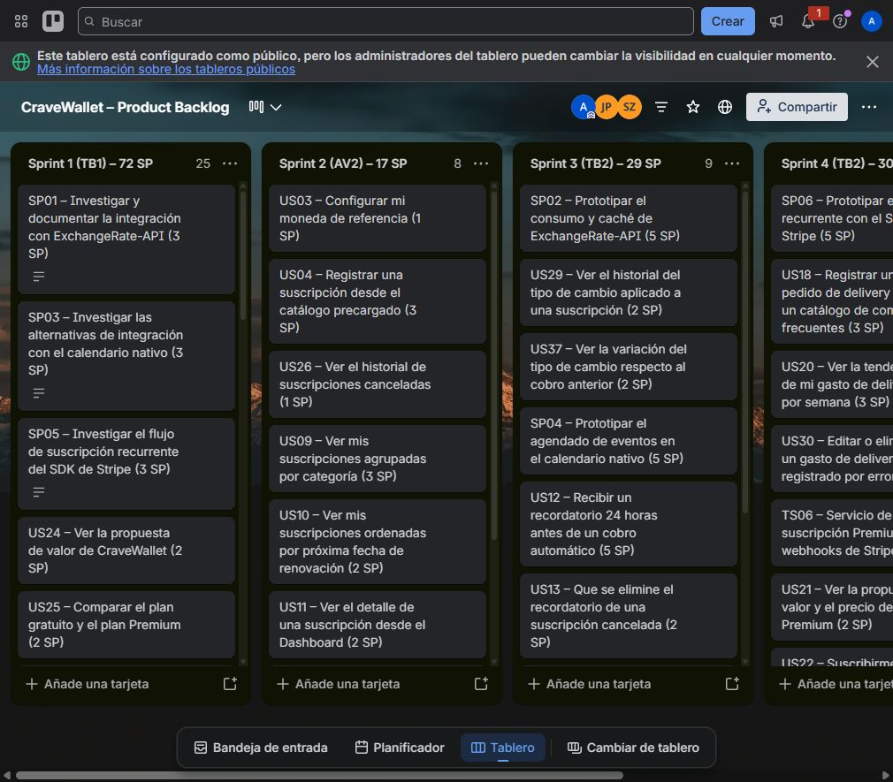

# Conclusiones

Las seis entrevistas, tres por cada segmento objetivo, muestran el mismo problema: los participantes olvidan las renovaciones, no conocen el monto en soles de sus servicios en dólares y no controlan su gasto en delivery. Ninguno recibe un aviso antes del cobro, y todos relatan al menos un cargo automático que descubrieron después de producirse.

Las seis entrevistas sustentan las hipótesis de centralizar suscripciones, estimar importes en soles y anticipar renovaciones. La reducción de cargos inesperados, la retención y la conversión a Premium se medirán cuando el producto esté en uso.

Los artefactos de Needfinding y la especificación conectan las necesidades de Camila Torres y Renzo Salazar con 52 historias priorizadas en el Product Backlog, cuyo tablero se presenta en el Anexo A.

El diseño estratégico separa tres contextos: Subscription Management, Delivery Expense Management y Premium & Billing. Esta separación distingue las suscripciones que el usuario paga a terceros, los gastos puntuales de delivery y la facturación del plan de CraveWallet, y protege cada modelo de los cambios en ExchangeRate-API, Google Places y Mercado Pago (evaluado inicialmente con Stripe en AV1 y TB1) mediante capas anticorrupción.

El diseño de la aplicación móvil y del landing page aplica un mismo Design System y permite recorrer, en el prototipo, los tres objetivos principales del usuario: agregar una suscripción, revisar su gasto mensual y configurar una alerta de pago.

Los seis spikes (SP01–SP06) investigan las integraciones con ExchangeRate-API, el calendario nativo y la pasarela de pago recurrente (Mercado Pago en AV2, tras evaluar Stripe en AV1/TB1), orientando las historias de implementación de los sprints.

En el Sprint 1 el equipo publicó el landing en Vercel, desplegó en Render un REST API con PostgreSQL y autenticación JWT que cubre funcionalmente 16 de 16 operaciones del alcance TB1 y supera 32 pruebas automatizadas, y compiló la aplicación Android en Kotlin y Jetpack Compose, recorrida en LDPlayer y conectada al API público con 9 pruebas de integración.

## Conclusiones de AV2

En el Sprint 2 el equipo consolidó la experiencia móvil en dos implementaciones complementarias: actualizó la aplicación Android nativa en Kotlin y Jetpack Compose (`CraveWallet-Mobile`) con el flujo completo de membresía Premium, y construyó la aplicación móvil multiplataforma en Dart y Flutter 3 (`CraveWallet-Flutter`) para acceso, portafolio de suscripciones, gastos de delivery y suscripción Premium con Mercado Pago, respaldadas por 10 pruebas automatizadas en Kotlin y 8 en Flutter.

El backend de AV2 (`CraveWallet-Backend`) amplió su inventario a 22 endpoints REST documentados con OpenAPI y verificados con 72 pruebas automatizadas en 13 clases de prueba. Incorporó el Bounded Context `Premium & Billing` con la API de Suscripciones y Webhooks firmados (HMAC-SHA256) de Mercado Pago para el plan de S/ 9.99 mensuales, las migraciones Flyway V4 y V5, el control del límite de 5 suscripciones en el plan gratuito, los subtotales mensuales por categoría y el ahorro estimado al cancelar, así como el adaptador de sugerencias de comercios con Google Places Text Search.

# Glosario

**Anti-Corruption Layer (ACL).** Patrón de Context Mapping que interpone un adaptador entre dos Bounded Contexts, o entre un contexto y un sistema externo, para traducir modelos sin contaminar el dominio propio. En CraveWallet se implementa en las integraciones con ExchangeRate-API, Mercado Pago (diseñado inicialmente con Stripe en AV1/TB1) y Google Places.

**Bounded Context.** Límite explícito dentro del cual un modelo de dominio es coherente y un mismo término tiene un único significado. CraveWallet propone tres: Subscription Management, Delivery Expense Management y Premium & Billing.

**Context Mapping.** Técnica de Domain-Driven Design que documenta las relaciones de integración entre Bounded Contexts y los sistemas externos, especificando el lado que dicta el modelo (upstream) y el que se adapta (downstream).

**Domain-Driven Design (DDD).** Enfoque de diseño de software que centra el modelo en el dominio del negocio y su lógica, promoviendo una colaboración estrecha entre expertos del dominio y desarrolladores a través de un lenguaje ubicuo compartido.

**EventStorming.** Taller colaborativo de modelado que descubre el flujo de Domain Events de un sistema mediante notas adhesivas, distinguiendo eventos, comandos, actores, políticas y sistemas externos. El equipo lo aplicó en dos modalidades: Big Picture (As-Is y To-Be) y detalle por Bounded Context.

**Flutter y Dart.** Flutter es el toolkit multiplataforma de Google y Dart su lenguaje tipado para compilar aplicaciones móviles, web y de escritorio desde una sola base de código con Material 3. Conforman el stack de la aplicación móvil multiplataforma (`CraveWallet-Flutter`) incorporada en el Sprint 2.

**GitFlow.** Estrategia de ramificación para Git que organiza el trabajo en ramas de largo plazo (`main`, `develop`) y ramas de corto plazo (`feature/`, `fix/`, `release/`), facilitando el desarrollo paralelo y los releases controlados.

**Kotlin y Jetpack Compose.** Kotlin es el lenguaje oficial de Android y Jetpack Compose, el toolkit declarativo de Google para construir interfaces nativas con Material 3. Conforman el stack de la aplicación móvil nativa para Android (`CraveWallet-Mobile`).

**Lean UX.** Marco de trabajo que combina pensamiento de diseño, metodologías ágiles y modelo de negocio Lean para validar hipótesis sobre el usuario antes de invertir en construcción. El equipo aplicó sus artefactos principales: Problem Statements, Assumptions, Hypothesis Statements y Lean UX Canvas.

**Product Backlog.** Lista priorizada y estimada de todos los requisitos del producto (User Stories, Technical Stories y Spike Stories). El Product Backlog de CraveWallet contiene 40 US, 6 TS y 6 SP, gestionados en Trello.

**Shared Kernel.** Subconjunto del modelo y código que dos Bounded Contexts comparten y mantienen conjuntamente. CraveWallet no propone este patrón: usar `UserId` para correlacionar registros no establece un modelo compartido. Subscription Management y Delivery Expense Management mantienen modelos independientes (Separate Ways).

**Spike Story.** Historia técnica de investigación, sin entregable de código productivo, cuyo objetivo es reducir incertidumbre sobre la viabilidad o el comportamiento de una tecnología o integración antes de implementarla en una historia de usuario.

**Spring Boot.** Framework de Java que simplifica la configuración y el arranque de aplicaciones backend basadas en Spring. El REST API Backend de CraveWallet usa Spring Boot con Java 21.

**Ubiquitous Language.** Vocabulario compartido y acordado entre el equipo de desarrollo y los expertos del dominio, usado de forma consistente en el código, los diagramas y la documentación. El glosario de dominio de CraveWallet está definido en la sección 2.3.6.

# Bibliografía

<!-- pdf:only
::: {#refs}
:::
-->

<!-- pdf:omit-start -->

## Dominio de negocio

BudgetBakers. (2026). *Everything about Premium*. Wallet Help Center. https://support.budgetbakers.com/hc/en-us/articles/7151349344018-Everything-about-Premium

Fintonic. (s. f.). *Organiza tu dinero y ahorra con la app de Fintonic*. Fintonic. Recuperado 7 de octubre de 2026, de https://www.fintonic.com/es-ES/inicio/

Rejón-Guardia, F. (2024). The influence of aesthetics and emotions on reuse intention and compulsive behaviour in food delivery usage. *British Food Journal*, *126*(13), 353–377. https://doi.org/10.1108/BFJ-03-2024-0222

Shi, W., Ali, M., & Leong, C.-M. (2025). Dynamics of personal financial management: A bibliometric and systematic review on financial literacy, financial capability and financial behavior. *International Journal of Bank Marketing*, *43*(1), 125–165. https://doi.org/10.1108/IJBM-06-2023-0359

Škudienė, V., Augutytė-Kvedaravičienė, I., Truncienė, G., & Legotė, I. (2026). Antecedents of retention: Digital subscription perspectives of Generation Z. *Management Decision*, *64*(2), 610–629. https://doi.org/10.1108/MD-04-2024-0961

Spendee. (2025). *What is Spendee Premium?* Spendee Help Center. https://help.spendee.com/article/202-what-is-spendee-premium

Superintendencia de Banca, Seguros y AFP, & CAF. (s. f.). *Encuesta de Medición de Capacidades Financieras: Perú 2022*. SBS y CAF. Recuperado 6 de octubre de 2026, de https://www.sbs.gob.pe/Portals/4/jer/CIFRAS-ENCUESTA/2022/Brochure_ENCUESTA_CAPACIDADES%20FINANACIERAS%202022_vr.pdf

## Métodos, técnicas y enfoques de ingeniería de software

Brown, S. (s. f.-a). *Deployment diagram*. Recuperado 9 de octubre de 2026, de https://c4model.com/diagrams/deployment

Brown, S. (s. f.-b). *The C4 model for visualising software architecture*. Recuperado 7 de octubre de 2026, de https://c4model.com/

DDD Crew. (s. f.-a). *Context Mapping*. Recuperado 7 de octubre de 2026, de https://github.com/ddd-crew/context-mapping

DDD Crew. (s. f.-b). *Domain Message Flow Modelling*. Recuperado 7 de octubre de 2026, de https://github.com/ddd-crew/domain-message-flow-modelling

DDD Crew. (s. f.-c). *The Bounded Context Canvas*. Recuperado 6 de octubre de 2026, de https://github.com/ddd-crew/bounded-context-canvas

Evans, E. (2003). *Domain-Driven Design: Tackling Complexity in the Heart of Software*. Addison-Wesley.

Gothelf, J. (2021). *How to use the Lean UX Canvas*. https://jeffgothelf.com/blog/how-to-use-the-lean-ux-canvas/

Gothelf, J., & Seiden, J. (2021). *Lean UX: Creating Great Products with Agile Teams* (3.ª ed.). O’Reilly Media.

Laubheimer, P. (2016). *Wireflows: A UX Deliverable for Workflows and Apps*. Nielsen Norman Group. https://www.nngroup.com/articles/wireflows/

Mahmud, T., Che, M., Ngu, A. H. H., & Yang, G. (2025). Why Android app testing falls short: Empirical insights from open-source projects and a practitioner survey. *Empirical Software Engineering*, *30*(6), Article 163. https://doi.org/10.1007/s10664-025-10726-x

Portigal, S. (2013). *Interviewing Users: How to Uncover Compelling Insights*. Rosenfeld Media.

Weichbroth, P. (2024). Usability of mobile applications: A consolidated model. *IEEE Access*, *12*, 62378–62391. https://doi.org/10.1109/ACCESS.2024.3395528

World Wide Web Consortium. (2018). *Web Content Accessibility Guidelines (WCAG) 2.1*. https://www.w3.org/TR/WCAG21/

Zhong, C., Li, S., Huang, H., Liu, X., Chen, Z., Zhang, Y., & Zhang, H. (2024). Domain-Driven Design for microservices: An evidence-based investigation. *IEEE Transactions on Software Engineering*, *50*(6), 1425–1449. https://doi.org/10.1109/TSE.2024.3385835

## Lenguajes, frameworks y herramientas

ExchangeRate-API. (s. f.). *Pair conversion requests*. Recuperado 7 de octubre de 2026, de https://www.exchangerate-api.com/docs/pair-conversion-requests

Google. (s. f.-a). *Material Design 3*. Recuperado 8 de octubre de 2026, de https://m3.material.io/

Google. (s. f.-b). *Text Search (New)*. Recuperado 7 de octubre de 2026, de https://developers.google.com/maps/documentation/places/web-service/text-search

Jošt, G., & Taneski, V. (2025). State-of-the-art cross-platform mobile application development frameworks: A comparative study of market and developer trends. *Informatics*, *12*(2), Article 45. https://doi.org/10.3390/informatics12020045

Mercado Pago. (s. f.-a). *Suscripciones: resumen*. Recuperado 12 de noviembre de 2026, de https://www.mercadopago.com.pe/developers/es/docs/subscriptions/overview

Mercado Pago. (s. f.-b). *Webhooks*. Recuperado 12 de noviembre de 2026, de https://www.mercadopago.com.pe/developers/es/docs/subscriptions/additional-content/your-integrations/notifications/webhooks

Stripe. (s. f.-a). *Receive Stripe events in your webhook endpoint*. Recuperado 7 de octubre de 2026, de https://docs.stripe.com/webhooks

Stripe. (s. f.-b). *Using webhooks with subscriptions*. Recuperado 7 de octubre de 2026, de https://docs.stripe.com/billing/subscriptions/webhooks

Structurizr. (s. f.). *Structurizr DSL: Language reference*. Recuperado 9 de octubre de 2026, de https://docs.structurizr.com/dsl/language

<!-- pdf:omit-end -->

# Anexos

## Anexo A. Product Backlog en Trello

El Product Backlog de CraveWallet se gestiona en Trello. El tablero organiza las 40 User Stories, 6 Technical Stories y 6 Spike Stories de la especificación en cuatro listas, una por sprint, respetando la priorización y estimación descritas en la sección 2.4.3.

**Enlace público del tablero:** [CraveWallet – Product Backlog](https://trello.com/b/W0MvIjVH/cravewallet-product-backlog)

La figura 128 muestra una vista parcial del tablero después de la revisión TB1 del 10 de octubre de 2026. El [inventario observado de las 52 tarjetas](evidence/backlog/2026-10-10-board.json) registra los cuatro sprints: 25 tarjetas / 72 SP, 8 / 17 SP, 9 / 29 SP y 10 / 30 SP. La tabla 84 conserva la asignación inicial y la revisada; los puntos representan alcance asignado, no trabajo completado. La [captura de la planificación inicial de AV1](images/chapter_2/Product_Backlog_Trello_av1.png) se conserva para trazar el cambio.

<!-- pdf:omit-start -->

*Figura 128. Product Backlog de CraveWallet en Trello.*

<!-- pdf:omit-end -->

*Fuente: captura del tablero público de Trello del equipo Gastify, 10 de octubre de 2026 (America/Lima); el inventario completo se registra en evidence/backlog/2026-10-10-board.json.*

## Anexo B. Evidencias del Sprint 2

- [Código de la aplicación Flutter en el corte de AV2](https://github.com/1ACC0238-2620-4950-Gastify-CraveWallet/CraveWallet-Flutter/tree/d32ecc0), [pruebas de modelos](https://github.com/1ACC0238-2620-4950-Gastify-CraveWallet/CraveWallet-Flutter/blob/d32ecc0/test/models_test.dart) y [pruebas del flujo Premium](https://github.com/1ACC0238-2620-4950-Gastify-CraveWallet/CraveWallet-Flutter/blob/d32ecc0/test/premium_flow_test.dart).
- [Código de la aplicación Android en Kotlin en el corte de AV2](https://github.com/1ACC0238-2620-4950-Gastify-CraveWallet/CraveWallet-Mobile/tree/c94e795) y [guía de integración Premium en Kotlin](https://github.com/1ACC0238-2620-4950-Gastify-CraveWallet/CraveWallet-Mobile/blob/c94e795/docs/premium-integration.md).
- [Código del backend revisado para AV2](https://github.com/1ACC0238-2620-4950-Gastify-CraveWallet/CraveWallet-Backend/tree/a0aeabc), [contrato de Premium con Mercado Pago](https://github.com/1ACC0238-2620-4950-Gastify-CraveWallet/CraveWallet-Backend/blob/a0aeabc/docs/premium-api.md), [landing público](https://cravewallet-landing.vercel.app/es) y [Swagger del backend](https://cravewallet-api.onrender.com/swagger-ui/index.html).
- El diseño de validación, la evaluación heurística (Anexo E) y la estructura de los tres videos de AV2 se registran en la sección 4.3. La tabla 181 relaciona las figuras de evidencia de AV2 con las secciones correspondientes del Capítulo IV.

*Tabla 181. Índice de evidencias visuales del Sprint 2 (AV2).*

| Figura | Evidencia | Sección del informe |
| --- | --- | --- |
| AV2-1 | Historial de commits de Flutter | [4.2.2.4. Desarrollo](chapter_4.md#4224-development-evidence-for-sprint-review) |
| AV2-2 | Commit del contrato de checkout del backend | [4.2.2.4. Desarrollo](chapter_4.md#4224-development-evidence-for-sprint-review) |
| AV2-3 | PR integrado de Mercado Pago | [4.2.2.4. Desarrollo](chapter_4.md#4224-development-evidence-for-sprint-review) |
| AV2-4 | Validación de Flutter en GitHub Actions | [4.2.2.5. Pruebas](chapter_4.md#4225-testing-suite-evidence-for-sprint-review) |
| AV2-5 | Validación del backend en GitHub Actions | [4.2.2.5. Pruebas](chapter_4.md#4225-testing-suite-evidence-for-sprint-review) |
| AV2-6 | Landing publicado | [4.2.2.8. Despliegue](chapter_4.md#4228-software-deployment-evidence-for-sprint-review) |
| AV2-7 | Migraciones Flyway V1–V5 | [4.2.2.8. Despliegue](chapter_4.md#4228-software-deployment-evidence-for-sprint-review) |

*Fuente: elaboración del equipo Gastify.*
